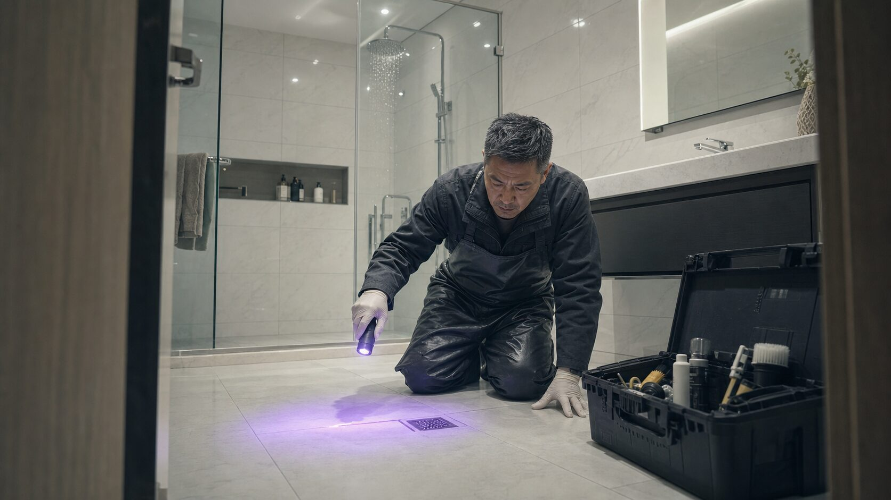
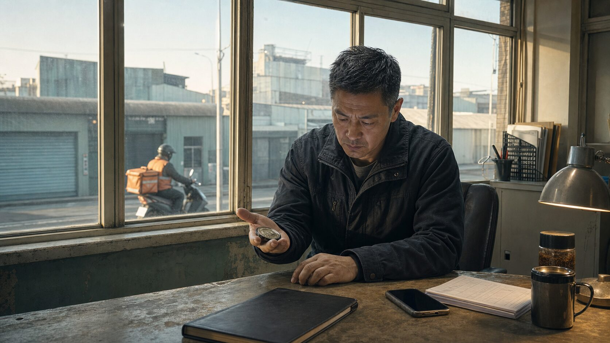
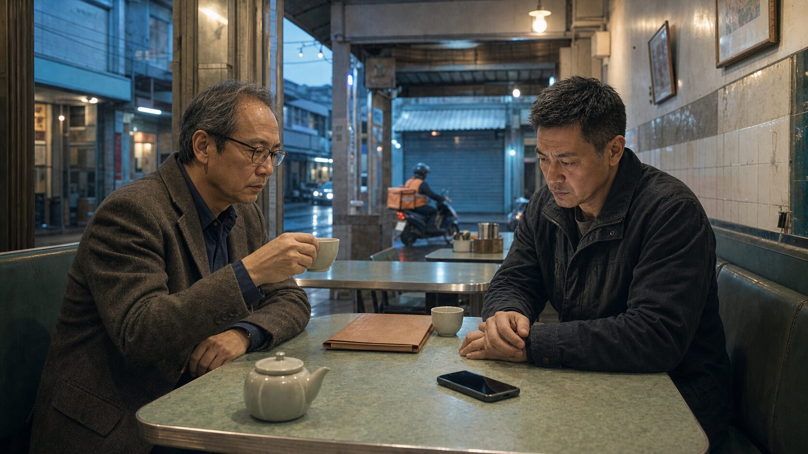

## 第一章：沒有血的浴室

電話是凌晨兩點十七分響的。

謝文斌睜開眼，天花板是熟悉的灰白色，牆角那道裂縫還在原來的位置。他沒有那種睡眼惺忪需要定向的時刻，這一行幹久了，睡覺只是暫停，不是休息。

號碼陌生。他接起來。

「謝先生。」

聲音是男的，帶著一種刻意壓低的平靜，像是在會議室裡說話，背景極安靜。「有人推薦你。說你做事乾淨。」

「謝謝。」

「我需要今晚——」短暫停頓，「或者說，現在就去處理。」

文斌看了一眼床頭的數字：2:17。「地點。」

對方報了一個地址，是北區靠山那一帶的新開發區，文斌在腦子裡過了一遍地圖。豪宅群，那種有二十四小時警衛的社區。他做過那一區兩次，一次是浴缸，一次是地下室。

「報酬？」

「十五萬。現金，分三批。」

文斌沉默了一秒。尋常的案子開價頂多八萬，且通常要他殺價。十五萬意味著對方知道這件事情燙手，或者更可能的，是要買他的沉默，而不只是他的服務。

「你有半小時決定。」

「我現在就決定。發地址給我，我去看。」

他掛電話，從床底下拖出那只黑色工具箱。裡面的東西他用手就知道位置：除污劑、酵素溶液、紫外光手電筒、拋棄式手套、鞋套、幾捲垃圾袋，還有一本空白的工作紀錄本，從來沒寫過任何字。他在警察局的時候寫過太多紀錄，後來他決定什麼都不寫。

他洗了把臉，沒有開燈。

───

社區門衛是個五十幾歲的男人，看到文斌的廂型車沒有多問，只是掃了一眼車牌，在電腦上輸入了什麼，然後點頭放行。

文斌沒有說話，但他記住了那個動作。

對方沒有聯絡屋主確認，沒有登記訪客，沒有抬頭看他，只是輸入，然後放行。像是按一個預設好的程序走完流程。文斌當刑警的時候，遇過很多「只是按程序走」的人——他們說不出任何細節，事後卻在現場紀錄裡消失得最乾淨。

電梯上到十二樓，走廊燈光是那種高級住宅專用的暖黃，讓所有東西看起來都比實際上更乾淨。1204。門把上套著一個磁卡，沒有信封，沒有紙條，沒有任何表示有人在等他的跡象。文斌戴上手套，感應開鎖，推門進去。

屋子裡的燈沒有開。他用手電筒先掃一圈。

客廳的傢俱有塑膠套還沒拆，沙發是米白色的，看起來從來沒有人坐過。廚房的流理台是大理石紋路，乾的，連紙巾架都是空的。玄關地板有一張地墊，嶄新，底面的防滑膠還沒磨損。整個空間有一股若有似無的揮發性氣味——不是血，不是消毒水——更像是有人不久前開了窗，又把窗關上，把空氣也一起關進去。

他走過客廳，推開主臥室的門。床鋪整齊，枕頭沒有任何壓痕，棉被的折角是直的，像酒店備房，像沒有人住過，或者說，像有人把「沒有人住過」這件事情非常仔細地還原。

衣櫃的門開著一條縫。文斌用手電筒掃了一眼，裡面是空的，衣架都掛著，間距均勻，一件衣服也沒有。

他在衣櫃前站了一下。

這不是一間暫時空置的屋子。這是一間被清空的屋子。兩者之間有一個細微但確實的差別，前者是留白，後者是抹去。

浴室的門開著一條縫，他用手推開。

磁磚是白色的，義大利進口那種質地。洗手台的鉻合金水龍頭反著他手電筒的光。浴缸是嵌入式的，蓮蓬頭還滴著水，一滴一滴，間隔均勻。地板是乾的。牆面是乾的。玻璃隔板是乾的。

文斌站在浴室門口，沒有進去。

他做這行七年，接過的案子超過六十件。什麼樣的現場他都見過——血跡、嘔吐物、焦黑的痕跡、某些他從來不允許自己辨認的碎片。他早就訓練出一種職業性的感知系統，一進現場就能感覺到哪裡需要處理，身體先於意識做出反應，像獵犬入林。

但這裡什麼都沒有。

他開了主燈，白色的浴室在強光下更白。他蹲下來，從工具箱取出紫外光手電筒，從靠門的牆角開始照。牆面、地板縫隙、排水孔周圍——大部分地方乾淨到像廣告樣品屋。

大部分。

他在排水孔右上方約二十公分處停了下來。磁磚縫裡有一塊微光，很淡，淡到幾乎只是個殘影，但在紫外光下那個特定的藍白色不會騙人。被清理過的血，蛋白質的殘跡。他繼續照，沒有站起來。

蓮蓬頭下方的牆面，第三塊磁磚的接縫，又一個殘影。更淡，形狀不規則，像飛濺後被抹過的。然後是浴缸右側的外緣——這個地方如果不是知道要找，正常人照一千次也不會照到——有一道細長的弧形殘光，和液體流動後留在轉角的形狀一致。

文斌把紫外光手電筒收回工具箱，在浴室門口站著。蓮蓬頭還在滴水，那個均勻的節奏在安靜的浴室裡顯得很大聲。

他看著那些殘影的位置。分布並不隨機，但又偏偏只在不容易注意到的角落才留有殘跡。用了漂白劑稀釋液，量很準確，足以讓肉眼完全看不見。問題是漂白劑稀釋液有專業配比，一般人只會過量——要嘛整個地板發白，要嘛根本沒稀釋。

這個量，控制得很準。

文斌在這個念頭上停了一秒，然後讓它滑走。這不是他要想的事。

他走回客廳，在窗邊站著，外面是北區的夜景，道路燈光整齊，山的輪廓在更遠的黑暗裡。他是為十五萬來的，他是為維持這間公司運作來的，他是為了不必再去想其他事情來的。這七年他就是這樣過的，接案，清理，收錢，然後不思考。

手機震動了一次，是一則簡訊，還是那個陌生號碼：「工作如何？」

文斌看著那三個字。委託人在等他確認，等他表示一切順利，等他告訴對方現場已經沒有問題。正常情況下他會回，然後開始工作。

但正常情況下，他接到的案子是有問題要他解決的，不是一個問題已經被解決了一半、但又讓他特地來重做的。

他拇指滑過螢幕，打出：「需要兩個小時。」發出去，然後把手機收進口袋。

他把工具箱打開，戴上第二副手套，拉開工作用的防水圍裙，走回浴室。他跪在排水孔旁邊，把酵素溶液噴在殘影上，取出刷子，開始工作。

動作是熟練的，是七年來的肌肉記憶。做就是了，不想就是了，這間公司還有三個員工要養，還有三個月的租金壓著，還有很多比追問更現實的事。

他就這樣告訴自己。

但他的眼睛一直沒有離開那道弧形的痕跡。淡得幾乎不在，卻又確實存在。清理它，是他的工作。清理之前先把它記住，是他沒辦法徹底戒掉的舊習慣。

他繼續刷，蓮蓬頭繼續滴水。

他不知道這件事情到底是什麼形狀。

但他已經在裡面了。

## 第二章：舊警徽

他在那間浴室工作到快五點。

清理完之後，他沒有立刻離開。在客廳站了一陣子，手套還戴著，工具箱蓋著。窗外的天光把山的輪廓從黑色裡緩緩推出來，道路上出現了第一輛車——外送的機車，橘色反光背心，在路燈下亮了一秒，消失在轉角。

他沒有特別注意。當時沒有。

他把工具箱拎起來準備走，目光最後掃過玄關。

那張地墊還在原位，底面防滑膠嶄新。他進門時留意過，現在又看了一眼，不是因為有什麼東西不同，是因為突然意識到：地墊是讓人進門踩的，底面沒有磨損，代表沒有人從外面踩進來。但整個屋子裡，衣架間距均勻，床角折得像酒店備房，這些東西都是被整理過的。地墊卻是新的。

沒有人住的屋子，放一張新的玄關地墊。

他蹲下來，把地墊翻了一面。底面乾淨，沒有砂礫，沒有任何踩過的痕跡。他把地墊翻回去，拿出紫外光手電筒，沿著地墊邊緣照了一圈。

接縫的位置，一個很淡的弧形。

文斌把手電筒貼近看。他的腦子裡沒有立刻形成結論，只是把那個形狀記住：不寬，弧度圓，比正式皮鞋的前掌窄一些，比靴底更輕。他當刑警的時候見過很多這種印記，倉庫、便利商店後門，不同年紀的人踩出來的形狀稍稍不同，年輕一點的男孩鞋底更軟，重量集中得更快，收得也更快。

他把手電筒關掉，站起來，在玄關站了一陣子。

浴室裡的清理那麼準確，這張地墊卻沒有人翻過。或者翻了，又放回去。這兩件事擺在一起，並不吻合，也沒有一個顯而易見的解釋。他記住了這個不吻合，讓它懸在那裡，拎起工具箱，走出去，讓磁卡落在門把上，沒有碰那張地墊。

───

早上七點，他把廂型車停回停車格，把後車廂的東西處理好，上了二樓，泡了杯即溶咖啡，坐在辦公椅上把帳記進流水帳。十五萬，第一批五萬，現金，從一樓郵箱取的。「收入」那欄填了數字，來源那格空白，永遠空白。

他把帳本蓋上，拿起桌上那幾張估價單。

兩分鐘後，他把估價單放回去。

手機在桌上震了一下，是一個沒有儲存的號碼，他讓它震到語音信箱，繼續坐著。兩分鐘後，語音信箱通知進來了，他拿起手機，播放。

「謝先生。」

聲音是女的，很平，像是在唸一份稿。「您昨晚在的地址，警方今天早上接到了通報。一名外送員，姓林，林祐丞，二十三歲，被指認為昨晚現場的相關人士。我們認為您應該知道這個消息，以便妥善評估您目前的處境。如果您有任何疑問，可以在今天中午之前聯繫我們。不過請放心，謝先生，這種事有時候是這樣的，我們相信您一直是個懂得做紀錄的人，只是紀錄要更仔細一點，就這樣。」

電話號碼唸了兩次，切斷。

文斌把手機放在桌上。

「紀錄要更仔細一點。」

他在那句話上停了很久。

那是他主管在辦公室說過的話，一字不差，而那次談話從來沒有進任何官方紀錄，在場的只有他們兩個人。現在這個女聲把那句話放在一個「懂得做紀錄的人」後面，合在一起，平靜唸過去，像是轉述一件她自己並不在意的事。

文斌坐著，不動。

他聽完的時候，第一個反應不是憤怒，甚至不是驚訝，是一種他很熟悉的感覺：像地面的某個地方悄悄鬆動了，但腳還踩在上面，還沒有塌。

對方查過他，查到那間辦公室裡說過什麼，查到那句沒有人應該知道的話，然後把它原封不動放進一封語音信箱，讓他確認這件事，確認他們手裡握著什麼。這不是通知，是在告訴他，他的沉默值多少，以及如果他不沉默，什麼東西會被拿出來。

───

那是八年前的事，他在重案組的最後一年。

一個中盤商死在倉庫裡，鈍器傷。文斌接了那個案子，最強的嫌疑落在一個十九歲的便利商店打工仔身上。他從店長那裡問出一份送貨供詞，記進了報告，把那男孩從參考人變成嫌疑人。

後來找到了真正的兇手，案子結了。男孩沒有被起訴，但在拘留室待了十一天。

再後來，主管私下告訴他，那份供詞有問題。不是店長說錯了，是那些話根本沒有發生過。

文斌在主管的辦公室坐著，點了頭，說了「好」。

主管說：「以後紀錄要更仔細一點，這次就這樣。」

他交出警徽的理由是回家照顧老母親，母親在那半年前就已經過世了。他帶著那個「好」字離開，把十一天鎖在後面。

那個男孩的家後來搬走了，他在任何後續的紀錄裡再也沒有出現。

───

樓下工廠的機械聲在八點準時響起來。

文斌在辦公椅裡沒有動。

他的腦子走了一圈那個玄關地墊的弧形，走了一圈浴室那三個殘影，走了一圈門衛在電腦上輸入車牌沒有抬頭的樣子。然後他想到那個電話女聲說的：「外送員，林祐丞，二十三歲，被指認為昨晚現場的相關人士。」

外送員有接單紀錄，有GPS軌跡，手機位置從凌晨出門到天亮可以按分鐘重建，APP後台有照片。如果那個地址在他的接單範圍之內，甚至不需要做任何手腳，只需要一個舉報電話，警方自己就會走完後面所有程序。

他想到地墊那個弧形，想到浴室漂白劑那個準確的配比，想到整間屋子被清空的方式，以及，清空之後，那個弧形被留下來的方式。

他沒有結論。但他有一個問題，從凌晨就懸在那裡、現在還在那裡的問題：一個做得如此仔細的人，為什麼在玄關留了一個缺口。

那個缺口，是給誰看的。

文斌從抽屜最底層取出一個棕色信封袋，從裡面取出一張識別牌。硬殼的，燙金的名字磨掉了大半，謝文斌三個字只剩模糊的輪廓。警徽他交回去了，識別牌那天沒有人清點，他放進口袋帶走了，也沒有特別的理由，只是帶走了，像是在兩手空空離開的時候，需要用一個沒有重量的東西假裝自己還帶著什麼。

他把識別牌放在掌心。

比記憶中輕。

他盯著那個輪廓，在腦子裡把那個弧形的位置再確認了一次。地墊內側，靠近門口，是一個把東西交到門口、但沒有進屋的距離。那個人站在那裡往裡看過一眼，然後離開了，或者被帶離開了。

然後有人把地墊放回原位，等警察來。

文斌把識別牌放回信封袋，把抽屜推回去。

他想到那個十九歲的男孩，十一天，家人搬走，之後再也沒有出現在任何一份紀錄裡。那段時間那個男孩往哪個方向消失掉的，他不知道，他當時告訴自己不需要知道，他說了「好」，走出去，門關上了，不需要知道。

現在有人把一個完全相同的形狀放在他面前，等他再說一次「好」。

語音信箱說的是「妥善評估您目前的處境」。他的處境很清楚：接尾款，沉默，讓警方走完程序，讓那個外送員去解釋自己的軌跡，讓那個足跡印記在某一份偵查報告裡發揮它被放上去的作用。

他可以這樣做。

他做這行七年，比較難的不是清理現場，是把理解到的東西隔在某一個隔間裡，讓它不影響今天的工單、今天的估價單、今天的帳。他有這個能力，他有七年的練習。

他的手很穩，他做這行的基本要求是手穩。他把手放在桌上，看著手機，計算那個電話打回去要說什麼。

然後他停在一件他沒有辦法繼續往下移動的事上：

那個玄關地墊上的弧形，是被留下來給警察看的。清理現場的人知道那個足跡在那裡，選擇讓它留著。浴室的殘影被打磨到只剩紫外線讀得出來，但那個地墊，沒有人去翻。

意思是說，他昨晚花了兩個小時，把本來用來讓警察感到疑惑的浴室現場清理得更乾淨，讓那些可能暗示問題的殘影消失得更徹底——他以為他在做委託人的工作，但他實際上做的事，是把一個栽贓現場打磨得更完整。

他在椅子上坐著，讓那個理解在胸腔裡占了位置。

「好」字在嘴裡的重量他記得，記了八年，很清楚那個重量長在什麼形狀裡：如何從清晨一直壓到入夜，如何在他以為快要淡掉的時候又從某個毫無關係的角落浮出來，如何讓一個人在很多個很小的日常時刻裡成為自己一直試圖不去看的那個人。

不一樣的地方是，這一次他在說「好」之前就已經知道了。

## 第三章：清潔合約

文斌沒有回那個電話。

他讓中午的截止時間過去，就像讓一列他沒有打算搭的班車開走。電話在十二點二十分又響了一次，同一個號碼，他讓它震完，繼續坐著。沉默不代表他在對抗什麼，沉默只是他買下來的時間。

───

早上十點，他叫阿勇去跑估價單，讓小陳把月底的帳軋一遍，自己關了辦公室的門。

他把昨晚的委託在腦子裡重新走了一遍。

陌生號碼，凌晨兩點，知道他的號碼，知道他做什麼，知道報酬要開多高他才會去——這條資訊鏈不是從網路上找得到的，是從某個認識他的人那裡出來的。他在這一行七年，客戶都不透明，但資訊在流動，而且流動的方式是有脈絡的。他需要先找到脈絡。

他打給一個叫老鄭的人。老鄭替人介紹人，不追問原因，文斌跟他有過兩次往來，一次是北區的地下室，一次是更早以前的一個電梯間。

電話響了五聲才接。

「是你。」

「兩個多月前，有沒有人透過你問起過我。」

「有。」老鄭說，「但他不是找你接案，他問的是這一行裡誰做事最不留紀錄。我說不出名字，他又問北區那一帶有沒有在地的聯絡人，門房或物業那類的。我說我不做那條線，他就掛了。」

「聲音。」

「很習慣讓人等他說完的那種人。」

文斌謝過他，掛電話。

那條委託的鏈，起頭比他想的更長。而且，對方在找到他之前，已經先在北區做了佈置。

他在桌墊邊緣寫了一個字：「物業」。

───

下午，他去了那個社區對街的便利商店，站在門口觀察了四十分鐘，等到下午換班，看見那個五十幾歲的門衛走出來。文斌記得那雙眼睛——進社區時，那個人看的不是他的臉，是螢幕，把車牌輸進去，點頭，沒有抬頭，像是按一個被告知好的程序走完。

他讓那個人走出兩個路口，才跟上去。

門衛在巷口一家自助餐店坐下，文斌等他吃了幾口，才端著碗走過去坐對面。說自己上週送東西來過，進去有點複雜。說話是閒聊的語氣，不快不慢。

問完一般程序，文斌說：「如果住戶提前告知，直接放行的那種呢？」

門衛停了一秒。就那一秒，文斌認得那裡面的東西。

「正規還是要登記，」他說，「有些住戶提前報備，後台有紀錄的，可以直接掃車牌。」

「後台誰能看？」

「物業主管，管委會。」

文斌點頭，說聲謝謝，繼續吃飯，沒有再問。

但他得到他要的：那個社區後台系統裡有一筆放行紀錄，有時間戳，有車牌，有某人提前留下的報備動作。那個動作從哪裡來，是誰的名義，文斌還沒看到，但它在那裡，等著某個有資格查的人去找。

問題是，他沒有資格，也沒有搜查令。

───

回辦公室路上，他買了一個行動硬碟。

回來，他把那個語音信箱翻出來，用電腦錄音工具把聲音抓下來，存成有時間戳的音訊檔，複製三份，分別存進行動硬碟、電腦加密資料夾，以及一個他鮮少使用的舊電子信箱草稿匣，什麼都不發，只是讓它活在那裡。這是老刑警教他的：真正重要的東西，備份的邏輯不是複製，是分散，你不知道哪個地方會先不見。

他在文字檔裡把語音信箱的話一字一字打出來，在後面加一行：「說這句話的女聲，把我主管從沒有進入任何紀錄的談話裡說過的原話原封不動放進來。對方掌握的資訊超過這個案子本身。」

他把音訊檔和文字檔放在同一個資料夾裡，蓋上電腦。

他需要的不是一份完整的陳述，他需要的是一條他不在場也能繼續走的線。

───

那條線，在一個他原本沒有打算撥的電話裡找到了。

兩年前老鄭介紹過一個地下室的案子，同一個社區，那個客戶自稱是企業顧問，付錢爽快，問題少。中間人是個賣保險的，姓黃，兩個人沒有特別的交情，但黃先生介紹案子的習慣是把名片留著，逢年過節群發簡訊。

文斌打過去，黃先生接起，聽到他報名字，語氣有一瞬的收緊。

「那個客戶是他自己來找我的，說有朋友推薦，給我一張名片，後來沒有聯絡。」

「名片還在嗎？」

等了四分鐘。

「找到了，名片上是一間顧問公司，德信企業管理，名字叫楊建中。」

文斌謝過他，掛掉電話，馬上搜尋德信企業管理。

公司確實存在，商業登記在冊，資本額很小，業務項目是「管理顧問、企業諮詢」。負責人不是楊建中，是一個叫趙文明的名字。文斌繼續搜，搜到的東西不多，公司在登記後兩年內停止申報，像一間用完就擱下的殼。

他試了另一個方向，搜「趙文明 宏允」。

宏允，是因為在走訪那個社區周邊時，他順手問過一個在附近開業的會計師——哪些律師事務所的客戶跟北區這一帶有往來，那個會計師沒有直接回答，只說：「宏允的帳不走一般律師的程序，我們業界很多人知道他這個名字，但沒有人見過他的帳。」

文斌把那句話記下來，沒有立刻說什麼。

現在，「趙文明 宏允」搜出一個結果——不是新聞，是一個五年前某個產業協會的會員名冊，掃描的PDF，兩個名字都在其中，沒有別的說明。

他把那個頁面截圖存起來。

他知道這不是直線，但它是一個橫向的交叉，是兩塊在顏色上有重疊的碎片。這種東西在法庭上什麼都不是，但在一個拼圖的邏輯裡，它說明了某件事：這些人不是陌生的。

───

他去見馮記者，是傍晚的事，在一家他們以前談過幾次話的茶餐廳，靠裡的位置，兩個人隔著一張小桌。

文斌把宏允的名字說出來。

馮記者沒有翻白眼，也沒有表現出認得這個名字的興奮，只是把茶杯放下，說：「你是從哪裡進的。」

「被案子餵進去的。」

馮記者沉默了一下。「三年前一個建設公司性騷擾案，受害方在開庭前撤告，速度快到不正常，我追過，那條線在某個法律顧問的辦公室外面就斷了。助理打電話來說當事人希望和平解決，不希望媒體介入，然後沒有了。」

「那個法律顧問。」

「宏允，信義區，主任律師蔡承恩。」馮記者說這個名字的時候，語氣是平的，像說一個他已經在腦子裡放了太久的詞，「他的客戶名單是空白的，沒有任何案件是以他的名義結案的，因為案子在變成案子之前就已經消失了。我不是找到了他，是發現事情在他那裡停掉了，然後後面什麼都沒有——那個停掉本身才是線索。」

文斌讓那句話在腦子裡走了一遍。

「他不是在打官司，」他說，「他是在阻止官司被打。」

「對。」

文斌把外套的下擺壓了壓，喝了口茶，沒有立刻說話。他想到浴室那三個殘影的分布，想到整間屋子被清空的方式，想到那個準確的漂白劑配比——做這件事的人有完整的流程，知道清理到什麼程度，知道在哪裡停下來。不是第一次，不是臨時起意，是有架構的。

蔡承恩的架構，不是替人辯護，是替人讓事情不要成為問題。

「那個外送員的案子，」文斌說，「你有辦法確認跟宏允有沒有關係嗎。」

馮記者再度沉默，這次更長。「你是從什麼角度問這個問題的。」

「我從內側問。」

馮記者拿起茶杯，又放下，沒有喝。「你告訴我，什麼時候你有東西是可以讓我去核實的。不是你告訴我答案，是有什麼具體的東西讓我去確認。」他停了一下，「東西夠了，你從哪裡來的我不問。」

文斌說聲好，站起來，把外套拿起來，準備走。

馮記者說：「還有一件事。宏允，我不確定他是頂端。我手上那條線追到他，後面就沒有了——但不是到他為止，是到他那裡，那道牆就出現了。這種牆，通常不是一個人蓋的。」

文斌把外套穿好，沒有回頭，說了聲謝謝，走出去。

他站在茶餐廳外的騎樓，夜裡的街上有外送機車經過，橘色反光背心，像他清晨在十二樓窗邊看到的那個形狀。他看著機車消失在路口，讓馮記者最後那句話在腦子裡壓了一下：還有一層。

他本來就沒打算蔡承恩就是終點。

───

回到辦公室，已經快九點。他坐在辦公椅裡，把今天的東西逐一過了一遍：後台系統有放行紀錄，有某人留下的報備；語音信箱裡有人用從沒入過任何檔案的話威脅他；宏允是那個讓案子在成案前消失的人，而它的主任律師蔡承恩和趙文明曾在同一個名冊上；德信是一間用完就放著的殼，楊建中用那個殼找到了文斌。

這些東西單獨看都是碎片，合在一起還不是答案，但已經有某種形狀了——不是隨機的，是有設計過的。

他把行動硬碟從電腦上拔下來，放進外套的內袋。那個重量很輕，但他知道它在那裡。

然後他想到那個他沒辦法讓它不在的問題：如果他現在去報警。

他讓這個假設走完。他進警察局，說有人在嫁禍一個外送員，然後他怎麼回答「你怎麼知道」？他怎麼解釋他凌晨兩點去了那個地址，花兩個小時清理了一間浴室，拿了五萬現金？他怎麼解釋七年來那只工具箱，那本空白來源欄的流水帳？

他無法用乾淨的手指著任何人。

對方在設計這件事的時候，就算進了這個——找一個有足夠刑事邊緣履歷的人來做清潔，既有用，又是最好的鎖：這個人知道代價是什麼，知道沉默值多少，在需要的時候，他本身就是一個說出口就把自己也說進去的人。

文斌在椅子裡坐著，讓這個計算在胸腔裡占了位置。

他想到那個外送員的社群帳號——一碗拉麵，很低的角度，手機放在桌邊隨手拍的。二十三歲。現在在什麼地方，接受什麼，他不知道。

他想到那張地墊底面那個弧形，被留下來，等著警察去找。

他想到自己昨晚蹲在排水孔旁邊刷洗殘影的那兩個小時，以為在做委託人的工作，實際上是在把一個栽贓現場打磨得更完整。

他站起來，走到窗邊，看著夜裡的路燈。

他不知道蔡承恩的名字這次出現在哪一層，也不知道馮記者說的「那道牆」後面是什麼人。但他知道自己現在在什麼位置——他是那個被找來收拾的人，七年來他一直是那個人，而這一次，他在開始清理之前，就已經知道了他在清理的是什麼。

這讓他手上的東西有點不一樣的重量。

他把資料夾的檔名改了一個字，從「筆記」改成「紀錄」，存檔，關掉電腦。

這個字的差別他清楚。筆記是給自己留的，紀錄是給某個以後可以查的人留的。

他要讓那個資料夾繼續長，長得夠有分量。等到有一天，即使他沒有辦法替自己說話，那些碎片還有機會被一個有辦法查的人找到彼此。

但這是以後的事。

眼前，他還需要知道那個後台放行紀錄裡，報備的那個人，是誰的名義。

## 第四章：第二個現場

電話是隔天早上八點四十分的簡訊，不是語音，不是女聲，是蔡承恩本人。

「謝先生，我想我們應該當面談一次。」

沒有問他方不方便。文斌把手機放回桌上，喝了半口咖啡，讓那則簡訊在桌面停著。他想到馮記者說的那道牆，想到老鄭說的「很習慣讓人等他說完的那種人」——語音信箱是女助理，現在換成本人親自來，是升了一個層級。這個升級有時間壓力，否則不需要他出面。

他回：「哪裡。」

地址來了，是信義區一棟商辦大樓，十九樓，一家叫「茶語」的私人會所，不在網路上，需要預約入場。文斌確認了位置，把手機放進口袋，讓阿勇去跑下午的估價單，換了件外套，出門。

───

茶語的前台看到他進來，沒有問名字，只說「謝先生，請跟我來」，帶他走過一條走廊，在最裡面的包廂門口輕叩，推開，側身讓路。

蔡承恩坐在裡面。

五十出頭，西裝是深色的，領帶打得一絲不苟，頭髮灰白，梳理整齊。他坐在一張低矮的木桌後面，桌上已經擺了茶，兩個杯子，一壺冒著淡煙的東西。看到文斌進來，沒有站起來，只是抬頭，做了個手勢，意思是坐。

文斌在對面坐下，沒有把外套脫掉。

「你沒有回那通電話。」

「截止時間我在辦公室坐著。」

蔡承恩提起茶壺，給文斌倒了一杯，輕放。「我早說那個電話設計得太複雜，做事情直接就好。」他把茶壺放回去，「所以我來直接。」

文斌沒有動那杯茶。

「你昨天去查了一些人。」蔡承恩說，語氣是陳述，沒有責怪，像在確認一個已知的事實。「然後你去見了馮建明。」

這個名字說出來，文斌讓它在臉上過去，沒有停。

「那個記者，跑了三年跑不出一篇有用的稿子，因為他只有一隻腳踩進來。」蔡承恩把自己的茶杯端起來，喝了一口，放下，「這種人做不成事，你知道的。我不在意他知道什麼。問題是你。你有東西。」

文斌等他說完。

「你去了那間浴室，你比任何人都清楚那裡發生了什麼。你沒有回電話，代表你還沒決定往哪個方向走。」蔡承恩的視線落在文斌臉上，很穩，「我這個人，不習慣把自己放在別人還沒決定的局裡。所以我給你一個確定的東西。」

他從公事包裡取出一個牛皮紙袋，放在桌上，推過來，沒有說話。文斌低頭看了一眼，沒有去拿。

「裡面是一個新的委託。北區郊外，一間小型倉庫，今晚。完成之後，餘款一次付清，整件事到此為止。」蔡承恩停了一下，「三十萬。」

文斌沒有動。

蔡承恩從公事包取出一支手機，在桌面轉了一下，推到文斌這側。是截圖，三張，文斌低頭看了一眼。

第一張是新聞稿的標題，是某地方媒體的格式，還沒有刊出，上面有發稿日期——明天。「外送員涉嫌與命案現場相關，DNA採樣送驗，警方：正式移送在即。」

第二張是鑑識報告的表頭，案號、日期、物證編號，底下是地墊的送驗欄位，已標「優先處理」，批核人的名字他不認識，機關章是刑事警察局的。

第三張更簡單。是外送員林祐丞本人的一張照片，在某個便利商店門口，角度是監視器，時間戳是昨天下午。他穿著橘色反光背心，背著保溫箱，站在那裡，臉沒有遮住，表情什麼都看不出來，只是站在那裡。

文斌把目光從那張照片上移開。

「鑑識程序最快四十八小時，」蔡承恩說，「但採樣條件很理想，我聽說可能更快。今晚，謝先生。」

沉默了幾秒。

文斌把那個牛皮紙袋拿起來，放進外套口袋，站起來。「幾點。」

「晚上十一點，地址在袋子裡。」蔡承恩端起茶杯，「你是個做事仔細的人，謝先生，我欣賞這個。」

文斌沒有回話，把椅子推回去，走出去。

走廊的燈光是暖的，電梯門打開，他進去，看著門在身後合上，把自己的臉從門縫裡的反光中移開。

那三張截圖的畫面他讓它在眼後存著沒有散。報告表頭上的批核章、「優先處理」這四個字，以及那個外送員站在便利商店門口的姿勢——背著保溫箱，什麼都不知道，只是在上班。

三十萬，一棟倉庫，今晚。

就是這樣，夠清楚的。

───

下午三點，他一個人開著廂型車去看過那個倉庫。

沒有下車，只是遠遠停著。那條路是郊區倉儲用地的末段，兩側圍牆和矮樹，人流稀疏，偶爾一兩台送貨貨車經過。那棟倉庫沒有掛門牌，外牆是鐵皮噴漆的深灰，捲門鎖著，門口有一根銹色的路燈，燈是壞的。

他沿著外圍慢慢開了一圈，窗戶沒有搖下來，速度維持正常。隔著三個鐵皮倉庫距離，停著一台深色的休旅車，引擎關著，停在那裡太久了。他讓視線在後照鏡裡確認了一次，讓引擎保持轉動，沒有急著停。

他在車裡坐了一會兒。今晚他清理的是什麼，對方在倉庫裡設了什麼，進場之後拿了第二筆錢，任何他後來說的話就更難說——這些他都讓它在腦子裡走了一遍，很仔細，沒有跳過。他還想到另一件事：蔡承恩知道他去見了馮記者，知道他在查，昨天還能如數家珍。今天他讓他去一個地址，那個休旅車也許是確認他去了，也許是確認他乾乾淨淨地走出來。

對方相信他會去，是因為對方知道他沒有退路。

他把車開回辦公室。

───

阿勇和小陳五點走，文斌讓他們走，說自己要軋一些帳，沒有細說。他聽著腳步聲下樓，聽著公司的鐵捲門落下，把辦公室的燈開著，坐到電腦前。

他把那個行動硬碟插上，打開已經在長的資料夾，花四十分鐘把今天和蔡承恩談話的內容打成逐字。時間、地點、蔡承恩說的每一句話，以及那三張截圖的描述：報告表頭的案號、鑑識批核欄位、「優先處理」、時間戳。他在最後一行加了一個括號，裡面寫：「這些截圖他能拿到，代表對方在程序內部有人。不是影響結果，是在加快結果。」

他把這一行存進去。

這個字他知道它的重量——這行字說的是他知道，對方的手伸進了程序裡。這件事如果將來有人看到這份資料夾，會是很重要的一行，但前提是這個資料夾要被找到，而他不一定有辦法確保這件事。

他在椅子上坐著，把這個不確定讓它待著，沒有試著解掉它。

然後他打開工具箱，取出幾樣東西。紫外光手電筒；一個小型錄音設備，比手機輕，比手機更難被發現，電池下午充好了；還有三個小號的玻璃樣本瓶，是他以前替某個案子在生化耗材店買剩的，在工具箱底層壓著。他取出三個，放進外套的內袋。

他把工具箱蓋上，在桌邊站了一下。

他知道今晚帶這幾樣東西進倉庫意味著什麼。如果樣本是他的人從第一現場取的，他就是正式參與了——不是清理，不是週邊，是直接從犯罪現場取材、保存、處置物證。這件事在法律上沒有模糊地帶。他七年的邊緣都是在替人擦，今晚是他自己踩進去。

他知道，他還是把三個瓶子放進了口袋。

───

他把廂型車停在倉庫附近的小路，比約定時間早了四十分鐘。

他讓引擎熄火，沒有開燈，先坐著。他在後照鏡掃了一遍那條路，深色休旅車沒有跟來，至少沒有停在可見的範圍。但他不覺得這表示沒有人看著，只是看的方式換了。

他等到十點四十五分，才取出工具箱，戴上第一副手套，開門出去。

捲門的組合鎖號碼在牛皮紙袋裡，和地址寫在同一張紙上。他按好號碼，彎腰把捲門拉起一半，進去，放下。

倉庫不大，大約是兩個停車位拼起來的空間，地面是水泥，沒有貨架，靠後牆有幾個空的棧板疊著。燈是舊式日光燈，拉繩的，他拉了一下，燈管閃了幾下，亮起來，白光，很亮。

靠右側的牆角，地上有一塊防水布，深藍色的，鋪開來大概一個浴缸大。

文斌在門口站著，先把整個空間掃了一遍：牆角，天花板的鋼架，後牆的排風孔，捲門底部。沒有明顯的設備，但他在左側牆角高處，貼著排風孔旁邊的暗色位置，看見一個小的、幾乎不反光的東西。形狀是長方的，比打火機厚，顏色和牆面幾乎一樣。

他沒有靠近，沒有做任何表示他看見了的動作，繼續走向防水布。

那個東西在那裡，代表他現在在鏡頭裡。他今晚在倉庫裡做的每一個動作，以後可能會是一份影像，落在某一個對他不友好的地方。他把這件事讓它在腦子裡放穩，繼續往下走，工具箱放在防水布旁邊，蹲下來。

他取出錄音設備，確認指示燈正常，放進外套口袋最深處，布料壓著，讓它繼續走。他這個動作很小，是翻口袋裡東西的那種幅度，鏡頭在角度不好的牆角，應該看不清楚。

然後他掀開防水布。

地面上有一灘已經乾了一半的深色液體，在水泥地的粗糙紋路裡呈現出不均勻的滲透，形狀沒有邊界，最集中的地方靠近牆根，越往外越淡。那個氣味是舊的，發酵過的，他讓那個反應在喉頭停住，沒有讓它繼續往下走。

他取出紫外光手電筒，從最外緣開始照。

液體的分布比看起來更廣，從防水布蓋著的那一圈，延伸到約兩個身位外的地面縫隙裡，有幾個踩過的印記，方向是往捲門的——有人從牆根走出去，路過這裡，離開了。文斌把那幾個印記的形狀確認進腦子裡，繼續照往牆角。

牆根的位置，他停了下來。

有一道細的血流痕，從距離地面大約六十公分的高度留下來，順著牆面下去，落點的形狀不是滴落，是拖。牆面那個接觸面大約是一個手掌寬，有模糊的壓痕，像是一個人側著身，把手撐在牆上，血從手掌或手腕的位置留下去的。那個高度和面積，對應一個已經無法站立、半跪或蹲靠著牆的人。

文斌在那個壓痕上多看了一會兒。

浴室那個現場，打掃過，殘影是別人留下再被掩蓋的。這個倉庫，沒有人碰過，原始的。那道牆面的壓痕在紫外光下的形狀——拖、不是滴——說明那個人在失血的狀態裡還移動過，從撐著牆的位置，移到後來防水布蓋住的那個最後的位置。

這裡死過一個人。

文斌把這件事在胸腔裡站定了，然後繼續照。

牆面壓痕右側約十五公分，在距離地面齊腰的高度，水泥牆面有一個地方是不同顏色的——稍微淺一點，不是原來的水泥色，更像是有什麼東西嵌在裡面，被塞進了牆面的一道裂縫。他把紫外光手電筒換回一般手電筒，靠近看。

是一顆鈕扣。

金屬的，不是水泥，圓的，直徑大概一公分，深色，掉進裂縫裡面一半，還露著另一半，上面有一個細小的標記——他把手電筒貼近，看清楚那個形狀：是字，英文字，壓鑄在金屬裡的，「ERMENEGILDO」幾個字母繞著圓邊，中間有一個字母Z。

訂製西裝的配件，不是一般的成衣鈕扣。

文斌蹲在那個裂縫前面，沒有動。

漂亮的倉庫，外牆噴漆深灰，地面水泥，一台裝了錄影機的仿舊燈架，一塊覆蓋著的防水布，然後這裡：一個掉在牆縫裡的訂製鈕扣，是在防水布覆蓋的那個人身上的，或者是站在他旁邊的人的，不管是哪個，都是清這個現場的人漏掉的。

蔡承恩說，情況很簡單，和浴室程序一樣。

一個習慣讓事情在成為問題之前就消失的人，不會安排一個不完整的現場，除非：這個現場本來就是要讓人清的，而且要讓一個叫謝文斌的人親手把它清掉。那顆鈕扣可能是意外，也可能是留著的。兩種解釋文斌都無法排除，但不管是哪種，他的指紋如果出現在那個裂縫旁邊，就什麼都說不清了。

他沒有去動那顆鈕扣。

他站起來，取出樣本瓶。他用一把乾淨的刮刀，從幾個不同的位置各刮了一點樣本，分別裝進樣本瓶，旋緊，用膠帶封口，在膠帶上用細字油性筆各寫了一個字：甲、乙、丙，以及今晚的日期。他把三個樣本瓶放回外套內袋，把扣子扣上。

然後他從口袋裡取出一個小型透明夾鏈袋——他習慣多帶幾個在身上，通常是裝消耗性耗材用的。他把它打開，翻過來，用它套著手去碰那顆鈕扣，從裂縫裡把它撥出來，讓它落進夾鏈袋，封口，把那個夾鏈袋塞進口袋裡和樣本瓶不同的一側。

他知道他剛才做了什麼。

從犯罪現場取走物證，用隱蔽方式攜帶，不報警，不移交。這件事跟清理現場的罪不是同一種罪，更直接，更難解釋。在任何以後的調查裡，他拿走那顆鈕扣的動作，如果被看見了，是一條單獨成立的罪。

他讓這件事在腦子裡坐定，然後開始工作。

跪在地上，刷子，除污劑，酵素溶液，程序是熟悉的，手是穩的。他把防水布那一圈先做，讓溶液滲透，沿著水泥縫隙按壓，吸水巾吸走，換乾淨的。

做牆面的時候，他在那道血流痕上多停了幾秒，噴了三次溶液，等滲透，擦，再等，到第三次那道弧形只剩極淡的輪廓。他在做的時候，腦子裡有一個他不得不想的計算：那個鏡頭在那裡，今晚的畫面他帶不走，他能帶走的只有口袋裡那幾個小東西，以及一份沒有人知道他在錄的音訊。

以後如果有人用那段影像指著他說「他在第一現場清理血跡」，他沒有辦法否認。他也沒有辦法解釋那顆鈕扣，因為解釋就是承認。他在這個案子裡已經不是外圍的人，是在現場跪著擦地的那個人，外套口袋裡帶著物證，手上沾著溶劑和血的殘跡。

他繼續刷，沒有停。

用紫外光確認：牆面和地面都到了可以接受的程度。

他把防水布折疊，套進特大號的垃圾袋，綁緊。脫下防水圍裙，捲起來，一併裝進去。重新戴上一副乾淨的手套，把工具箱關上，把垃圾袋放在捲門旁邊。

他在倉庫中間站著，把燈光下的空間掃了最後一遍。

水泥地是乾的，牆面是乾的，棧板還在原位，防水布不見了，那個氣味已經很淡。那個牆角裂縫，空的，光線照在裡面，只是一條縫。

他沒有再往那個方向多看。

───

他在一間二十四小時的快遞便利站停車，把那三個樣本瓶和夾鏈袋分開裝進兩個牛皮信封，放進兩個不同的儲物格，鎖上。他用手機拍了儲存資訊，把格號記進那個舊電子信箱的草稿匣，存著不發。

然後他把錄音設備連上轉接頭，把音訊檔傳進同一個草稿匣，儲存，不發送。

他在便利站的停車場裡坐著。

外套的兩個內袋現在是空的。剛才那個重量，他把它分開放進了兩個他不跟著走的地方，而這個動作是單向的，沒有辦法假裝沒做過。那個鈕扣更是——他一旦把它放進那個儲物格，它就是他從犯罪現場取走的一件物品，有他碰過的痕跡，在一個用他帳號登記的儲物格裡。

他不知道那顆鈕扣屬於誰。他知道的只有：訂製西裝，那個品牌，不是一個外送員能穿得起的東西。如果那個倉庫裡死掉的人，和林祐丞完全不同類型，那他身上那顆鈕扣就是整個栽贓邏輯開始對不上的地方。

但文斌沒有辦法去核實這件事。核實這件事的人不是他，需要有資格查的人、有搜查令的人、不會因為說出這件事就把自己也說進去的人。

他發動車子，把這個缺口讓它懸著，沒有急著填。

回辦公室的路是靜的，路燈在擋風玻璃上逐一劃過。他想到蔡承恩說「整件事到此為止，你我之後都不認識對方」，想到那個茶杯放下去的聲音，想到那台停在倉庫附近的深色休旅車。對方相信他今晚去了，清了，收錢，然後事情停在這裡。

對方也許是對的，只是不完整。

他確實去了，確實清了，他也確實會去領那三十萬。這些事他無法退回去，它們已經發生了，像那個「好」字，像浴室那兩個小時，一旦進入，就改變了形狀，不會因為之後的選擇而從那個位置消失。

他把車停進停車格，熄火，在車裡坐了一下。

他想到那個倉庫牆根的壓痕，手撐著牆，拖著移動，然後沒有再移動。那個人是誰，他不知道，可能永遠不會知道。這個不知道讓他在車裡靜了很長的時間。他沒有把它解決掉，只是讓它待著，讓它就是一個他沒有辦法填的空位。

他下車，拎起工具箱，把車門關上，走上二樓。

辦公室的燈還開著，桌上是估價單，是那本來源欄永遠空白的帳本，都在原位，什麼都沒有動，就像他只是出了一趟平常的差。他在辦公椅裡坐下，把電腦打開，在資料夾的最後一行打完他今晚的紀錄。

時間。地點。蔡承恩的威脅，那三張截圖，批核章，「優先處理」。倉庫的格局，鏡頭的位置，牆角裂縫，那顆鈕扣的樣子。他把樣本和鈕扣存放的儲物格號寫進去，然後停了一下，再加了一行：

「這些東西在我手裡沒有用。我找不到可以替它們說話的地方。」

他看著這行字。

然後他在下面又加了一行：「但先讓它們存在。」

他存檔，關上電腦蓋。

窗外是夜，路燈在那裡，一個一個的，到很遠的地方。他沒有去數，只是讓它們在那裡。他現在知道自己在什麼位置：不是還站在邊緣往裡看，是早就在裡面了，踩著它，手上沾著它，口袋空了是因為把別人的東西從現場帶走放進了儲物格。

他原本只是替人清理，但他現在是案子的一部分，而且是他自己選擇成為的那種方式。

這兩者他沒有辦法分開，也不打算分開。

## 第五章：擦不掉的指紋

他讓三天過去。

三天裡，他照常開公司，讓阿勇跑估價，讓小陳軋帳，自己坐在辦公室簽了幾份合約，接了兩個正常的案子——一個是餐廳油煙的頑固沉積，一個是倉庫漏水後的發霉處理，都是普通的污漬，沒有人死過的。帳軋得清楚，工單交得準。

但他一直知道那個草稿匣在那裡，知道那份資料夾的最後一行是「但先讓它們存在」，像是把什麼東西推進一個黑暗的地方，讓它待著，等某個還沒發生的時刻。

第三天晚上，他看了一則新聞。

不是頭版，是社會版的側欄，標題很短：「外送員遭疑涉北區命案，警方說明已排除其餘人證」。文字是記者型的制式寫法，沒有細節，只說「林姓男子，二十三歲，目前仍在協助調查中，不排除移送」，以及警方說明「採樣程序進行中，結果尚未出爐，但依目前掌握的物證，方向明確」。

「方向明確。」

文斌把視窗關掉，在辦公椅裡坐了很久。他想到那個玄關地墊的弧形，那個踩出來又被留下來的印記，想到蔡承恩說「你是個做事仔細的人，謝先生，我欣賞這個」，想到一個二十三歲的男孩現在在什麼地方，在向誰說清楚他說不清楚的事。

他想到十一天，想到一個家，後來搬走了，在所有紀錄裡消失了。

他打開電腦，進了那個舊電子信箱，把草稿匣打開，把音訊檔下載，把那份資料夾的文字全部複製出來，另存成一個新的文字檔，名字叫「補充說明」。

他在最開頭加了一行：

「這是謝文斌本人寫的。我知道自己在說什麼，也知道說完之後我在哪個位置。」

然後是他在案子裡的角色，從凌晨兩點十七分那通電話寫起，一步一步，不跳過，不美化：接案，進屋，清理，收款，怎麼發現是栽贓，怎麼查到宏允，怎麼見了蔡承恩，怎麼去了倉庫，拿走了什麼，藏在哪裡，儲物格的號碼，格號。他把那份文件寫到快一點，往前看了一遍。

這些字如果以後被人讀到，不會讓他全身而退。每一段都有他的名字在裡面，在現場，拿了錢，拿走物證，沒有報警，把一個栽贓現場清理得更乾淨。沒有一段是可以撇乾淨的，他在寫的時候就知道，寫完還是知道。

他把文件儲存，關掉。

───

他打電話給馮記者，是隔天早上七點二十分，比平常打電話的時間早了很多。電話響了很久，對方才接，聲音是剛睡醒的濁：「你知道幾點嗎。」

「知道。」

停了兩秒。「你有東西了。」

「有。不少。」

「你說過你從內側進來的。」

「是。」

「這個內側，如果我用出去，你能承認是你嗎。」

文斌讓那個問題在耳朵裡過了一遍。能承認是你嗎——不是有沒有辦法全身而退，是願不願意用他自己的名字把這件事坐實。

「能。」

馮記者沒有說恭喜你，也沒有說謝謝。「你選擇不走警方的線，為什麼。」

文斌想了一下，不是因為不知道答案，是在想怎麼說得準確。「警方的程序我太熟，裡面有多少地方可以讓東西消失，我親眼見過。」他停了一秒，「而且，如果我去警局，進門前我自己先說完，他們第一件事是查我，不是查蔡承恩。那個時間差，夠讓很多東西先不見了。」

「你信不信媒體？」

「我信馮建明。」

馮記者在電話那頭沉默的方式有些不一樣，不是想，是在讓某件事在他那邊也落地。然後他說：「你把東西給我，然後呢。」

「然後你查，你核實，你決定怎麼寫。剩下的是你的事，不是我的。」

「你不控制走向？」

「我控制不了。我只能決定要不要讓它出去。」文斌在椅子上稍微動了一下，「已經決定了。」

馮記者說：「老地方，下午兩點。」掛了。

───

兩點他到了茶餐廳，靠裡的位置，和上次一樣的桌子。馮記者已經在了，桌上放著一杯奶茶，沒動過，像是已經等了一段時間。文斌在對面坐下，把外套口袋裡的東西逐一放到桌上：一個USB隨身碟，是他從行動硬碟另外複製的一份；兩個儲物格的號碼，寫在一張紙上；那份「補充說明」的列印本，十四頁，用鐵夾夾著。

馮記者沒有立刻去拿，先看了他。

「這個量，你花了多少時間整理。」

「不重要。」

「對你不重要，對我重要。」馮記者把那疊列印本拿起來，翻了第一頁，第二頁，第三頁，沒有快讀，是在確認密度。「這些如果我要核實，物證在儲物格裡，是你拿走的，上面有你的痕跡。」

「是。」

「你知道這件事曝光之後，先被調查的人包括你。」

「知道。」

馮記者把列印本放下，用手壓住，抬起頭來。「你沒有在跟我談條件。」

文斌想了一下。「我唯一的條件是你查清楚再說，不要先說。那個外送員姓林，二十三歲，他不應該是你文章的犧牲品，也不應該還沒搞清楚就先成為一個名字被消費。」

馮記者盯著他看了幾秒。然後他把那疊紙、那張紙、那個USB都放進公事包，扣上搭扣，拿起奶茶喝了一口，放下。「我大概需要雙到三個禮拜，你要保持手機開機。」

「好。」

「你在那個禮拜之內，不要做任何會讓你消失的事。」

文斌看著他。「你說的消失是哪種。」

「兩種都算。」

文斌沒有笑，但他讓那句話在臉上過去了。他站起來，把外套穿好，說了聲謝謝，走出去。

───

九點十三分。

報社網頁更新的瞬間，辦公室裡那台老舊的電話機突然尖銳地響了起來。文斌看著螢幕上的紅字標題，沒有接。電話斷了，不到三秒又響起，接著是他的手機。阿勇從隔壁軋帳的小房間走出來，手裡拿著一張剛列印出來的報表，腳步在門檻邊停住，他的手機也在口袋裡震動。

「斌哥，」阿勇的聲音很乾，把手機螢幕亮給他看，上面是社群軟體剛推播的新聞，「這上面寫的『謝姓負責人』，還有那個清潔公司……」

文斌抬起頭，看著阿勇。阿勇跟了他四年，手粗，指甲縫裡總有洗不掉的溶劑藍。此時阿勇的眼神裡沒有憤怒，只有一種極度困惑的驚慌，還有這幾個禮拜以來積累的疑問終於落地的複雜。

「阿勇，下午正常出工，餐廳油煙那個案子你去跟。」文斌把手機反扣在桌上，聲音很低，但很穩，「如果有人打公司電話問新聞的事，就說不知道，讓他們打我手機。」

「斌哥，你……」

「去吧。」

阿勇在門口站了兩秒，把報表放在摺疊桌上，轉身出去了。隨後，自動門拉開的刺耳聲響傳來，門外探頭探腦的是附近分局的兩個便衣，文斌認得其中一個，是以前在市刑大共事過的後輩。

幾乎是同一時間，新聞的餘波在外面以文斌無法控制的速度失控。蔡承恩律師事務所的座車在宣德路被三家電視台的SNG車堵在巷口；蔡承恩的助理——那個在電話裡聲音冷靜的女聲——此時在市警局大門口被記者包圍，外套擋著臉，狼狽地推開麥克風。宏允建設的股價在半小時內被摜至跌停，媒體開始瘋狂起底這幾年來，所有與蔡承恩有過業務往來的權貴名單。

馮記者用了十六天，核實了那些證據。信封裡的毛髮與第二現場的血跡樣本，經過比對，證實屬於宏允建設董事長的小兒子；而那顆訂製西裝的貝殼鈕扣，更是直接與該子弟在命案當天穿著的衣物吻合。更關鍵的是，林祐丞的定位紀錄被證實是遭到「內部人員」以最高權限登入外送平台後台，手動修改了行車軌跡與派單時間。

林祐丞根本沒有進入過核心現場。他只是在不知情的情況下，送了一單外送，就被選中成為了那個「乾淨現場」裡的替罪羊。

文斌看著螢幕上轉載的起訴書進度，林祐丞的名字出現在「排除涉案」的清單首位。他把視窗關掉，拿起外套，主動走出了辦公室。

便衣警察在樓梯口等他，神色複雜地看著他：「謝學長，走吧。」

「好。」文斌反手把辦公室的鐵捲門拉下，鎖好。

───

偵查室的冷氣很足，吹得人關節發酸。

文斌坐在那張焊在地板上的鐵椅上，面前是一疊近十公分厚的卷宗。坐在對面的檢察官很年輕，眼神銳利，指甲修剪得極其整齊。他用原子筆敲了敲那本從文斌辦公室搜出來的、來源欄永遠空白的帳本。

「謝先生，七年，四十二個案子。我們一筆一筆來。」檢察官翻開第一頁，「三年前，建設公司性騷擾案。受害人的和解協議簽署當晚，蔡承恩的事務所匯了十五萬到你公司的帳戶，來源欄是空的。你那天晚上去清理了哪裡？」

文斌看著那個空白的格子。那裡原本是一段虛無，現在被強光照亮，顯露出底部的霉斑與污漬。

「長春路，宏允建設的招待所。」文斌的聲音沒有起伏，「客廳地毯，嘔吐物與酒漬。我用了酵素洗劑，地毯底層的血跡我沒有深清，只處理了表面。」

檢察官記錄的沙沙聲在密閉的房間裡顯得異常清晰。

「你知不知道那是犯罪現場？」

「知道。」

「知道為什麼不報警？」

文斌看著檢察官那雙沒有沾過任何污垢的手，自嘲地笑了一下，但笑意沒有到眼睛。「因為我是清現場的人。報警了，我明天就沒有公司，阿勇和小陳就沒有工作，我得回去面對八年前把我弄出來的那樁冤案。」他停了一秒，看著牆角的鏡頭，「而且，蔡承恩會讓另一批更乾淨的人去清。在那個地毯被燒掉之前，什麼痕跡都不會留下。」

這場問話持續了整整兩天。每一天結束，文斌都被帶回留置室。

留置室的牆壁是粗糙的灰色水泥，帶著尿液與消毒水混合的刺鼻氣味。隔壁的鐵欄杆後，有人因為毒品戒斷而痛苦地呻吟、用頭撞擊鐵門。文斌躺在冰冷的木板床上，看著天花板上那盞用鐵網保護著、永不熄滅的日光燈。

他看著自己的手。這雙手銬在鐵欄杆旁，手腕被冰冷的金屬磨得發紅。作為前刑警，他曾無數次把人送進這裡；作為命案清理人，他曾用化學溶劑抹去這裡的痕跡。現在，他自己躺在這裡，成了這個龐大、發臭的系統底層，最實體的一塊零件。

───

起訴書是第四個月下來的。

謝文斌，清潔公司負責人，涉嫌多次協助湮滅犯罪現場，非法持有物證，所涉金額共計九十萬五千元，另有數起早期案件被翻出來重新審視。

起訴書的附件裡，有一行他在那份補充說明開頭寫的那句話：「我知道自己在說什麼，也知道說完之後我在哪個位置。」

檢察官在起訴書中引用了這句話，作為他「明知法網而蓄意規避、以專業手段協助犯罪集團脫罪」的明證。

文斌在律師接見室裡看著這行字。這句話本來是他寫在草稿匣裡，用來在深夜提醒自己不要回頭的，現在被印在公文紙上，以法律的冷酷邏輯，精準地往他胸口扎了進去。

「謝先生，這對你的量刑非常不利。」律師皺著眉，用手指彈了彈起訴書，「檢方會以此證明你毫無悔意，且具備高度的社會危害性。」

「我沒有要否認。」文斌說，隔著強化玻璃，他的聲音透過麥克風傳過去，帶著金屬的雜音，「這句話確實是我寫的。讓它放著吧。」

在起訴書下來的第三週，林祐丞來了檢察署。

那天正好是文斌被提解出庭的日子。文斌手腳戴著鐐銬，在兩名戒護警員的押解下，一步一步走過候審室外長長的走廊。走廊另一端的大廳裡，林祐丞正跟在一名老律師後面，手裡拿著一張撤銷限制出境與排除涉案的公文，臉色蒼白，但肩膀是挺直的。

他穿著那件有些褪色的橘色外送背心，保溫箱放在大廳的長椅上。

似乎是聽到了鐵鍊碰撞的刺耳聲響，林祐丞轉過頭，視線穿過走廊的鐵柵欄，與文斌對上了。

兩人相距大約十公尺。

林祐丞停下腳步。他的眼神裡有那種剛從深淵被拉上來的驚懼，以及看著文斌身上囚服與鐵鐐時，那種極度複雜的、沉重的感激。他沒有說話，也沒有走過來，只是站在那裡，對著文斌深深地鞠了一個躬。

他的頭垂得很低，橘色的背心在檢察署冷白的光線下，像是一團微弱但真實的火。

文斌看著他，沒有點頭，也沒有停下腳步。鐵鐐在水泥地上拖出一道沉悶的聲響，他收回視線，跟著警員走進了候審室之內。

這就夠了。那個年輕人回到了路上，他的名字不用再和冰冷的浴室、死去的包商綁在一起。他可以繼續送餐，繼續在冬天的冷風裡騎車。那件橘色背心是乾淨的，這就夠了。

───

法院開庭的日期在年底，文斌出席，坐在被告席上。

他旁邊是辯護律師，委託費從帳戶裡出，那個帳戶裡有三十萬他沒有動過的錢，現在開始動了，動在這裡。

庭審的過程很長。對面的檢察官說他做的事，說的都是事實，文斌沒有打斷，也沒有搖頭。他的辯護律師在陳述的時候，說了那些物證，說了他主動向記者揭露、配合調查的事，說了林祐丞的脫罪和這份陳述之間的關係。

文斌在那段陳述裡聽到自己的名字被描述成一個在關鍵時刻選擇了某件事的人，聽起來比實際上更像一個決定，更乾淨，更有弧度。

他知道真正的形狀不是那樣。

真正的形狀是：一個人做了七年他應該知道後果的事，在第七年，在一個他已經在裡面了的案子裡，沒有辦法再說一次「好」，因為這次在說「好」之前他就已經知道了。而「知道了還是要說」，跟知道之後選擇沉默，是不一樣的重量，是一個很微小的、很難被法律定義的差別，但在他自己這裡，是確實存在的。

他坐著，讓法庭的聲音在他的外圍走，讓判決是它自己的形狀。

───

判決在冬天的一個早上。

文斌站著聽，法官唸完，他讓那些字一組一組在腦子裡站定：有期徒刑，三年六個月，罰金若干，若干緩刑申請不通過，即刻執行。

他沒有在那個時刻感覺到什麼特別的東西，只是讓判決是判決，讓它的重量是它真實的重量，不比它更輕，也不比它更重。

他旁邊的律師在說什麼，他點頭，說他知道了，說後續怎麼樣都跟他說。

走出法庭的走廊，是冬天的光，冷白，很清楚，把每一個東西的邊緣照得很利。他的影子很長，踩在走廊的地板磚上，一格一格往前移。

馮記者在走廊的另一端等著，看到他出來，走過來，在他旁邊走了一段，然後說：「蔡承恩那邊昨天出了新的爆料，再往上兩個名字，你看到了嗎。」

「看到了。」

「那道牆後面還有東西。」

「我知道。」文斌說，「這不是我的事了。」

馮記者沉默了一下。「你不覺得可惜？」

文斌讓那個問題真實地在腦子裡走了一遍。「沒有辦法覺得可惜。可惜是在旁邊看的人才有的感覺。」

馮記者沒有說什麼。

走廊的盡頭是大門，推開，外面是冬天的街，冷，人在走，車在開，一台外送機車從門口岔過，橘色背心，保溫箱，速度很快，沒有停，往下一個地方去了。

文斌站在門口看著那輛機車消失在轉角。這條路他不知道那個人送的是哪一家的餐，不知道這是他今天的第幾單，不知道他接下來往哪裡去。但他在路上，橘色背心反著冬天的光，這就夠了。

他想到起訴書附件裡的那行字，他自己寫的：「我知道自己在說什麼，也知道說完之後我在哪個位置。」

他知道。這個位置他是自己走進來的，是從凌晨兩點的電話，從七年的工具箱，從八年前的那個「好」字，一步一步走進來的，沒有哪一步是別人替他決定的。說這些讓他顯得更有擔當，還是只是說出一個事實，他分不太清楚，也沒有特別想分清楚。

他走進冬天的街，讓那個影跟著，踩在他身後，一格一格，往前。

案子還在繼續，在他不在的地方，由有辦法繼續的人繼續著。

而他在這裡，帶著那些擦不掉的指紋，讓它們是它們的形狀。
