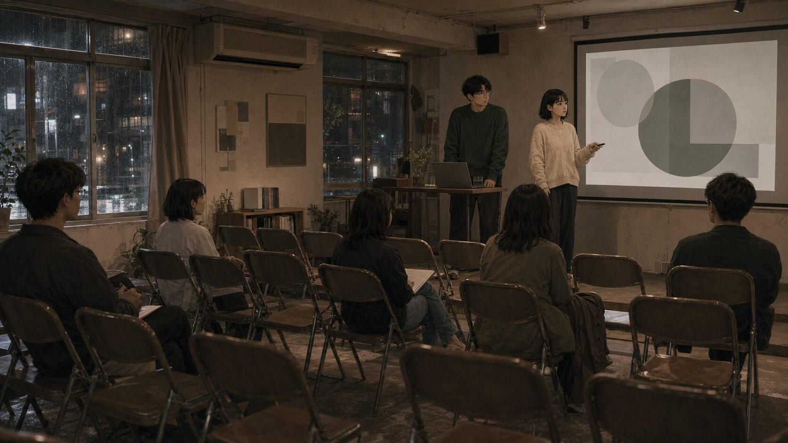
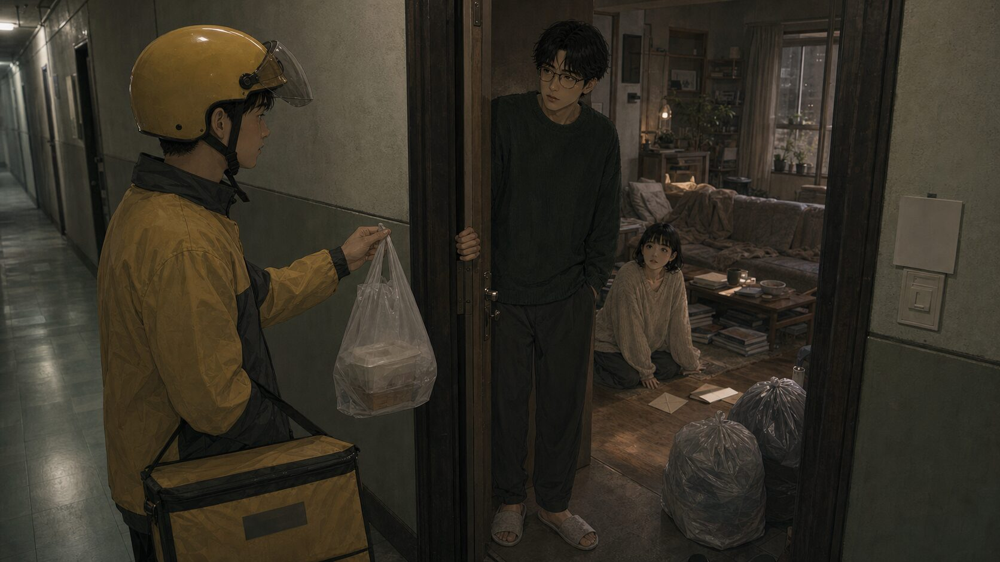
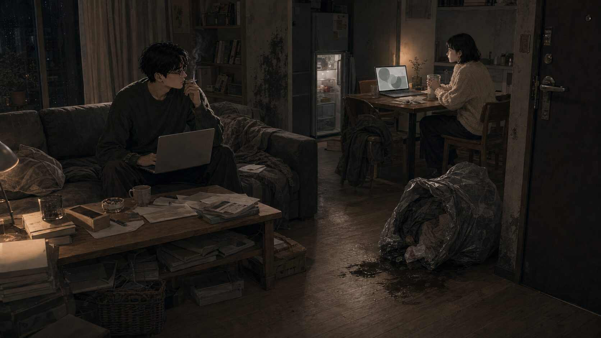

## 第一章：很深的下午

咖啡館裡的空調聲低而穩，像替所有停滯的人維持一種體面。

沈越把手機反扣在木桌上。十分鐘前，編輯傳來最後通知：「沈越，那篇談『當代知識勞動耗損』的稿子，這週已經是最後排版期。我們拖了兩個月，真的不能再等。」

他盯著黑色手機殼，手指扣著邊緣脫膠的橡膠條。

「現在的平台邏輯已經把語言切碎了。」沈越抬頭，看著坐在對面的林澄。「他們要的不是思想，是能被裝進一千字圖文包的便利貼。我不是不寫，我是在拒絕這種對語言的閹割。」

林澄攪著已經冷掉的燕麥奶拿鐵，微微點頭。

「我懂。」她說，「你的阻抗其實是很健康的防衛機制。當系統粗糙地消耗你，停滯反而是你還握得住的主體性。」

沈越胸口那塊因拖稿產生的羞恥，在林澄的詮釋裡被重新包裝成抵抗。他喝了口咖啡，焦慮慢慢淡去。

「那你呢？」他問，「NGO 那邊真的就這樣放手？」

林澄看著指甲上的倒刺。「那不是離職，是我拒絕繼續扮演無止境的照護者。每個人都談倡議，但整個組織都建立在榨取基層工作者的情緒勞動上。我如果繼續待著，只是在縱容那個系統。我必須先把自己回收。」

「你不是停下來。」沈越點頭，「你只是拒絕被錯誤的速度帶走。」

林澄笑了一下。自從遞出辭呈、每天在公寓裡看灰塵漂浮以來，這是她第一次覺得自己的無所作為有了座標。

外面的陽光逐漸變斜，落地窗把影子拉得很長。沈越的手機再次亮起，他沒有翻過來。

兩人繼續聊。沈越談階級、體制與勞動異化；林澄用心理諮商的語彙，把宏大的困境拆成創傷和界線。每次沈越露出無能為力，林澄就替他包紮；每當林澄為停滯恐慌，沈越就把她的焦慮歸咎於時代共業。

「我們應該把這些討論整理出來。」沈越看著窗外，「大家都以為停滯只是意志力問題。我們可以辦一場講座，就叫『底層的攪拌』。」

「底層的攪拌。」林澄重複了一遍，「探討當代人在結構中被攪碎，以及那些被視為爛泥的狀態背後，其實有怎樣的複雜性。」

「不提供解決方案。」沈越說，「提供解決方案本身就是新自由主義的毒藥。我們要共同承接這種無法行動的痛楚。」

林澄在面紙上寫下那五個字。夜幕降臨，咖啡館亮起黃色燈光。他們談海報、談發言比例、談互為容器。店員把「晚間九點打烊」的告示牌放到隔壁桌時，林澄看了眼時間。

「場地是不是要先看？」

「我認識幾個獨立書店店長，回去再問。」沈越摸到口袋裡那張很久沒繳的催繳通知單，又鬆開手。

「文案我明天可以先擬大綱。」林澄收起筆，「但可能要等狀態好一點，我這幾天內在耗損有點大。」

「不用逼自己。」沈越說。

他們並肩走出咖啡館。晚風有些涼，街上的通勤族走得很快，只有他們在人群裡放慢腳步，彷彿慢本身就是一種證明。

## 第二章：不是沒有做，是不想粗糙地做

沈越回到公寓時快十點。玄關感應燈壞了半個月，他摸黑換鞋，被地上的單隻皮鞋絆了一下，順腳踢到鞋櫃邊。

他打開電腦，名為「當代知識勞動耗損」的 Word 檔安靜躺在桌面角落。標題下只有三行字：

「當工具理性滲透進精神生活的最後一個角落，個體的停滯便不再是消極的怠工，而是一種無聲的撤退。我們必須追問，當行動本身成為一種被資本操縱的儀式……」

游標在「儀式」後閃爍。他點了根菸。若不先梳理效能崇拜，直接談精神危機，起點太窄。

他關掉 Word，打開 Notion，新建資料夾「當代主體性與阻抗研究」，把零散筆記整理進去。他開了二十多個瀏覽器分頁，從《疲倦社會》一路複製到《加速》。最後，他把文章標題改成〈逃避的現象學：論非功能性存在的政治學〉。

稿件字數仍停在三行，但沈越覺得自己完成了一場重要的思想清理。

同一時間，林澄坐在床上，膝上放著筆電。她正在替「非線性復原共同體」做 Keynote。她把字體從思源黑體換到蘋方，又換成日系明體，微調字距，直到字與字之間有了她想要的呼吸感。

她畫了幾個半透明圓圈，標上「斷裂期」「自我回收期」「低速重構期」。當她新建下一頁，敲下「預算與落地執行方案」時，手指停住了。她需要查共享空間租金、列茶點和講義印刷費、寫信問鐘點費。

具體數字浮現的瞬間，她呼吸一沉。她把那頁拖到「謝幕」後面，重新回去調整圓圈重疊角度。

快午夜時，手機震動，是沈越。

「我剛把電腦關掉。」他的聲音帶著煙腔，「今晚跟文本搏鬥到現在，整個人都被抽空。」

「辛苦了。」林澄翻身看著天花板，「我也是。做簡報時，效率和落地性的壓迫感一直跑出來。我花很多力氣承接自己的抗拒。」

「那是對的。」沈越說，「我們太習慣用『有沒有做成一件事』定義一天的價值。你的抗拒是在保護計畫的純粹性，不讓它被粗糙執行污染。」

「我們不能用壓迫自己的方式，做出一個反壓迫的計畫。」林澄說。

掛斷後，沈越看見編輯的新郵件：「禮拜五中午前若無完整稿件，只能撤版。上次預付的五千元大綱稿費，合約寫明若未按時交稿需退回。」

五千元。他心口猛地一跳，本能盤算戶頭餘額。隨後他長吐一口氣。這家媒體終究還是屈服於速度。他們要的不是文字，是填補版面的零件。

他把手機調成靜音。

另一條街上，林澄收到前主管訊息：「我們有新的社區心理韌性專案，需要有經驗的專案經理，待遇每月六萬五。要不要回來幫忙？」

六萬五。一份體面、熟悉、完全在她能力範圍內的工作。她盯著螢幕很久，最後把手機反扣在床單上。

那種穩定，不過是另一種溫和榨取。

## 第三章：他們不是真的沒地方去

隔天傍晚，兩人又在咖啡館碰面。催稿郵件和前主管的邀請都懸在各自的手機裡，像兩顆安靜的定時炸彈。

「如果我只是為了期限交出半成品，那不是完成工作，是對主體性的繳械。」沈越說。

「前主管找我回去，待遇跟以前一樣。」林澄說，「但如果現在妥協，我這幾個月回收的自我就又被送回去了。」

「寧可慢，也不要粗糙地落地。」沈越點頭。

這時，店裡兼職阿泰端著一疊剛洗好的咖啡杯快步經過。點單客人還沒說完，他已經在平板上敲好備註。等待濃縮咖啡萃取的空檔，他從圍裙口袋裡掏出一本單字書，嘴唇無聲翕動。

「高度功能化的創傷適應。」林澄輕聲說。

沈越看著阿泰搬起一箱燕麥奶，膝蓋微微一頓。「底層勞動者被迫自我管理的殘酷。他以為只要夠有效率、夠自律，就能上升。」

傍晚客人散去，阿泰端來一小碟肉桂捲邊角料。「店長說今天剩下的，招待你們。」

林澄叫住他：「你每天送貨，晚上還打工，身體吃得消嗎？」

阿泰用手背擦汗。「還好。就是膝蓋有點發炎，醫生叫我少蹲。所以想多背點單字，看能不能考物流公司的正職行政。坐辦公室比較穩，也有健保，陪我爸看診也方便。」

「物流行政也是另一種系統螺絲釘。」沈越說，「你有沒有想過，在追求速度和精準度的結構裡，人的主體性怎麼被磨損？」

阿泰愣了一下，抓抓後腦勺。「沒想那麼多，有薪水拿、能繳藥費就好。」

林澄眼神微亮。「我們下週六要辦一場講座，叫『底層的攪拌』。想探討人在只求速度和結果的社會裡怎麼被攪碎。你願意來當分享嘉賓嗎？我們需要你這種真實的勞動經驗。」

阿泰看了看寫滿名詞的面紙、沈越昂貴的降噪耳機，以及那台開著精美簡報卻一下午沒怎麼動過的電腦。

「底層的攪拌是什麼？」他問。

沈越說明了一大段，從效率道德、壓迫性上升通道，到停留原地也是無聲抗爭。

阿泰認真聽完，點點頭。

「喔。」

林澄補充：「我們不是要把你的經驗簡化成勵志故事，而是想讓大家看見，人怎麼被迫運轉。」

「那個講座會很久嗎？」阿泰問。

「大概兩小時。如果你分享，我們可以安排二十分鐘對談。」

阿泰看了眼牆上的鐘。「下週六我下午要送貨，晚上排這裡的班。而且我也不知道能講什麼。我就是送貨、背單字，還有上班。」

「這正是最重要的部分。」沈越說，「你覺得自己沒什麼好講，這個感覺本身就值得談。」

阿泰想了想：「可是如果停下來，房租怎麼辦？」

林澄放下杯子，眼神亮起。「這個問題非常好。講座想處理的就是這個：為什麼一想到停下來，第一個浮現的是房租？」

阿泰笑了一下。「我不是那個意思。我是說，我如果少上一天班，月底就會差一點。」

他拿好托盤。「肉桂捲趁熱吃。我後面還有杯子要洗。」

阿泰走回吧台，右腳落地時微微遲了一拍。

「他剛才那句可以直接放進講座。」沈越打開電腦，敲下：「如果停下來，房租怎麼辦。」

「他自己完全沒有意識到。」林澄說，「這種問題對他來說不是問題，是空氣。」

當晚，沈越回家，在 Notion 新建「田野隨筆」：

「真正殘酷的不是底層勞動，而是底層勞動者被迫相信行動仍然有效。」

他看著這行字，覺得極好。

## 第四章：把問題說得更完整

「可是如果停下來，房租怎麼辦？」在接下來幾天成了沈越和林澄最常引用的句子。每次談到停滯、修復和自我防衛，他們都會把它拿出來，語氣像發現了一份珍貴的田野材料。

沈越一整天沒拉開窗簾。沙發旁的閱讀燈亮著，筆電螢幕上是一篇預備發在社群平台的短文，標題為〈行動力崇拜與新自由主義的道德審判〉。這不是編輯催了無數次的專欄稿。

他寫得很快，談行動如何被道德化，談系統如何把結構困境轉嫁為自律問題。寫到「缺乏現實感」時，他停了一下，才繼續往下。

他把段落傳給林澄。五分鐘後，林澄打來電話。

「我把阿泰那種狀態叫『過度功能化創傷』。」她說，「有些人在長期匱乏裡只能不停運轉。他背單字、考正職、膝蓋發炎也送貨，不是因為比較清醒，是因為他沒有崩潰的權利。」

「他把生存本能當自主選擇。」沈越說。

「所以我把他放進簡報了。」林澄說，「標題是：低度資源勞動者對效率的病理式適應。」

接下來三天，他們的精力幾乎全泡在簡報裡。林澄調整深炭灰背景、白色細字和圓圈重疊角度；沈越增補註腳。他們為了「互為容器」還是「共感性承接」哪個詞更不具壓迫性，討論了一個小時。

至於確認場地尾款，沈越在 Notion 待辦上打了黃色星號，就沒再點開。林澄看到報名表需要綁定金流，默默關掉分頁。

週四下午，林澄準備公開文案，才發現報名連結失效，場地資訊仍寫著「暫定獨立書店」。

她撥通沈越電話。「問卷連結失效了。場地也還是暫定。」

「問卷不是你在管嗎？」沈越聲音疲倦，「場地我有問店長，他沒回。我以為你跟企劃熟，會確認尾款。」

「我以為你已經把大綱費預付款匯過去當訂金。」

「我的戶頭因為拖稿被編輯卡著，這你知道。」

電話兩端安靜下來。距離講座只剩一週，宣傳沒發，場地沒定，報名連結打不開，阿泰甚至不知道自己已被寫成案例。

但兩人都沒有生氣。

「這其實很典型。」林澄緩緩吐氣，「我們都太害怕去壓迫對方，所以用『以為對方會處理』來保護彼此空間。」

「對。」沈越接得很快，「這是高敏感者協作困境。當我們試圖建立非壓迫空間，對控制的防衛就轉成行動真空。」

他們決定今天先不談庶務，明天再對流程。掛斷後，林澄看著那張漂亮的「低速重構期」簡報頁。失效的表單和尚未確認的尾款，在瀏覽器分頁被合上時，一起從視線裡消失。

## 第五章：沒有人負責的小事

房東的簡訊是兩天前發來的：「沈先生，本月房租已逾期三天，再麻煩匯款，謝謝。」

沈越在沙發上打開輸入框，寫了又刪。他想解釋自由寫作者收入週期如何受平台化榨取影響，又覺得對一個只關心轉帳帳號的房東來說太尖銳。他改寫成「非體制內知識勞動者在碎片化市場中維持自主性所導致的現金流浮動」。

兩百字的解釋在輸入框裡停了三小時。最後，他按住退格鍵，把所有字抹掉。

太卑微了。他想。一個試圖解構權力的人，卻要向房產擁有者論證拖延的合理性。

他鎖上手機，丟進沙發縫裡。

林澄看著信用卡帳單。應繳一萬八千六百元，可用餘額三千兩百元。另一個分頁是「金錢焦慮與豐盛感重塑：從匱乏系統中自我解殖的八堂課」，報名費三千元。

如果她因害怕債務放棄這堂課，不就證明自己徹底被匱乏感綁架了？這筆消費本質上是一種修復，是對自身安全感的投資。

她輸入卡號。交易成功。可用餘額變成兩百元。

下午兩點，沈越提著筆電來到林澄公寓。玄關堆著三個未拆快遞和兩袋過滿、散發果酸味的垃圾。餐桌上有簡報草稿、貝果包裝紙和社會學書籍。

「場地那邊呢？」林澄問。

「書店說因為我們沒匯尾款，時段被新書發表會訂走了。要辦只能改週日晚上九點後，或另外找場地。」

「週日晚上九點太壓迫了。」林澄說，「這反映空間對非生產性活動的排斥。」

「我們為什麼一定要急著下週六辦？」沈越把筆電蓋上，「對特定時間節點的執著，本質上就是 KPI 焦慮。」

他們從空間異化談到承諾的心理防衛，四個小時過去。下午陽光從窗簾縫照進來，照亮桌上幾張概念圖。

「所以今天至少定一件事。」林澄看錶，「海報視覺調性。中灰，還是偏藍的冷灰？」

沈越看著兩張紙樣。「太偏藍會不會像冷酷的工業設計，削弱泥濘感？」

「有道理。那再想想。」

他們最後連海報顏色也沒決定。

這時，林澄手機震動。阿泰傳訊：「澄姐，不好意思，下週六講座我不能去了。我剛收到物流公司的錄取通知，下週一開始正職培訓，六日也要輪班。謝謝你們之前邀請。」

林澄平靜地把手機扣在桌上。

「阿泰不能來了。他拿到物流正職。」

沈越彈煙灰的動作停了一下，笑容裡帶著乾澀的悲憫。

「他可能還沒有空間理解停下來的必要。」林澄說，「被生存焦慮填滿的人，最直觀的反應就是抓住任何能讓他運轉的齒輪。」

「他還在被生存邏輯推著走。」沈越說。

垃圾仍堆在玄關，沈越的房租沒繳，林澄的信用卡仍赤字。但在這個充滿灰塵與未決之事的客廳裡，只要精準的詞彙還能運轉，他們的停滯就仍有某種高貴秩序。

## 第六章：講座

講座當天下午，台北下著黏膩細雨。臨時租借的小型共享空間在舊商業大樓四樓，電梯裡有散不去的霉味。因為前一天下午沈越才勉強聯絡書店企劃，對方看在人情上，把他們塞進這間合作空間。

門口指示牌是 A4 紙臨時印的。上面寫著「底層的攪拌：當代結構耗損與主體性懸浮」，邊緣因墨水不足有些斷線。

開場前十分鐘，場地稀稀落落坐了十幾個人。前三排大半空著，後排幾個大學生低頭滑手機。沒有媒體攝影機，沒有熱烈低語，只有老舊空調規律運轉。

「那我們正式開始。」

沈越站在麥克風前，神態從容。「我們今天想談的，不是如何在加速時代取得成功。相反地，我們想聊『停滯』。當工具理性滲透進精神生活每個角落，無法行動究竟是個人失能，還是對系統最深沉的抵抗？」

他講得很流利，將拖延定義為對效能崇拜的政治性防衛。林澄接著上台，語調柔軟，談復原的非線性，談無法起床、抗拒社交，都是內在系統在自我回收。

兩人的發言銜接流暢，精準得像調校好的室內樂。

問答環節，一名穿褪色帽 T 的年輕人舉手。

「我很有共鳴。」他聲音乾澀，「但我現在背了幾十萬債務，每月都被銀行催收。我每天一睜眼就是利息，沒有辦法像你們說的那樣停下來感覺耗損。請問第一步可以怎麼做？有沒有具體方法？」

沈越點頭，像遇到好問題。

「也許我們要先拒絕將債務完全個人化。」他說，「如果一開始就落入『如何還債』的技術性思考，就等於接受系統對你的道德審判。第一步，或許是解構債務關係背後的暴力，不讓它異化你作為人的主體性價值。」

年輕人愣住，低頭捏著礦泉水瓶，發出細微塑料聲。

後排一個戴口罩的女生舉手。

「我最近狀態很糟，連續兩週每天都起不來，工作堆積如山，主管警告好幾次。我知道快被開除了，但就是沒力氣打開電腦。林諮商師，有沒有實際方法，哪怕每天能起床工作三小時也好？」

林澄看著她，眼神溫和。「你可以先不要把自己推回功能性的位置。當你問如何工作三小時時，其實是在用主管的眼光審判自己。你的身體正在用『起不來』保護你。」

「可是我下週就會被開除。」女生說，「沒有這份工作，我下個月就繳不出房租。」

場地安靜下來。

林澄點頭，語氣更輕：「被開除，可能是一個系統逼你面對自身界線的時刻。痛苦，但也是重建主體性的契機。」

女生定定看著她，沒有再問。

之後幾分鐘，再也沒有人舉手。

掌聲稀稀拉拉地響起。聽眾安靜而迅速地朝出口走去，像急著離開這場沒有給出任何出口的討論。

書店企劃禮貌地說：「今天辛苦了。雖然人數沒有預期多，但討論深度還是很好。以後有機會再合作。」

兩人都聽得出來，沒有下次了。

收拾完東西，他們並肩走出大樓。雨停了，路面反射霓虹招牌。

「也許這種東西本來就不該被講座形式承載。」林澄說。

「講座本質上還是要求講者給答案。」沈越點菸，「而觀眾期待立即套用的工具。這與我們想談的非線性背道而馳。」

「如果我們為迎合他們給出具體第一步，那才是對主題最大的閹割。」林澄說。

沈越點頭。他們把失敗的講座重新命名為形式的不適配，便又能繼續往前，或者繼續停在原地。

## 第七章：臨時過渡

「回去吧。」沈越說。

這句「回去」指的是林澄的公寓。

兩天前，房東給他最後通牒：明天中午前搬空，押金扣除未繳房租和清潔費後退還餘額。沈越本可以打電話給父母，也可以找短租，或答應前同事介紹的深夜財經編譯兼職。但回家是主體性的退化，短租是消費主義租賃市場的消耗，固定時間交稿則是對文字的背叛。

林澄看著他提著兩個帆布袋和一箱書站在門口，沒有驚訝。

「你先在我這裡過渡一下。」她說，「個體要維持獨立，本來就得用更彈性的方式互相支持。」

「我們是在摸索一種去中心化的合作生活。」沈越說。

一開始，他只說借住幾天。第三天，他的大衣掛上臥室門口的掛鉤；第五天，他的刮鬍刀擺進洗臉台鏡櫃。茶几成了他的工作區，理論書、讀書筆記和畫著箭頭的草稿佔滿桌面。林澄想放杯子時，只能放在地上。

她沒有問他打算住到什麼時候。

某種程度上，她甚至鬆了一口氣。自從辭職以來，空蕩的公寓總讓她被焦慮吞噬。現在，沙發上多了一個同樣不拉窗簾、同樣在工作日中午昏睡的人。只要房間裡還有另一個人也在壞掉，她的停滯就不是孤立失能，而是一種共同狀態。

污染是無聲的。

沈越白天蒙頭睡，晚上十點後才活過來，開燈、敲鍵盤、抽菸。林澄原本十一點前睡，後來躺在床上聽客廳的滑鼠聲和打火機聲，漸漸也放棄睡眠，走到客廳陪他在凌晨兩點談宏大話題。

「生理時鐘本質上是被工業社會時間表馴化的。」沈越說，「晚睡是身體奪回自己的時間。」

「我們在拒絕用白天的效率定義一天的結束。」林澄說。

生活的小事開始偏離。垃圾在玄關放到第三天，水槽裡杯子一個疊一個。每件事都只是晚了一點，而在他們的解釋系統裡，每個延遲都有安全避難所。

週五下午，前主管又傳訊給林澄：「主管位置還空著。全職太累的話，要不要先回來兼職？一週三天，時間很彈性。」

這幾乎是完美緩衝，能解決她下個月信用卡帳單。

她拿著手機走到客廳。沈越靠在沙發上，旁邊放著一盤風乾的吐司。

「前主管問我願不願意回去兼職，一週三天。」

沈越看了螢幕一眼。「你現在回去，可能會前功盡棄。」

「什麼前功？」

「你這段時間好不容易從那個榨取性的系統裡長出來的東西。兼職只是溫和的陷阱，系統用彈性做誘餌，把你拉回運轉軌道。」

林澄想說「但帳單呢」，也想說「這只是過渡」。可沈越的話像一堵沒有縫的牆，把具體憂慮擋在外面。她若答應，不就承認自己無法忍受懸浮，終究要向體制低頭？

「嗯，你說得對。」她輕聲說。

她關掉手機，沒有回覆。

## 第八章：比較舒服的壞掉

林澄公寓的客廳像一口沒有風的井。發酵果皮酸味和煙草焦氣混在一起，茶几上有外送盒、影印文獻、過期帳單。水費催繳單被半杯冷水壓著，紙邊受潮發黃。

「我最近看這屋子，覺得挺有意思。」林澄靠著餐桌腿，「以前在組織裡，主管總說桌面不能有無關雜物，說那代表專業。」

「那是最典型的主體性馴化。」沈越躺在沙發上滑手機，「社會用乾淨和秩序定義合格市民。你沒必要因為幾天沒洗的碗去迎合中產階級秩序。」

林澄看著玄關兩袋微酸的垃圾。「我本來下午要丟垃圾，但走到玄關就有排斥感。好像只要配合定時定點垃圾清運，我就又被納入功能性的運作軌道。」

「你不是懶，你是在尊重自己的停滯期。」沈越說。

林澄心底因沈越長期借住、不付房租也不幫家務而生出的不適，被妥帖地歸類為「界線感浮現」，成了一次健康實驗，而不是俗氣計較。

門鈴忽然響起。

沈越去開門。門外站著穿黃色外送外套的年輕人。

阿泰。

他安全帽的擋風鏡推上去，視線越過沈越肩膀，落進昏暗凌亂、散著酸氣的客廳，又看到坐在地板上、頭髮蓬亂的林澄。

「好久不見。」沈越接過塑膠袋，「你現在也跑外送？」

「正職是物流行政，週末接一點單。」阿泰看了看客用拖鞋、理論書和沒洗的碗，目光平靜，沒有輕蔑，也沒有驚訝。

「你們住一起了喔。」他說，像在核對一張出貨單。

「對，暫時的。」沈越說。

林澄朝門口揮手。「比較像一個支持性的過渡安排。在目前結構下，我們試圖用去中心化方式分擔生存成本。」

阿泰點頭，沒有回應那串詞。他在手機上點了兩下，轉身朝電梯走去。膝蓋似乎好了些，但步伐仍有常年勞動留下的微跛。

「祝你們用餐愉快。」電梯門關上前，他禮貌地說。

沈越關門回來，把袋子放在過期帳單上。

「你有沒有注意到他的眼神？」沈越拆著塑膠袋，「他還是習慣用傳統眼光看關係。不是夫妻，不是情侶，那就是寄生。他無法理解邊界模糊地帶的非線性協作。」

「他的生活太需要明確分類。」林澄說，「只有標上確定標籤，他才能維持基本秩序。」

客廳重新安靜。沈越躺回沙發滑手機，林澄看著那碗漸漸變溫的熱湯，終究沒有站起來去拿乾淨筷子。

## 第九章：下面還有下面

編輯的微信非常客氣，客氣到殘忍：「沈越，主編說排版真的等不到，這期專欄只能撤下。之前預付款，麻煩下週五前退回指定帳戶。」

五千元。沈越沒看銀行餘額，只覺得指尖僵硬地蜷縮了一下。他點了根菸，煙霧散開時，慌亂被另一套宏大的邏輯推開。

這不是他交不出稿，是媒體向流量速度妥協。他們要的不是思辨長文，是標準化零件。

他新建 Notion 頁面，敲下標題：〈無法交付的人：論當代知識勞動的耗損與交付暴力〉。鍵盤聲在深夜裡急促響起。

餐桌另一端，林澄盯著銀行催繳通知。信用卡已逾期七天，未繳一萬八千六百元。她把手機反扣，但紅色字體帶來的緊繃仍在空氣裡。

牆角有一小片黑霉。玄關垃圾放得太久，塑膠袋底部滲出一灘黏稠黑液。冰箱門每次打開，都飄出爛香蕉和過期燕麥奶混合的味道。

林澄把簡報標題從「非線性復原共同體」改成「低功能時代的互為容器」。

「這更準確。」沈越沒有停下打字，「我們不需要提供好起來的方案，只需要彼此容納。」

沈越的文章已寫兩千字，從福柯談到晚期資本主義，沒有一個字提到他收了預付款、拖了兩個月卻最終一字未交。在文字裡，他是一個純粹抵抗者。那未退還的五千元，只是抵抗中的摩擦成本。

夜深了，客廳酸氣更濃。

林澄起身倒水，拖鞋底黏在乾掉的垃圾黑水上，發出啪嗒一聲。她低頭看那袋垃圾。

「沈越，這垃圾放四天了。你今天出門買菸時怎麼沒順便帶下去？」

沈越停下打字，推了推眼鏡。「我覺得你現在的語氣不只是在討論垃圾。你是在對我佔用你的空間，以及目前不對等的合作關係感到焦慮，然後把焦慮投射到這袋垃圾上。」

林澄握著水杯，指關節發白。「你這樣回應，不也是把具體責任心理化嗎？我們現在是在討論誰去倒垃圾，不是在做諮商。」

「我同意。」沈越靠回沙發，「但『責任』這個詞本身就不是中性的。如果用家務勞動的對等性衡量彼此付出，其實是把中產階級家庭秩序強加在我們的共同生活上。」

林澄盯著他，想說垃圾發臭是物理事實。但話到舌尖，被更深的無力壓下去。如果她堅持談垃圾，就顯得斤斤計較、缺乏對結構的理解。

「我剛才那種催促，確實帶有要求功能性落地的強迫感。」她低聲說。

沈越微微點頭，重新敲鍵盤。

那袋垃圾依然靜靜躺在玄關。

林澄打開求職網站，看著「基金會行政助理」職缺，月薪四萬二。手指在「投遞履歷」上停了很久。

沈越端著空咖啡杯走到她身後。

「你確定那是你想要的，還是你的焦慮想要的？」

林澄沒有回答。她看著職缺頁，最後關掉分頁。

沈越坐回沙發，繼續完善〈無法交付的人〉。林澄重新打開「低功能時代的互為容器」，調整莫蘭迪綠色圓圈的透明度。客廳恢復潮濕寧靜，沒有人再提起玄關那袋垃圾。

## 第十章：底層的攪拌

台北的下午被沒下透的陰雨壓得很低。林澄客廳窗簾依然拉著，把室內維持在接近黃昏的昏暗裡。

在台北另一端的物流轉運站旁，阿泰穿著制服，低頭核對送貨單條碼。他已轉入內勤行政，不必再跟車送貨。

路過以前打工的咖啡館時，他隔著玻璃看了一眼。店裡冷氣依然很好，落地窗前坐著幾個拿筆電的客人。

「阿泰，好久沒看到以前常來那兩個人了。」兼職店員交班時順口說，「寫文章的男的，還有做諮商的女的。你還有跟他們聯絡嗎？」

阿泰停了一下，抓抓後腦勺。

「喔，沒有耶。」

他沒有多問，轉身朝公車站走去。公車剛好進站，他緊走兩步跟上人群，抓著吊環，在報站聲中點開手機看下半年的排班表。

而在那間拉著窗簾的公寓裡，時間仍以近乎靜止的黏稠感流動。

沈越躺在沙發上，半個身子陷在起毛球的灰毯裡，拇指機械式地滑著手機。稿約取消後，他的訊息安靜許多，只剩幾個群組發產業新聞。

林澄坐在地板上，身前散著積壓幾個月的帳單：水電費、電信費、信用卡催繳。她低頭把信件依月份排好，再用生鏽長尾夾夾在一起，整理得極專注，彷彿這是一項重要工作。

「其實我們這代人最難的，是所有問題都不能只看表面。」沈越突然說。

「嗯。」林澄沒有回頭。

「別人會以為我們只是沒把生活過好。」

「因為他們只能看見結果。」林澄看著牆角那片霉斑。

「對。」沈越翻了個身，「他們看不見底下那個結構。」

林澄手裡拿著最早的催繳通知。紙角已經被反覆拿取弄皺。她本想丟掉，最後卻小心撫平，放回厚厚的資料夾裡。

客廳瀰漫著潮濕霉味。玄關那袋垃圾已放了四天，塑膠袋底部滲出的黑水在木地板上乾涸，留下一圈深色、帶毛邊的痕跡。

林澄看著那圈痕漬。

「等一下再倒。」

「不用逼自己。」沈越說。

林澄笑了一下。那是一種虛弱，卻無比放鬆的笑。

客廳重新寂靜。沈越躺回灰毯深處，打開那篇寫了兩千字卻永遠不必交付的文章；林澄抱著膝蓋坐在地板上，靜靜看著那袋發臭的垃圾，感覺那圈乾涸黑印像是地板上本就該有的花紋。

那句「不用逼自己」在陰暗空氣裡漂浮，像一層溫柔的防腐劑，將屋裡所有腐爛，都細密地包裹成一種正在發酵的深度。

