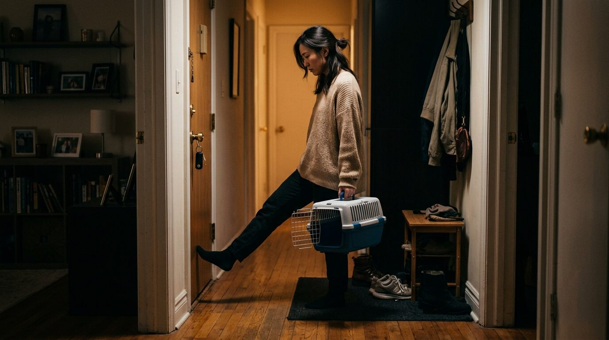
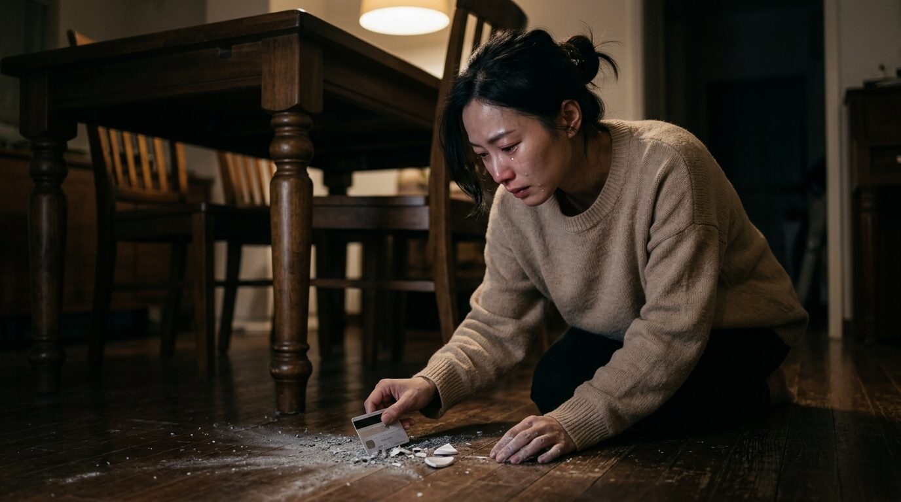

## 第一章：星期二

小滿死在星期二下午四點十七分。

獸醫把聽診器拿開，關掉桌上的計時器。機器停止以後，診間裡還有冷氣聲。

「已經走了。」獸醫說。

陳雨青點頭。

小滿側躺在藍色尿布墊上。前腳的毛被剃掉一小塊，留置針還貼在上面。牠的眼睛沒有完全閉起來。陳雨青用拇指往下推，推完又張開一點。

獸醫問她要不要單獨火化。

「要。」

「骨灰罈有兩種，木頭的和陶瓷的。陶瓷要多一千二。」

「都可以。」

「腳印要留嗎？」

「要。」

「毛呢？」

「要。」

櫃檯拿來一張表格。寵物姓名、物種、性別、體重、死亡日期。陳雨青填到飼主姓名時停了一下，然後寫下自己的名字。

護理師問她要不要再抱一會兒。

她把小滿抱起來。十五歲的貓只剩三點一公斤，比兩包米還輕。牠的頭垂在她手肘外面。以前這樣抱，牠會用後腳踢她的肚子。

護理師出去，關上門。

陳雨青坐了二十分鐘。她沒有說話。小滿的身體起初還是溫的，後來耳朵先冷。她把牠的耳朵握在掌心裡。握了一陣，掌心也變冷。

五點，護理師來敲門。

「陳小姐，我們要送去冰存了。」

「好。」

陳雨青把小滿放回尿布墊。護理師用白布把牠包起來，先包腳，再包頭。白布合上以前，陳雨青把手伸進去，摸了一下牠左邊的鬍鬚。

她提著空的外出籠搭計程車回家。

司機從後照鏡看了一眼，問：「帶貓去看醫生喔？」

陳雨青說：「嗯。」

回到家，她把外出籠放在玄關。門打開時，她用腳擋了一下。

小滿以前會往外鑽。

她站在門口，腳還擋著，等到感應燈熄掉才把門關上。

晚上七點，她打開一罐腎臟處方罐頭。罐頭倒進碗裡以後，她才想起來。

她沒有把罐頭倒掉。她用湯匙壓碎，加了兩匙溫水，放在小滿平常吃飯的位置。

十一點，罐頭表面乾了。

陳雨青坐在餐桌旁邊。她看了很久，拿保鮮膜把碗包起來，放進冰箱。

## 第二章：第十二天

小滿死後，陳雨青每天早上六點四十分起床。

鬧鐘原本設在七點半。小滿晚年腎臟不好，每天六點四十分要吃藥。陳雨青沒有改鬧鐘。

她起床，走到廚房，把水碗裡的水倒掉，洗碗，再裝新的水。

第一天她忘了小滿已經不在。

第二天她記得，但還是換了。

之後每天都換。

貓砂盆放在浴室外面。裡面的砂維持小滿最後一次使用過的樣子。右後方有一小塊結塊的尿，前面有兩道刨過的痕跡。陳雨青不准掃地機器人靠近。她用紙箱擋住入口，紙箱上寫「不要動」。

家裡只有她一個人。

第十二天早上，她收到母親的電話。

「骨灰拿到了嗎？」

「還沒有。」

「妳不要一直想。再養一隻就好了，收容所那麼多。」

陳雨青沒有回話。

「貓的壽命本來就這樣。妳已經照顧得很好了。」

陳雨青把電話掛掉。

母親又打來兩次。她把手機關機。

她請了三天喪假，公司不准。人事說寵物不適用。主管替她改成兩天特休，第三天要求她在家登入會議。

會議進行到一半，簡報裡有人說：「這個案子現在沒人養。」

陳雨青聽見「養」字，關掉鏡頭。

主管私訊問她是不是網路有問題。她沒有回答。

下午，購物網站寄來自動配送通知。十二公斤的貓砂已出貨，預計明天送達。她按取消，系統顯示商品已進入物流，無法取消。

隔天，管理員把貓砂搬到電梯口。

「妳家貓很會用喔，這麼大包。」管理員說。

陳雨青把貓砂拖進家裡。袋子磨過地板，發出沙沙聲。她把它放在原本堆飼料的位置，旁邊還有七罐處方罐頭、十一包藥、一支餵食針筒。

晚上，她在沙發上睡著。

凌晨兩點二十三分，她聽見小滿從書架跳下來。

那是一聲很輕的悶響，接著有爪子踩過木地板的聲音。

她立刻坐起來。

客廳沒有東西。冰箱運轉，窗簾被冷氣吹動。她跪在地上，往沙發底下看。

「小滿。」她叫了一聲。

沒有回應。

她又叫一次。

她趴在地板上，把手伸進沙發底下。裡面有一顆乾掉的飼料、兩枚硬幣和一團灰色的毛。她把毛拿出來，放在掌心。

她在地上趴到天亮。

## 第三章：名字

骨灰在第三個星期送到。

紙箱外面貼著「易碎物品」。陳雨青把箱子放在餐桌上，用剪刀沿膠帶中間割開。

裡面有一只白色陶瓷罈、一張火化證明、一個透明塑膠袋。塑膠袋裡裝著一撮毛和一塊灰色黏土。黏土上有四個腳趾印。

她先看腳印。中間那塊肉墊太圓，不像小滿。小滿右前腳的第二個趾頭受過傷，印出來會歪一點。黏土上的四個趾頭排得很整齊。

她拿出火化證明。

上面寫：

「寵物姓名：小曼。」

陳雨青打電話給火化公司。

客服請她提供編號。她念了兩次，第二次念得很慢。

「有查到，陳小姐。是六月十七日送來的米克斯貓，小曼，對嗎？」

「不是小曼。是滿，滿月的滿。」

「可能是登打錯誤，不影響火化流程。」

「腳印也不是牠的。」

「腳印是火化前由醫院協助留存，這部分要詢問醫院。」

「這裡面是不是牠？」

客服停了一下。

「罈底有一組識別貼紙，您可以核對。」

陳雨青把陶瓷罈倒過來。底部的貼紙印著同一個編號。名字仍然是小曼。

「編號是一樣的。」客服說，「那就沒有問題。」

「可是名字不是。」

「名字是人工輸入，編號才是辨識依據。」

「腳印也不是。」

「陳小姐，如果您對醫院採樣有疑問——」

陳雨青掛掉電話。

她把陶瓷罈放回桌上。罈口用熱熔膠封住。她去廚房拿水果刀，沿著蓋子刮。刀尖滑開兩次，割破左手食指。血落在罈子的白色表面。

她用衛生紙包住手指，繼續刮。

蓋子打開時，她用力過大，罈子從桌邊滑下去。

陶瓷撞到地板，裂成三塊。灰白色的粉末撒在磁磚上，一部分落進桌腳下面，一部分混進她早上掉落、還沒掃掉的麵包屑裡。

陳雨青站著沒有動。

過了幾秒，她蹲下來，用兩隻手把粉末往中間撥。粉末很細，黏在指紋裡。她拿名片刮，名片太軟。她又拿信用卡。刮到磁磚縫時，裡面有黑色的灰塵和頭髮。

她不知道哪些是小滿。

她去拿吸塵器。插上電以後，又把插頭拔掉。

她拿透明膠帶黏地板。黏起來的東西更多，有貓毛、棉絮、砂粒，還有她自己的頭髮。她把每一條膠帶都貼在餐桌上，不敢丟。

晚上七點，主管打電話來。她坐在地上接聽。

「雨青，妳明天能進公司嗎？大家都在等妳那份資料。」

陳雨青看著地上的粉末。

「我弄混了。」她說。

「什麼？」

「我把牠弄混了。」

主管叫了她兩次。她開始哭。

一開始沒有聲音。她用手背擦眼睛，手背沾到灰，又把灰擦到臉上。她看見以後，立刻用袖子擦，越擦越開。

她把手機丟到旁邊，趴下去，用胸口護住地上的粉末。

「對不起。」她說。

她把額頭貼在磁磚上。

「對不起。對不起。對不起。」

電話裡的主管還在說話。她聽不清楚。

她哭到吐。吐在桌子旁邊，又怕濺到地上的灰，只能用兩手圍住那一小塊地方。她的肩膀一直抖。後來沒有東西可以吐了，身體還是往前縮。

她叫小滿的名字。叫得很大聲。

隔壁敲牆。樓下有人按門鈴。她沒有開門。

那一晚，她沒有把骨灰收完。

## 第四章：早上六點四十分

天亮時，陳雨青還躺在餐桌下面。

手機沒電了。地板上的嘔吐物已經乾在邊緣。破掉的陶瓷罈用毛巾包著，放在椅子上。

六點四十分，臥室裡的鬧鐘響了。

她聽完第一輪。五分鐘後，鬧鐘又響。

她扶著桌腳站起來，走進臥室，把鬧鐘關掉。

回到廚房時，她經過水碗。

昨天的水裡浮著兩根毛。她把碗拿起來，走到水槽前。她站了很久，最後把水倒掉。

她洗碗，裝新的水，放回原位。

接著她坐在水碗旁邊。

八點，陽光照到碗口。十點，陽光移到冰箱下面。中午，管理員又送來一箱自動配送的罐頭。

門鈴響了三次。

陳雨青沒有去開門。

水一直放在那裡。

