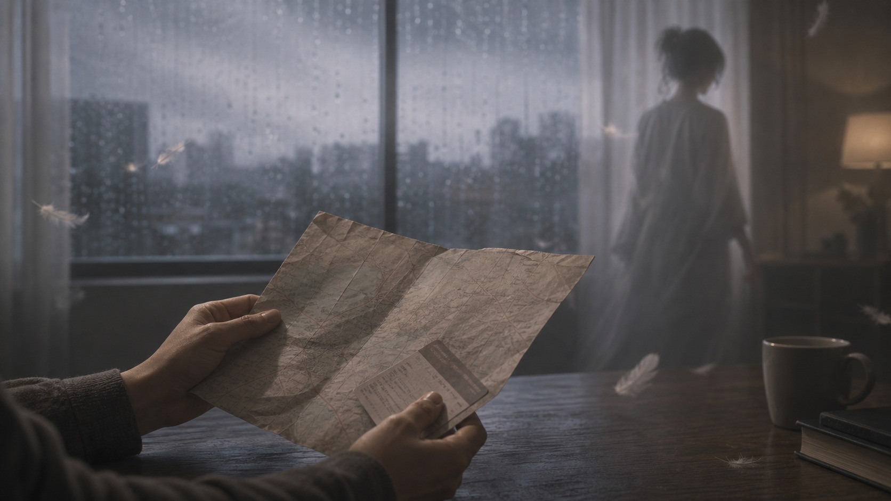
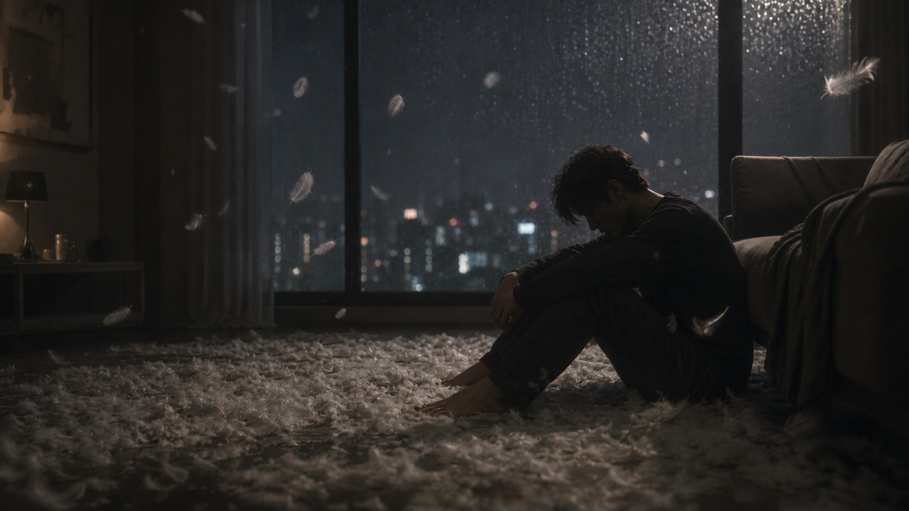
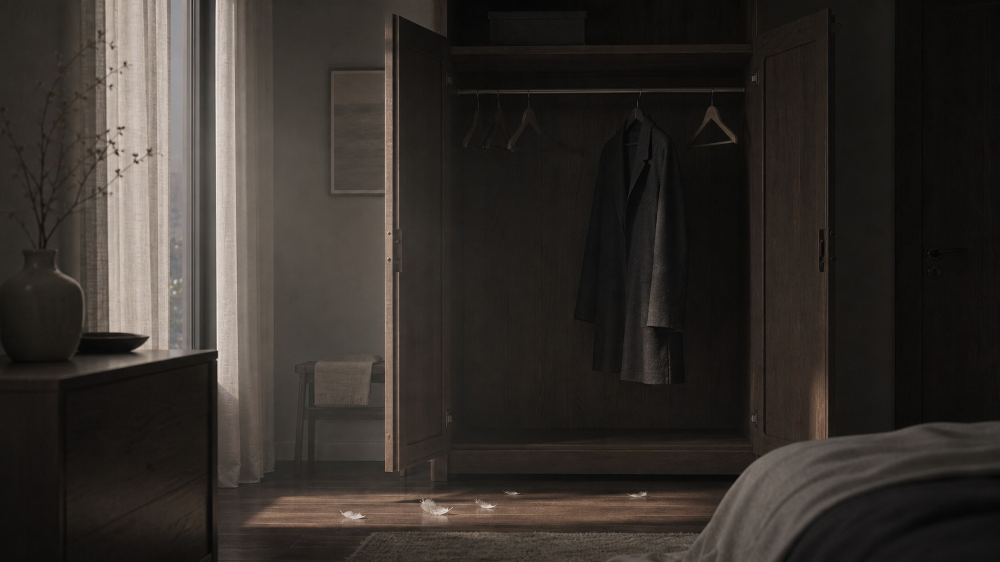

## 第一章：無害的影子
搬進來那天，薇只帶了兩個紙箱和一個帆布袋。她把衣服一件件掛進衣櫃，木衣架沒有發出太多聲音。

她說話的聲音很輕，習慣帶著一點氣音：「以後請多指教。」

薇記得我喝茶不加糖。我加班時，她會倒一杯溫熱的伯爵茶放在我筆電旁，不發一言。有一次下大雨，她在巷口蹲了半小時，替一隻走不動的流浪貓撐傘。

大家都說她人很好，很無害。

十月的時候，我計畫去花蓮。火車票和民宿都訂妥了，行程表印出來放在餐桌上。

出發前晚，薇一邊喝水一邊看著那張行程表。她看了很久，久到我以為她在默記。

「對不起啊，我明天好像有點累，不想去了。」

我捏著火車票。紙張的邊角刺進拇指的皮膚，微微發疼。

「那下次吧。」我說。

「好啊，下次。」她說，聲音裡有一種如釋重負的輕快，轉身回了房間。

我站在原地，把火車票對折，又對折。對折到第四折的時候，紙張的摺痕處已經泛白，像一道傷口。

那晚我坐在餐桌前，把那張行程表翻到背面，寫了四個字：「下次不會。」

然後劃掉。看不出來原本寫的是什麼。

我把火車票夾進行事曆，關了燈。黑暗中聽見隔壁房間她的呼吸聲，平穩、均勻，像是什麼都沒有發生過。

---

那天晚上關了燈之後，薇沒有睡。

她從枕頭底下摸出手機，打開月曆，把花蓮那幾天的格子塗成灰色。塗完之後她盯著螢幕看了一會，又把灰色取消。

她其實還是想去的。

但「想去」和「做得到」之間，有一條她跨不過去的河。她不知道那條河叫什麼名字，只知道每次站在河邊，腳就動不了。

她把臉埋進枕頭裡，沒有哭。只是躺著，等天亮。

## 第二章：大家都說她很好
聚會時，薇總是那個幫忙收杯子、遞紙巾的人。

有一次朋友聚餐，她遲到了四十分鐘。她坐下來，氣還沒喘勻，先合掌對大家笑：「對不起，在捷運站看到一隻狗，蹲在那邊看了很久，後來上車一直想著牠，回過神已經坐過三站。」

桌上的人都笑了，說她單純。

我沒笑。我低頭用拇指的指甲反覆刮著酒杯外壁凝結的水珠，刮出一道道透明的水痕。

旁邊的朋友悄悄推我：「別這麼嚴肅，她都道歉了。」

我抬頭。薇正在用吸管戳杯裡的冰塊，沒有看我。

我做智齒手術那天，臉腫得很厲害。薇答應會來接我。我在醫院大廳坐到下午三點，塑膠椅的邊緣在腰上壓出一道紅痕。護士開始關燈，一排一排暗下去。

手機響了。螢幕上是她的名字。

「對不起喔，昨晚失眠睡過頭了。到家了嗎？加油。」

我盯著「到家了嗎」三個字看了很久。她以為我已經回去了。她沒有想過我可能還在等。

我把手機放回口袋，站起來。傷口隱隱作痛，口腔裡有血和紗布混在一起的味道。我一個人走出醫院，攔了計程車。車窗外的路燈一盞一盞往後退，每一盞都像一個沒有說出口的句子。

後來我跟朋友提起這件事。朋友說：「她也不是故意的，她最近工作壓力大。而且上次你感冒，她不是還幫你煮了粥嗎？你別太計較了。」

我沒有再說什麼。我看著窗外，想起那碗粥。稀的，米粒沒有煮透，咬開是白的。我喝完了。喝完之後跟她說謝謝。

她說：「下次會煮好一點。」

沒有下次。從來沒有。

---

薇醒來的時候，手機螢幕亮著三通未接來電。

她沒有點開。她把臉埋進枕頭裡，躺了一會。她知道自己錯過了什麼。她知道那個人現在坐在醫院大廳裡，可能還在等。但她的身體像被釘在床上，每一根骨頭都在說「再一分鐘就好」。

等她終於坐起來的時候，已經是三點。

她打開簡訊，打了一行字，刪掉。又打一行，又刪掉。她找不到一個版本，能夠同時裝下「對不起」和「我不是故意的」和「我真的有想要去」和「我也不知道為什麼會這樣」。

最後她寄了一個最短的。不是因為覺得這樣最好。是因為她的腦子已經沒有力氣處理更多字了。

寄出之後她把手機丟在沙發上，去廚房煮咖啡。等水燒開的那三十秒，是她今天唯一沒有在算「我又搞砸了什麼」的時刻。

## 第三章：羽毛的重量

我們住處的廚房水管有些微滲水，角落的木地板開始發霉。我預約了水電工星期二下午來維修。

那天我公司有重要的簡報，不能請假。

出門前，我跟薇說：「水電工下午兩點到四點會來。」

她正在廚房弄什麼東西，鍋鏟停了一下：「兩點到四點。」她重複了一遍，像在手機裡按儲存。

「對，兩點到四點。」我說，「你休假在家，幫我等一下。」

「放心。」她說。

我出門的時候回頭看了一眼。她站在廚房裡，背影看起來很確定。

晚上七點我回到家。推開門，腳踩進去的時候感覺不對——鞋底觸到的不是乾燥的地板，是一層薄薄的水。

玄關全是水。幾塊木地板已經泡得拱起來，邊緣翹起，像被打開的盒蓋。我站在那裡，水慢慢滲進皮鞋的皮革裡，腳趾開始發涼。

薇坐在沙發上，正用小刀拆一包新買的咖啡豆。茶几上那包豆子已經拆了很久，封口的鋸齒撕得歪歪扭扭。

「水電工沒來嗎？」我問。

「啊，對不起。」她抬頭，「我下午出去買這包豆子，排隊排得有點久。回來的時候我看門口沒有師傅的鞋，以為他還沒來。」

她低頭看了看那片積水，安靜了幾秒。小刀還握在手裡，刀尖無意識地在紙盒邊緣來回刮著，刮出一道白痕。

「……我應該打電話問你的。」她說，聲音小下去，「但我怕打擾你開會。」

我站在水裡，沒有換鞋。腳趾已經完全冰了。

沒有爭吵。我甚至沒有提高音量。

「我們分手吧。」我說。

薇愣了一下。她手裡的小刀掉在沙發上，彈了一下，落在座墊縫裡。她的眼眶慢慢紅了，嘴唇動了動。我以為她又會說對不起。

但她沒有。

她只是點了點頭。很輕。

「如果這樣能讓你舒服一點。」她說。聲音比平常更薄，像一張紙被風吹起來，還沒落地就不見了。

隔天我下班，屋子裡乾淨了。積水沒了，泡壞的木地板被拆掉幾塊，露出底下灰撲撲的水泥。她的兩個紙箱和帆布袋都不見了。

餐桌上留著那把鑰匙。旁邊壓著一張紙條。

我拿起來。紙條很薄，幾乎透光。上面的字跡是她的，比平常小，比平常用力，筆尖壓進紙面，留下凹痕。

「對不起，讓你這麼累。希望你以後輕鬆一點。」

我捏著那張紙條，站在那片缺了木板的廚房裡。腳邊水泥地粗糙的觸感隔著鞋底傳上來。

我沒有丟掉它。也沒有收起來。

它現在還夾在那本行事曆裡，夾在退掉的火車票旁邊。兩張紙中間隔著三個月，但摺痕的弧度幾乎一模一樣。

最消耗人的，不一定是暴力，而是持續的輕慢。

---

薇把最後一個紙箱搬下樓之後，在樓下站了一會。

她把鑰匙留在桌上，寫了一張紙條。她本來想寫很多——想寫「我知道自己總是這樣」，想寫「我不是不在乎」，想寫「對不起」——但最後她只寫了那一句。不是因為溫柔。是因為她已經沒有力氣再替自己解釋了。

太累了。

走出公寓之後，她沒有回頭。

她走進捷運站，隨便搭了一班車。不知道要去哪裡，只知道想坐著。車廂晃動的時候，她看見對面座位有一個女生在讀一本詩集。

她想起自己一直想買一本。看了三次，每次都拿起來又放回去。

下一站她下車。走進那家書店。詩集還在架上。

她買下來，坐在捷運站出口的階梯上，翻開第一頁。

以後不會有人等她回家了。

但她還是會繼續排她的月曆。用不同顏色的筆，畫圈、打叉、畫箭頭。

那些顏色現在只屬於她自己。

沒有人需要看懂。

