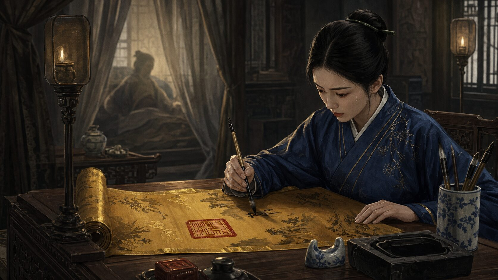
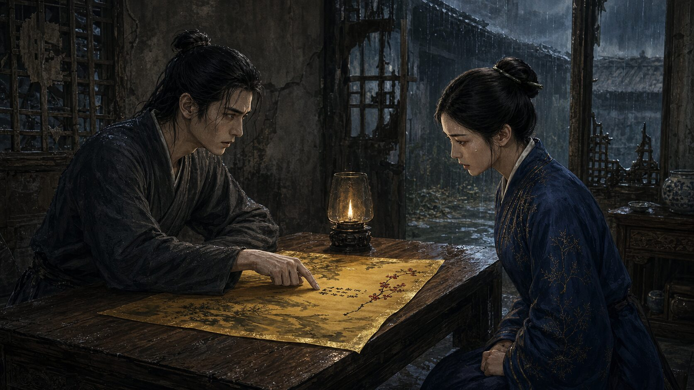
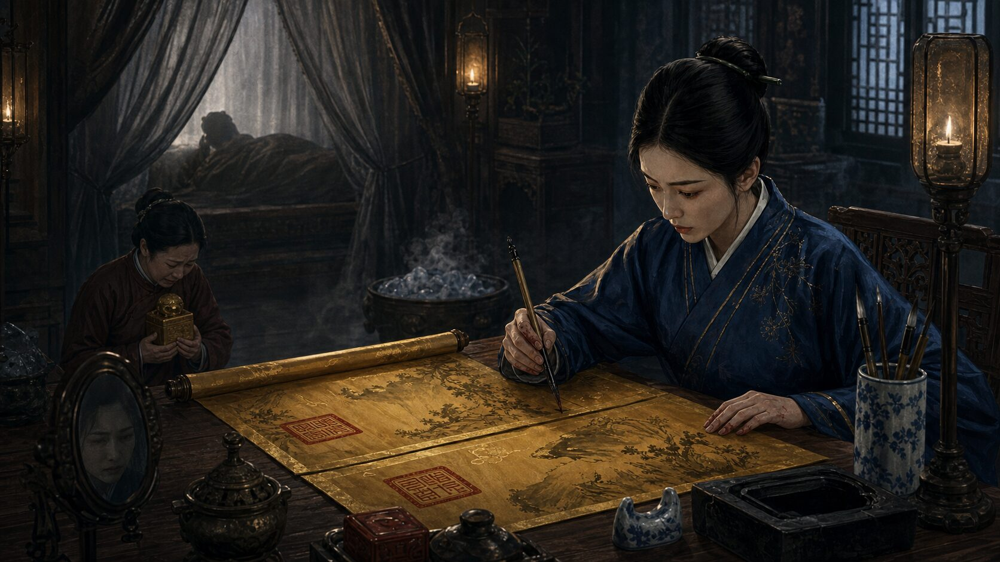
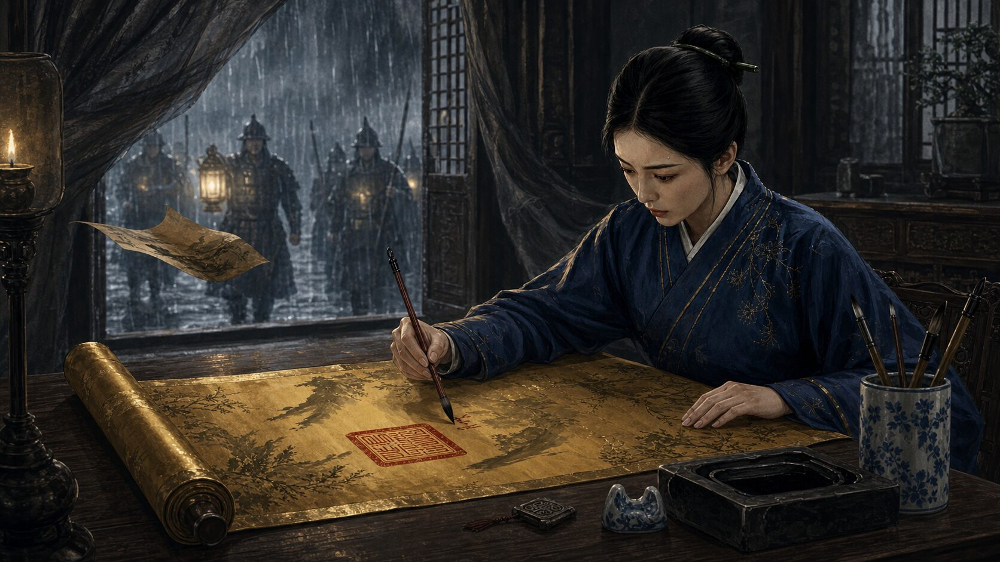

## 第一章：代筆

殿內瀰漫著一股濃重而苦澀的藥氣，夾雜著龍涎香燃盡後的死灰味。重重幃幔將日光死死擋在殿外，唯有幾盞長明燈在風中搖曳，將宮牆上的影子拉得極長，如同一隻隻潛伏在暗處的巨獸。

　　陸行微跪在青磚地上，額頭緊貼著冰冷的水磨石。膝蓋的酸麻早已轉為針扎般的刺痛，但她連呼吸都刻意壓得極低。

　　「陸女史，起來吧。」

　　說話的是掌事姑姑雙喜，聲音壓得極低，透著一股不容置疑的緊繃。

　　陸行微直起腰，垂著眉眼，起身的動作沒有一絲聲響。她的視線只落在雙喜的繡鞋上，跟著那抹絳紅色的裙擺一步步繞過八寶琉璃屏風，走進了皇后的寢殿深處。

　　榻上的重幃半掀，隱約可見一個清瘦削骨的身影。昔日母儀天下的王皇后，此時正無力地靠在迎手枕上，臉色蠟黃，眼窩深陷，唯有一雙眼睛在昏暗中亮得驚人，死死盯著緩步走近的陸行微。

　　「女史陸行微，叩見娘娘。」陸行微再次跪倒。

　　「免了。」王皇后的聲音沙啞乾枯，像是兩塊粗糙的砂紙在摩擦，「抬起頭來。」

　　陸行微微微抬頭，目光停留在皇后下頜處。

　　「本宮聽說，妳在內閣掌管誥敕，最擅模仿筆跡。前年太后壽辰，百官賀表裡的真跡殘缺，是妳補齊的？」王皇后一邊說，一邊劇烈地咳嗽起來，雙喜連忙上前撫背遞茶。

　　陸行微垂眸答道：「回娘娘，微臣粗通書法，臨摹之技，不過是工整而已，不敢欺瞞娘娘。」

　　王皇后擺了擺手，示意雙喜退下。她用乾枯如柴的手指指了指不遠處的紫檀木長案，案上早已備好了文房四寶，還有一疊明黃色的空白絹帛。

　　「去那裡坐下。」王皇后喘息著，眼中閃過一抹複雜的光芒，「北境的折子，妳看過了嗎？」

　　陸行微心頭一凜。她是寒門出身的女史，平日只負責謄抄無關痛癢的儀制文書，北境防線告急、鎮邊大將穆海起兵逼宮逼餉的軍情，絕非她這個身份所能知曉。

　　「微臣……略有耳聞。」

　　「穆海率十萬大軍，已過青嶺關，名為『清君側』，實為要挾朝廷。」王皇后冷笑一聲，笑聲中帶著幾分淒涼，「聖上病重，朝廷無銀可撥。內閣那幫廢物只會主和，卻不知穆海要的不是銀子，是本宮母族的命。朝廷要本宮下一道懿旨，安撫穆海，命他退兵。」

　　陸行微靜靜地聽著，手心漸漸滲出冷汗。這種軍國大事，一旦落筆，便是千鈞之重。

　　「本宮的右手已經握不住筆了。」王皇后看著自己微微發抖的五指，目光冷厲地射向陸行微，「從今日起，妳就是本宮的右手。本宮唸，妳寫。若有半點差池，或是洩露了半個字，陸家滿門，連同妳那尚在國子監的兄弟，皆會死無葬身之地。」

　　「微臣明白。」陸行微深吸一口氣，走到長案前坐下。

　　她閉上眼，腦海中迅速浮現出王皇后往日的字跡。皇后的字承襲衛夫人，看似娟秀，實則骨力挺拔，字裡行間帶著一股將門女子的英武與決絕。

　　陸行微睜開眼，提起紫毫筆，沾飽了徽墨。

　　王皇后靠在榻上，合上雙眼，緩緩吐字：『皇帝體恤將士，邊防艱苦。將軍世受國恩，當思報效。今北境互市已開，餉銀已在籌措之中，將軍宜即刻勒馬北返，拱衛京畿……』

　　陸行微落筆如飛，絹帛上頓時呈現出一行行鐵畫銀鉤的字跡。那字跡與王皇后平日的懿旨如出一轍，甚至連起筆時習慣性的微微一頓、收筆時的鋒芒畢露，都模仿得惟妙惟肖。

　　寫到「將軍宜即刻勒馬北返」時，陸行微的手指猛地一顫。

　　她聽聞過朝中對穆海的傳言，穆海此番起兵，名為「清君側」，實則是因其子在京中受制於皇后母族，穆海本人已然騎虎難下。朝廷如今既拿不出餉銀，若在懿旨中以「宜」字施加強硬命令，只怕會激得穆海以為朝廷要對其子痛下殺手，逼得他玉石俱焚。

　　但若是給他一個台階？

　　「望將軍即刻勒馬北返。」

　　「望」字，在朝廷公文中極少對臣下使用，帶著幾分期許與示好，甚至隱含了一絲朝廷願意退讓協商的空間。這不僅僅是語氣的溫和，更是一個政治信號——皇后母族或許願意在京中做出讓步。

　　然而，擅改懿旨是株連九族的大罪。陸行微看著那行未乾的墨跡，耳畔是榻上皇后沉重如拉風箱般的喘息聲。她不知道穆海看到這個字究竟會如何反應，更不知道自己這一筆落下去，究竟是能救命，還是會立刻招來殺身之禍。

　　冷汗順著她的鬢角滑落，滴在紫檀木案上。她牙關緊咬，在極度的恐懼與一絲近乎瘋狂的賭徒心態下，手腕微沉，避開了原本要寫的「宜」字，落筆寫下了一個端正挺拔的「望」字。

　　「寫好了？」皇后的聲音傳來。

　　陸行微屏住呼吸，迅速吹乾墨跡，捧起絹帛走到榻前。

　　王皇后睜開眼，借著雙喜手持的燈盞，仔細審視著上面的字跡。她的目光在每一個字上掃過，最後停留在那個「望」字上。

　　殿內的空氣彷彿在這一瞬間凝固了。陸行微低著頭，能清晰地聽到自己胸膛裡瘋狂的撞擊聲。

　　過了許久，王皇后才緩緩閉上眼，發出一聲幽幽的嘆息。

　　「字寫得不錯，幾乎能以假亂真。」王皇后沒有提那個字，只是疲憊地揮了揮手，「用印吧。」

　　雙喜捧出沉重的皇后金寶，沉沉地壓在絹帛末端。硃砂鮮紅如血，印文在明黃的絹帛上顯得格外刺眼。

　　陸行微退下時，後背已被冷汗浸透。

　　三日後。

　　晨霧未散，內閣與兵部便傳來了震驚朝野的消息。

　　原本已逼近青嶺關百里之內的穆海大軍，在接到皇后懿旨後，竟在關前整整駐紮了一夜。次日拂曉，穆海下令大軍調轉馬頭，撤回北境防線。與此同時，穆海自降軍階，向朝廷上表謝罪，卻在折子裡隻字不提退兵的真正原因，只道「感念娘娘體恤之情」。

　　朝臣百官皆驚嘆於皇后懿旨竟有如此威嚴，能讓手握重兵的悍將退兵。

　　然而，在內閣的大堂內，幾位老臣正圍著那份送回存檔的懿旨副本，低聲私語。

　　首輔老臣指著上面的那個「望」字，眉頭緊鎖，聲音壓得極低：「穆海生性多疑，這次退兵，定是從這份懿旨裡看出了什麼。可你們看這『望』字，娘娘生性剛烈，且王氏與穆家積怨已深，娘娘怎會突然對穆海示弱？這不像是娘娘平日的行文做派。」

　　另一位閣臣湊上前，仔細端詳著墨跡，低聲道：「字跡確實無疑，但這字裡行間的意思……莫非坤寧宮裡有了別的聲音？」

　　首輔抬起頭，環視四周，眼中閃過一抹陰鷙的光芒。

　　「查。把這幾日進出過坤寧宮的記錄，原原本本地查清楚。」

## 第二章：病榻後的命令

坤寧宮的風，彷彿永遠帶著洗不淨的藥苦味。

　　陸行微再次站在紫檀木長案前時，掌心裡攥著一塊被汗水浸濕的素羅手帕。殿內的長明燈只點了兩盞，光線昏暗得讓人看不清帷幔後的虛實。

　　「陸女史，本宮今日要妳寫的，是一封給兵部侍郎的密信。」王皇后的聲音比三日前更為乾枯，聽起來像是落葉在地上拖曳，「穆海雖然退兵，但他的長子穆延仍在京中擔任羽林衛指揮同知。太后那邊，一直想動穆延，藉此斬斷穆海在京中的耳目。」

　　陸行微垂首站立，屏氣凝神。她聽著帳幔後那聲聲微弱卻冰冷的喘息，意識到皇后此舉並非出於婦人之仁。皇后是在保住北境的退兵承諾，也是在為王氏一族拉攏穆家這條最後的退路。若穆延在京中出事，穆海必然認定是皇后過河拆橋，屆時十萬大軍再度南下，王氏便再無轉圜餘地。

　　「本宮的母族已經在北境的事上退了一步。若是此時讓太后動了穆延，穆海定會以為是本宮出爾反爾，屆時北境再起狼煙，王氏一族便成了千古罪人。」王皇后的聲音陡然冷了下去，帶著一絲狠戾，「妳寫，命兵部侍郎暗中調度，將穆延明升暗降，調出羽林衛，送去巡防營。雖失了天子近臣的實權，但巡防營皆是本宮的人，能保他一命。」

　　「微臣領旨。」陸行微正欲提筆，卻聽得殿外傳來一聲細微的衣襴摩擦聲。

　　雙喜快步走了進來，臉色慘白，在皇后耳邊低語了幾句。王皇后的臉色瞬間陰沉得可怕，她冷冷地盯著陸行微，半晌才道：「陸女史，今夜妳便留宿在坤寧宮的東偏殿。沒有本宮的旨意，哪裡也不許去。」

　　夜半。

　　東偏殿的窗櫺被風吹得微微作響。陸行微和衣躺在窄榻上，根本無法入眠。白天王皇后那雙深陷的眼眸在她腦海中反覆出現，還有那個在懿旨中被她改動的「望」字。她知道，自己擅自改動的那一個字，已經在平靜的湖面投下了巨石。

　　突然，偏殿的木門被無聲地推開了。

　　進來的不是雙喜，而是一個面生的宮女。那宮女沒有帶燈籠，只憑著月光走到陸行微榻前，朝她打個手勢，聲音低得如同耳語：「陸女史，太后娘娘召見。」

　　陸行微心中一緊，緩緩坐起身。

　　她跟著那宮女穿過幽深黑暗的夾道，避開了巡夜的禁軍，最後進入了慈寧宮的佛堂。

　　慈寧宮內煙香繚繞，檀香的香氣濃烈得有些嗆人。太后身著一襲絳紫色佛衣，正背對著門口，手中一下又一下地撥動著紫檀佛珠。木珠碰撞的脆響，在空曠的佛堂裡顯得格外清晰，像是一聲聲催命的鼓點。

　　「奴婢陸行微，叩見太后娘娘，願娘娘萬福金安。」陸行微跪在蒲團旁，身子伏得極低。

　　太后沒有立刻叫起，佛珠轉動的聲音在寂靜中顯得無比漫長。

　　「那封退兵的懿旨，是妳寫的吧。」太后終於開口，聲音平緩、溫和，卻帶著一股不容抗拒的威壓。

　　「回太后，微臣只是遵照皇后娘娘的口諭，代為謄抄。」

　　「謄抄？」太后停下手中的佛珠，緩緩轉過身來。她保養得宜的臉上帶著一絲慈祥的笑意，但那雙鳳眼卻冷若冰霜。「王氏那丫頭是個什麼性子，哀家看著她進宮，最清楚不過。她生性剛愎，寧折不彎，若是她親口所授，絕寫不出那個『望』字。」

　　太后沒有多言，只是遞給身旁掌事姑姑一個眼色。姑姑將一本國子監的秋闈點名冊，以及一枚坤寧宮進出登記的腰牌，無聲地放在了陸行微面前的青石板上。

　　這兩樣東西，沒有一句威脅，卻將陸行微的軟肋與行蹤扣得死死的。

　　「陸行微，妳是個聰明人。」太后走到她面前，從袖中取出一張紙箋，遞到陸行微眼前。

　　陸行微接過紙箋，借著佛堂微弱的燭光看去，只见上面用極其秀麗的簪花小楷寫著一行行墨跡：『羽林衛指揮同知穆延，護駕有功，著即賜金樽，加封羽林衛指揮使，於今夜入大內面聖謝恩，並留宿宿衛。』

　　看著紙箋上的字，陸行微的心思飛速運轉。

　　「留宿宿衛」這四個字，在宮禁森嚴的大內是極大的禁忌。穆延一旦持這道懿旨入宮，便是自投羅網。但更深一層的是，這道旨意若蓋上坤寧宮的印璽，太后便能置身事外。事發之後，太后大可以「皇后擅召外臣、意圖不軌」為由，將謀逆的罪名死死釘在坤寧宮頭上。

　　這不單是為了殺一個穆延，而是要用皇后的印，替太后自己動手清除異己的後果背鍋，順帶將重病的王皇后徹底推向萬劫不復的深淵。

　　「去吧。」太后轉過身，重新撥動起佛珠，「哀家只看結果。」

　　陸行微將額頭死死扣在青磚上，喉嚨發乾：「微臣……遵旨。」

　　回到東偏殿時，天色已近拂曉。

　　她坐在床沿，手心沁出的冷汗漸漸風乾。她將那張帶著檀香味的紙箋藏入袖中，腦海中不斷對比著兩邊的命令。

　　皇后要她寫信給兵部，將穆延挪到巡防營，是以守為攻，試圖保全大局；太后要她寫懿旨召穆延入宮，是以退為進，試圖徹底奪取宮禁掌控權。兩道命令，背後的真正爭奪點不是穆延的生死，而是誰將在事後承擔欺君與謀逆的代價。

　　如果她照著任何一方寫下去，一旦事情敗露，她這個執筆的「右手」都注定是第一個被拋棄的替罪羔羊。

　　她不能再只是一個毫無知覺、任人擺佈的筆桿了。她必須在這兩道互相撕扯的命令中，找到一個能讓自己、也讓陸家活下去的夾縫。

　　天亮了。

　　雙喜推門進來，面色凝重：「陸女史，娘娘召見。筆墨已備好，該落筆了。」

　　陸行微站起身，整理了一下女史的青色官服，一步步朝主殿走去。她的目光落在那扇即將開啟的殿門上，藏在袖中的雙手緩緩攥緊。在這兩股即將相撞的權力漩渦面前，她已做好了準備，去在即將落下的筆跡裡，尋找自己的生路。

## 第三章：錯字

坤寧宮主殿的日光被厚重的鮫帳濾成了一種近乎病態的死白。王皇后今日的咳喘聲比昨日更低沉，每一聲都像是從乾癟的胸腔深處生生擠出來的，帶著令人心驚的衰竭。

　　陸行微跪在紫檀木長案前，身側是由雙喜親自把守的殿門。

　　「陸女史，落筆吧。」榻上傳來皇后沙啞的催促。

　　陸行微的袖子裡，還沉甸甸地壓著慈寧宮太后給她的那張紙箋。一邊是皇后要她寫給兵部侍郎保全穆延的密信，一邊是太后要她以皇后名義召穆延入宮的懿旨。兩道互相絞殺的命令，底牌都是穆家的十萬鐵騎與宮闈的生殺大權，而她不論落筆寫哪一份，都等於將自己的脖子套進了其中一方的絞索裡。

　　她提起筆，指尖冰涼。徽墨在硯台裡磨得極濃，散發出淡淡的松煙香。

　　「娘娘，」陸行微的聲音極低，卻字字清晰，「給兵部侍郎的密信，若要顯得是娘娘的親筆，行文便不能走內閣的公文套路，須得用娘娘母族私信的口吻。臣女僭越，敢問娘娘，平日與家中私信，可有特定的避諱或落款習慣？」

　　幃幔後沉寂了許久，只聽得見王皇后沉重的呼吸聲。那一瞬間，陸行微甚至聽到了自己緊繃的心弦幾乎要斷裂的聲音。

　　「本宮行文，向來不喜繁文縟節。」王皇后的聲音終於隔著帳幔傳來，透著一股冰冷的審視，「若給兵部侍郎那隻老狐狸寫信，開篇只寫『見字如晤』，結尾不落款，只畫一朵殘梅。那老狐狸認得本宮的墨梅。妳畫得出嗎？」

　　「微臣曾臨摹過娘娘早年墨寶，斗膽一試。」

　　陸行微深吸一口氣，將明黃的絹帛鋪開。

　　她知道，這封信不可能平安無事地送到兵部。太后的耳目遍布宮掖，尤其是與外臣的私密聯絡，慈寧宮定會全力截獲。如果她完全照皇后的意思寫，一旦被截獲，太后便會知道她並未順從，國子監的兄弟和陸家滿門難逃一死；若她寫了太后那份召穆延入宮的懿旨，王皇后一旦察覺，便會立刻將她當場打殺。

　　她必須在信中留下一個只有極少數人能看懂，卻能改變整封信性質的破綻。

　　王皇后早年出身將門，由廢太子李景的生母——已故的先溫皇后一手撫育長大。溫皇后生前極好王右軍筆意，尤其在寫「景」字時，因避諱其母族的名諱，習慣將「景」字下半部的「小」字，寫成一個帶倒鉤的雙點，且最末一筆微微上挑，形似一個暗記。王皇后承襲此法，早年與溫皇后宮中往來，皆以此字暗中辨識真偽。自從溫皇后暴卒、太子被廢，坤寧宮便再也沒有出現過這種寫法。

　　如果太后截獲此信，只會將其交由翰林院或內閣的謄抄官辨識筆跡。那些人只認得王皇后如今在懿旨上的公眾字體，看不出這個少女時期的隱祕習慣。

　　但若是熟悉溫皇后舊年筆法、或是對這樁宮闈祕事洞若觀火的人，便能一眼看出，這封信並非出於病榻上心力交瘁的王皇后之手，而是有人在刻意傳遞某種信號。

　　陸行微手腕微沉，紫毫筆尖落在絹帛上。

　　她落筆的字跡，依然是王皇后那骨力挺拔、將門英武的筆意。

　　『見字如晤。羽林衛同知穆延，邊將之子，留京甚久。今北境雖退，然防務未穩，穆延留於禁軍，終為隱患。宜將其調出羽林，移印巡防營，明升暗降，以安朝局……』

　　寫到「明升暗降，以安朝局」後，她微微一頓，接著寫道：『京中景況，不比往日，望將軍自珍。』

　　寫到「景」字時，陸行微的手指在半空中微微一滯。

　　她沒有寫尋常的「景」字。在落筆那一刻，她將字形最底部的「小」字，寫成了那個帶有倒鉤的雙點，收筆處往上極細地一挑，隨後用一滴極輕的墨點半遮住。

　　這不是朝廷公文裡的「景」，而是溫皇后當年在東宮所用的「景」。

　　寫完之後，她提起乾筆，在絹帛末端寥寥數筆，勾勒出一朵傲雪的殘梅。

　　她吹乾墨跡，將密信呈到榻前。

　　王皇后撐著身子坐起，雙喜小心地掀開帷幔。皇后那雙深陷的眼眸在微弱的燭光下顯得異常銳利，她一言不發地盯著那幅絹帛，目光在每一個字上緩緩掃過。

　　時間在寂靜中被無限拉長。陸行微伏在地上，感到膝蓋下的青磚冷得直往骨縫裡鑽。

　　皇后的視線落在「京中景況」四字上。她乾枯的指尖在那個隱蔽的墨點上停留了片刻，眉頭微微蹙起，似乎察覺到了什麼不尋常的痕跡，但此刻她的精神已是強弩之末，又一陣劇烈的咳嗽襲來，讓她不得不靠回枕上。

　　「字跡倒是一點沒變。」王皇后緊閉著眼，揮了揮手，「去吧，讓雙喜送出去。」

　　「是。」雙喜接過信，深深地看了陸行微一眼，轉身出了殿門。

　　陸行微回到東偏殿，整整一日一夜，她都坐立難安。

　　她站在窗前，看著宮牆上的雨水順著斑駁的磚縫蜿蜒流下。她不知道這封信能走到哪裡，也不知道是兵部侍郎先拿到信，還是太后的人先截獲它。她更不知道，那個字究竟會被當作一個普通的筆誤，還是會被解讀成最致命的政治信號。

　　這是一場賭博，而籌碼是她和家人的命。

　　第三日傍晚，天空下起了淅淅瀝瀝的小雨。

　　東偏殿的門被猛地推開，雙喜臉色鐵青地站在門口，身後跟著兩個面色陰沉的慈寧宮太監。

　　「陸女史，跟我們走一趟吧。」雙喜的聲音沒有一絲溫度，甚至帶著一絲隱約的顫抖。

　　陸行微心中一沉，暗道該來的終究來了。她整理了官服，默默地跟著太監穿過雨幕。

　　然而，她被帶去的方向，既不是坤寧宮的主殿，也不是慈寧宮，而是皇宮西北角最荒涼、最偏僻的照月軒。

　　那裡是禁錮廢太子李景的地方。

　　照月軒內雜草叢生，宮牆斑駁，雨水順著殘破的瓦片滴滴答答地落在石階上。殿內沒有掌燈，只有一扇破舊的窗櫺透進微弱的暮光，空氣中瀰漫著一股陳腐的霉味。

　　陸行微被推入殿內，木門在她身後沉重地合上。

　　在昏暗的殿角，一個身著灰色布衣的青年正席地而坐。他面前擺著一張粗糙的松木案，案上放著的，正是兩日前陸行微代筆寫給兵部侍郎的那封密信。

　　聽到動靜，青年緩緩抬起頭。他面容清癯，眼眸如同一潭死水，卻在看向陸行微的瞬間，閃過一抹銳利的光芒。

　　「妳就是寫這封信的人？」廢太子李景的聲音平靜得沒有一絲波瀾，卻帶著一種在深淵中磨礪出來的冷酷。

　　陸行微跪倒在地，雨水順著她的髮梢滴在冰冷的石板上：「女史陸行微，叩見殿下。」

　　李景修長的手指輕輕敲擊著那封密信，指甲在那個被墨點半遮的「景」字上摩挲著，發出微弱的沙沙聲。

　　「這封信送出不到半里地，就被慈寧宮的密探截了。」李景看著陸行微，嘴角勾起一抹自嘲的笑意，「太后懷疑母后試圖用這封信聯絡兵部，更懷疑這信中提到的『京中景況』是在指代孤。她特意派人把這信送來照月軒，藉口是讓孤代她『辨識』母后的真跡，實則是想逼孤指認母后有謀逆之心，好給王家定罪。」

　　李景緩緩站起身，走到陸行微面前。

　　「太后和她身邊的翰林學士，都說這是母后的親筆，絕無二致。太后以此認定，母后已然聯絡外臣。」他居高臨下地看著她，眼神在昏暗中明滅不定，「可孤認得這個『景』字。母后自孤九歲被廢、先母后暴卒之後，便在孤面前發誓，此生絕不再寫先母后的避諱字，以免招來殺身之禍。她寧可將『京中景況』寫成『京中時局』，也絕不會落這一個『景』字。」

　　他微微前傾身體，聲音陡然壓低，帶著一絲令人毛骨悚然的寒意。

　　「陸女史，妳在信裡留下這個只有孤和母后才知道的廢字，是想告訴太后孤不安分，還是想告訴母后，妳已經知道了她們的底牌？」

## 第四章：紙上的皇后

照月軒內的霉味被雨水激得更加刺鼻。冷風從破落的窗櫺灌進來，吹得案上的絹帛獵獵作響。

　　陸行微伏在地上，額頭緊貼著粗糙的石板。雨水與冷汗混在一起，順著她的鼻尖滴落在地。

　　「這封信送出不到半里地，就被慈寧宮的密探截了。」李景看著陸行微，手腕微晃，將那幅明黃色的絹帛湊近了松木案上的燈火。微弱的火苗瞬間吞噬了明黃色的綢緞，焦黑的灰燼在風中四散，將那個隱祕的「景」字與殘梅一同化為虛無。「孤告訴送信來的太監，此信字跡確為母后真跡，絕無二致。孤還說，母后思慮憂深，字裡行間已現油盡燈枯之兆。」

　　陸行微閉了閉眼，低聲道：「謝殿下不殺之恩。」

　　「孤不過是說了太后想聽的實話。」李景看著飛散的灰燼，聲音冷淡，「太后要的只是一個向王家發難的藉口，孤若在此時多言，只會先被祭旗。陸女史，往後的路，妳自己走。」

　　殿門被粗暴地推開。慈寧宮的太監不耐地站在門外，尖聲道：「陸女史，辨識完了就別耽擱。太后娘娘還在慈寧宮等著呢。」

　　陸行微沒有回頭看李景，低著頭退出了照月軒。

　　回到慈寧宮時，夜色已深。太后依然坐在佛堂前，殿內燃著濃重的沉香，將方才照月軒的霉味洗滌得一乾二淨。

　　「廢太子認過了？」太后連眼睛都沒睜開，只是有一下沒一下地撥動著佛珠。

　　「回太后娘娘，廢太子殿下看過密信，神色惶恐，叩首認罪，道是皇后娘娘親筆無誤。」陸行微跪在地上，聲音恭順至極。

　　「好。」太后加重了撥動佛珠的力道，發出沉悶的聲響，「王氏那丫頭病得糊塗，竟想私調穆延以自保。既然她如此器重穆延，哀家便如她的願——傳旨加封穆延為羽林衛指揮使。穆延一旦接旨，便是天子近臣，哀家倒要看看，他守在御前，北境的穆海還敢動什麼心思。若是穆海仍有異動，穆延便是第一個要被拿下的叛逆。」

　　太后睜開眼，那雙鳳眼中閃過一絲冷意：「明日早朝前，哀家要看到坤寧宮發出兩道懿旨。一道駁回內閣請安，以皇后病體沉重、不便見客為由推拒；另一道，則是賞賜北境將士、加封穆延的懿旨。兩道旨意，皆要用坤寧宮的寶印，妳知道該怎麼寫。」

　　陸行微的脊梁骨陡然升起一股徹骨的寒意。這兩道懿旨一旦蓋上坤寧宮的印璽，便意味著她必須替太后完成這場謀劃。她伏在地上，喉嚨乾澀：「微臣……遵旨。」

　　「去吧。好好伺候著。」

　　陸行微退下佛堂，踩著一路的冷雨回到坤寧宮。

　　然而，當她跨進坤寧宮大殿的那一刻，迎面而來的不是熟悉的藥氣，而是一股令人窒息的死寂。重重幃幔後，沒有了那拉風箱般的沉重喘息聲。

　　雙喜木然地站在榻前，雙眼通紅，手中攥著一條白綾。

　　榻上的王皇后，雙眼圓睜，乾枯的雙手死死抓著錦被，早已沒有了呼吸。那一雙曾經亮得驚人、充滿戾氣與不甘的眼睛，此時正空洞地盯著漆黑的殿頂。

　　「陸女史，」雙喜轉過頭，聲音沙啞得不似人聲，「娘娘在半個時辰前嚥了氣。臨終前，她只留下一句話。」

　　陸行微看著榻上那具漸漸冰冷的屍體，喉嚨像被什麼東西死死堵住：「娘娘……說了什麼？」

　　「娘娘說：『告訴陸行微，這筆，她停不得。』」

　　殿外的風雨在這一刻猛烈地撞擊著窗櫺，發出刺耳的巨響。

　　太后的命令、死去的皇后，還有正等著旨意的北境大軍……陸行微看著榻上的死者，又看了看自己那雙因為握筆而磨出薄繭的雙手。

　　「陸女史，」雙喜捧過一疊嶄新的明黃絹帛，無聲地跪在陸行微面前，眼中閃爍著瘋狂而絕望的光芒，「該落筆了。」

　　陸行微緩緩走到紫檀木案前坐下。她看著那張明黃的絹帛，深深吸入一口帶有死氣的冷冽空氣。

　　手腕在半空中微微顫抖，但當筆尖觸及絹帛的瞬間，她的手奇蹟般地穩了下來。

　　第一道懿旨，是給內閣的。

　　『本宮體氣不和，近日倍覺神思懨懨，百官請安、內閣議政，皆暫免朝見。宮中內務，悉聽太后裁奪……』

　　字跡骨力挺拔，一如往常般帶著將門女子的傲骨。陸行微寫完，吹乾墨跡。雙喜顫抖著捧出皇后金寶，沉沉地壓在絹帛末端。硃砂鮮紅如血，在長明燈下顯得格外刺眼。

　　接著是第二道，加封穆延的懿旨。

　　陸行微提起筆，這一次，她的筆尖更加決絕。

　　『羽林衛指揮同知穆延，世受國恩，忠藎克茂。著即加封羽林衛指揮使，宿衛宮禁，以昭朝廷優敘之典……』

　　兩道懿旨送出坤寧宮時，天剛破曉。

　　晨霧之中，首輔老臣正領著百官在坤寧宮外候旨。當雙喜捧著那道駁回請安的懿旨走出殿門，交到首輔手中時，首輔展開絹帛，仔細端詳著上面的字跡。

　　「確實是娘娘的真跡。」首輔嘆了口氣，看著那鐵畫銀鉤的字體，並未發現任何異樣，隨後躬身道，「臣等遵旨，請娘娘安心調養。」

　　與此同時，另一道旨意送達羽林衛所。穆延跪地接旨，雙手顫抖。他看著懿旨上那熟悉的筆意，心中雖有萬般疑慮，卻不得不叩首謝恩，於當日黃昏按旨入宮宿衛，將自己置於天子近臣的危牆之下。

　　三日過去，坤寧宮的門禁愈發森嚴，慈寧宮調派的侍衛將殿宇圍得水洩不通。殿內，王皇后的屍身被雙喜用冰塊與香料暗中保存，藏於重重幃幔後的陰冷夾道中。

　　而陸行微，就坐在這具漸漸冰冷的屍骨旁，日復一日地握著筆。

　　太后送來的條子源源不斷。有的是調度後宮開支，有的是提拔慈寧宮的親信，更有的是在內閣與兵部的摺子上，以皇后的名義批復「知道了」或「依議」。

　　每一道旨意，都經由陸行微的手，化為王皇后的親筆。

　　百官只看見坤寧宮的硃砂與筆跡依然如舊，穆海的大軍在北境因為穆延在京的「重用」而暫時按兵不動，朝局在一片詭異的平靜中維持著微妙的平衡。

　　夜深人靜，陸行微看著鏡中的自己。她的臉色在長明燈下顯得如紙般蒼白，眼角眉梢竟不知何時多了一絲王皇后生前的冷厲。

　　她看著自己沾滿硃砂與墨汁的手指，突然感到一陣徹骨的荒涼。

　　躺在榻上的那個人早就沒了呼吸，但只要她的手還能動，這張紙上的「皇后」，就依然在統治著整個大齊的江山。

## 第五章：最後一道懿旨

坤寧宮主殿內的冰塊已經換了三輪。即便有濃烈的西域冰片與芸香掩蓋，空氣中依然浮動著一絲若有似無的腐朽之氣。那氣味極淡，卻黏稠得像洗不淨的血跡，附著在重重幃幔與金磚縫隙裡。

　　這座宮殿的主人已經死去半月有餘，但她依然「活」在陸行微的筆下。

　　「女史，慈寧宮又送條子來了。」雙喜的腳步聲極輕，端著一盞參茶走近，臉上的神色近乎麻木。她身後跟著一個慈寧宮的掌事太監，將一疊寫滿字跡的宣紙按在紫檀案頭，皮笑肉不笑地打了個千：「陸女史，太后娘娘說了，北境的穆海老將軍在邊境操練兵馬，動向有些不明。這道旨意，得用皇后的語氣寫得再疾言厲色些，命穆延親自去城外閱兵，以安軍心。」

　　陸行微低頭看著那張條子。

　　太后的算盤打得極響。北境穆海大軍已隱隱察覺京中異動，若此時讓穆延出城閱兵，名為「安撫」，實則是把穆延架在城牆上當肉靶子。只要穆延一出羽林衛的深宮禁苑，太后的人便可在城外以「突厥刺客」或「亂軍衝突」為由，無聲無息地除掉他。一旦穆延橫死，穆海在邊境必反，屆時朝廷便有足夠的理由發兵平叛，徹底清洗穆家與王皇后的殘餘勢力。

　　這是一張已經拉滿的弓，而她陸行微的筆，就是扣動扳機的最後一根手指。

　　「公公請回，微臣即刻落筆。」陸行微聲音平靜，沒有一絲波瀾。

　　待那太監退下，雙喜有些脫力地靠在案旁，低聲道：「女史，穆延將軍昨夜暗中遣人送信到宮牆外，說穆老將軍在邊境已然按捺不住，若再不見皇后娘娘親筆信物，他便要親率三千輕騎直叩京門。太后此番逼穆延出城，穆延定然也看出了凶險，他已做好了魚死網破的準備。」

　　陸行微提著筆，徽墨在硯台裡磨得極濃。她盯著那張條子，指腹輕輕摩挲著冰涼的筆桿。

　　太后與王皇后爭鬥一生，如今王皇后已死，太后急於收尾，手段愈發不顧後果。然而，若是穆海起兵，穆延被殺，北境十萬鐵騎長驅直入，京城只會淪為一片廢墟。不論是太后垂簾，還是王氏復辟，在這場滔天的兵禍面前，都將化為齏粉。

　　她閉上雙眼。她知道自己在做什麼。她依然在利用皇后的名義，在製造虛假的權力文本。這是矯詔，是誅九族的大罪。但她已經沒有選擇，如果繼續聽從太后的命令寫下去，她一樣會被當作廢棄的棋子抹去；如果就此封筆，迎來的便是京城的血雨腥風。她必須在這一筆中，將所有的權力拉回真實的軌道，哪怕代價是她自己。

　　「雙喜，把那枚照月軒的腰牌拿來。」陸行微睜開眼，聲音冷靜得不帶一絲起伏。

　　雙喜一驚：「女史，妳要做什麼？」

　　「既然太后要用皇后的名義下一道死令，那我便給她一道真的。」陸行微鋪開了最後一張空白的明黃絹帛。

　　她深吸了一口氣。這半月來壓抑在心頭的恐懼、掙扎與荒涼，在這一刻沉澱為手腕上無比沉穩的力道。她的右手不再顫抖，字跡依舊是王皇后那骨力挺拔、將門女子的筆意，但字裡行間，卻多了一種冷冽的決絕。

　　她沒有寫直白的控訴，而是用極其規整的宮廷文書筆調，寫下一道充滿政治張力的最後懿旨：

　　『坤寧宮懿旨。本宮體氣衰竭，自知不起，特詔告中外。自今上抱恙，朝政多舛，太后垂簾，本意在安社稷。然近日京畿調兵頻繁，北境守將穆海忠藎，其子穆延宿衛京師，動輒得咎，實非朝廷懷遠撫近之意。本宮崩後，宮掖若有以本宮名義所發之詔令，皆屬矯偽。著兵部即刻釋放照月軒廢太子李景，迎立監國，以協理朝政。穆延、穆海當恪守臣節，輔佐監國，不得擅動兵戈。』

　　這道旨意沒有直接指控太后謀逆，卻點明了「宮中有矯偽之詔」與「本宮崩後」的事實，將太后後續所有可能發布的命令徹底鎖死在「虛假」的陰影中，同時給了穆氏父子與廢太子李景最為合法的聯合契機。

　　寫到這裡，陸行微的手指微微一頓。她看著那行鐵畫銀鉤的字跡，心中突然感到一陣前所未有的輕鬆。

　　她沒有在懿旨裡為自己求任何退路，也沒有提到「代筆女史」該當何罪。

　　在絹帛的最末端，她沒有像以往那般不落款，而是提起硃砂筆，在皇后的金寶大印旁，以自己原本的書風——那清秀而略顯單薄的寒門簪花小楷，一筆一劃、端端正正地寫下了自己的名字：

　　『內閣掌誥敕女史，陸行微，代筆書。』

　　最後一個字落下，她輕輕吹乾了硃砂與墨跡。

　　「雙喜，用印。」

　　雙喜手手抖得厲害，幾次險些將皇后的金寶大印摔落。當那抹鮮紅如血的硃砂沉沉地壓在「陸行微」三個字上時，陸行微知道，自己的命運已與這張絹帛一同定格。

　　「女史，這懿旨一旦送出去，慈寧宮那邊……」雙喜眼眶濕潤，聲音哽咽。

　　「照原計劃辦。」陸行微的聲音聽不出情緒，「把這道旨意分成三份。一份用坤寧宮信鴿傳給城外的穆海，一份交給穆延即刻入照月軒救出廢太子，最後一份……妳親自送去午門前的通政司，當眾宣讀。」

　　雙喜跪倒在地，重重地叩了三個頭，隨後抱起懿旨，無聲地消失在坤寧宮的雨幕中。

　　大雨終於傾盆而下，將整個禁城籠罩在一片白茫茫的雨霧中。

　　陸行微獨自坐在紫檀木案前。她將桌上的硃砂、徽墨、紫毫筆一一整理整齊，隨後換上了自己入宮第一天穿的那件青色女史官服。

　　殿外傳來了密集的腳步聲，夾雜著金屬甲冑的碰撞聲與太監刺耳的驚呼。

　　慈寧宮的禁軍破門而入，將坤寧宮重重圍困。

　　領頭的內侍看著端坐在案前的陸行微，臉色鐵青，手中顫抖著那份在通政司被當眾宣讀的懿旨抄件：「大膽陸行微！妳竟敢矯詔欺君，誣衊太后！來人，給雜家拿下！」

　　陸行微緩緩站起身，神色平靜地伸出雙手。

　　冰冷的鎖鏈拷在她布滿墨痕的腕上，發出清脆的聲響。她沒有任何辯解，只任由禁軍將她拖出坤寧宮，在滿天冷雨中步入天牢。

　　與此同時，通政司前，那份由雙喜拼死送出的懿旨抄本已在百官與禁衛軍中傳開。皇后的死訊與代筆女史的署名，如同晴天霹靂，震得整個朝廷嗡嗡作響。

　　穆延在接到懿旨的瞬間，沒有絲毫猶豫，立刻以「護衛中宮」為名，率領心腹羽林衛封鎖了大內通道。他持著懿旨，帶著親兵直奔照月軒。

　　照月軒的木門被粗暴地踹開，塵土與雨水一同湧入。

　　李景依然席地而坐，看著出現在門口的穆延，以及他手中那幅蓋有皇后金寶與陸行微署名的懿旨。

　　「殿下，」穆延單膝跪地，聲音低沉，「坤寧宮懿旨，王皇后已薨。太后秘不發喪，矯詔亂政。請殿下出軒監國，以正朝綱。」

　　李景接過那幅絹帛，目光落在最末端「陸行微」三個清秀的小楷上，手指微微收緊。「她終究是落了這一筆。」李景長長地吐出一口氣，站起身，「走吧，去宣德門。」

　　宣德門外，百官齊聚，雨水將他們的官服淋得濕透。

　　太后身著紫色佛衣，在數百名內侍與慈寧宮禁衛的簇擁下，面色陰鷙地站在城樓上。城樓下，是穆延的羽林衛與聞風而動的兵部人馬。兩股勢力在雨幕中對峙，刀劍出鞘，寒光凜冽。

　　「李景，妳這逆子，竟敢勾結逆臣，矯詔逼宮！」太后的聲音在雨幕中顯得有些尖銳。

　　李景站在宣德門下，高舉那幅明黃色的懿旨：「太后娘娘，坤寧宮王皇后已於半月前薨逝，屍骨至今仍在坤寧宮夾道。此乃內閣女史陸行微親筆代書之最後遺詔，上面有皇后的金寶，亦有陸女史的真跡署名。百官皆知陸女史擅臨摹，若此詔為假，大可召陸女史出庭對質，辨識其筆跡真偽！」

　　首輔老臣顫抖著上前，借著隨從撐起的雨傘，仔細審視著穆延呈上來的懿旨。他看著那行鐵畫銀鉤的字，再看著旁邊那行簪花小楷，老淚縱橫：「這……這字跡，確實是王皇后的風骨，而那署名……亦是陸女史的親筆。太后娘娘，皇后娘娘究竟是否安在，老臣請開坤寧宮宮門驗視！」

　　「放肆！」太后怒喝。

　　城樓下的禁衛軍看著那幅赫然寫著女史名字的懿旨，以及廢太子李景的身影，面面相覷，握著兵刃的手漸漸鬆了下來。皇后的死訊與代筆的真相一旦揭開，太后便失去了最合法的權力來源，而穆延的手中，正握著禁軍的半數兵權。

　　宮外急報接踵而至，北境大將穆海率領的三千輕騎，已持著同樣的懿旨，在京郊十里外駐紮。雙方都在權衡，都在計算這道懿旨背後的政治代價。

　　數月後。

　　北境的風沙漫天，吹得驛道旁的野草沙沙作響。

　　一輛破舊的馬車在夕陽下緩緩行駛，拉車的老馬噴著響鼻，蹄聲單調而沉重。

　　陸行微身著粗布麻衣，靠在車輿旁。她的右手因為在獄中受過刑，有些微微的發抖，再也拿不穩沉重的紫毫筆了。但她的眼神卻比在坤寧宮時清亮了許多，看著窗外廣袤的原野，唇角帶著一絲釋然的笑意。

　　新帝登基後，為了維護皇家體面，並未將「代筆欺君」的全部細節公之於眾，只在史書上草草記下一筆：『有女史陸氏，亂筆矯詔，以亂朝綱，流放北境。』

　　後世史官稱她為「亂筆女史」。

　　馬車在一處邊境小鎮的茶棚旁停了下來。

　　陸行微走下車，要了一碗粗茶。茶棚內，幾個行商正圍坐在一起，其中一人從懷中小心翼翼地掏出一張泛黃的紙頁，低聲讀著：「……望將軍與殿下戮力同心，清君側，安社稷，解兵戈之災，保百姓無虞。內閣掌誥敕女史，陸行微，代筆書。」

　　「這就是當年坤寧宮傳出來的真跡？」

　　「那可不，要不是陸女史這最後一道旨意，北境的鐵騎早就把京城踏平了，咱們這幫腦袋還能安穩在脖子上？」

　　陸行微端著茶碗，靜靜地聽著。

　　風沙吹過，將商人們手中的紙頁吹得微微發響。

　　她低頭看了看自己那隻微微顫抖的右手，隨後端起茶碗，仰頭一飲而盡。

　　史書上的文字是冷冰冰的墨跡，但這世間的生靈，卻真真實實地活了下來。這對她而言，便已足夠。

