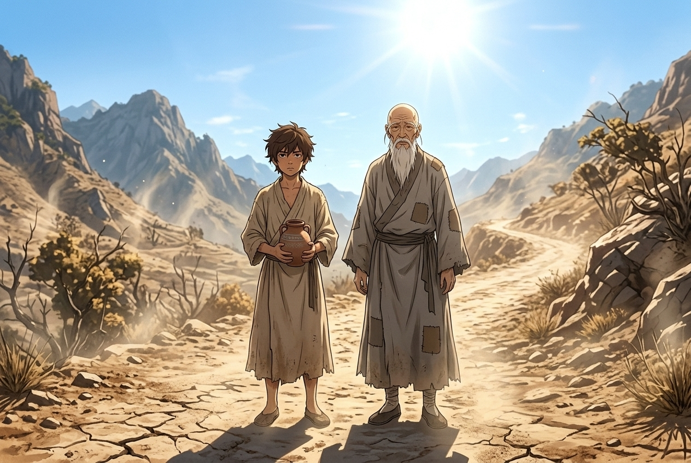
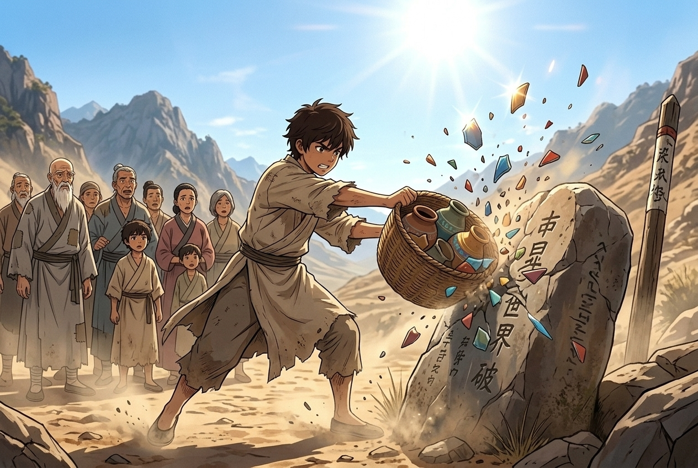

## 第一章：第一罐雨

雲散得太乾淨，天穹便顯得有些單薄，像是一層薄而脆的青瓷，經不起烈日再曬幾日。

阿澗站在乾裂的田埂上，泥土在他草鞋底下碎成細小的粉塵。四周的稻葉早已不再翠綠，邊緣焦黃，乾癟地垂掛著，像無數隻在風中嘆息的枯乾手指。空氣裡瀰漫著泥土被烤焦的腥氣，每一次呼吸都像是吞下一口帶砂的熱風。

老借雨師站在他身側，乾枯的手指撫摸著一隻青灰色的陶罐。那罐子粗糙得很，連釉都沒上好，表面還殘留著捏陶時留下的指紋。

「阿澗，拿著。」師父的聲音像落葉掠過石板，沙啞而輕。

阿澗雙手接過雨罐。罐子比想像中要沉，入手處冰涼沁骨，隱約能聽見裡面有細微的潮汐聲，彷彿裡面正關著一整座夏日的湖泊。那一瞬間，少年的心猛地漏跳了一拍。無數個在烈日下挑水挑到肩膀脫皮的午後，無數次看著村人對天哀求的無助，彷彿都在這沉甸甸的陶罐中找到了出口。他不再是那個只能看著乾旱嘆氣的學徒了，從今天起，他將是能安撫這片土地的借雨師。他手指不自覺地扣緊了罐身，掌心滲出一層溫熱的汗。

「揭開蓋子，對著風。」師父退後半步，雙手攏進寬大的袖子裡，神色平靜地望著遠處乾涸的群山。

阿澗深吸一口氣，壓下胸膛裡如鼓的跳動。他用顫抖的右手撥開木塞。

那一瞬間，陶罐的口部吐出一股極淡的白霧。霧氣並不急著散去，而是像有生命般貼著地面蔓延，將焦黑的泥土染上一層深色。天空似乎感應到了什麼，原本亮得刺眼的日光微微一暗，幾片薄薄的雲影從山頭那端生了出來，層層疊疊地往村落上空聚攏。

阿澗閉上眼，聽見了風聲的轉變。風裡開始有了潮濕的甜味。

「沙……沙……」

第一滴雨落在阿澗的額頭上，涼得他打了個激顫。接著是第二滴、第三滴，雨點敲擊在乾枯的稻葉上，發出清脆的琵琶聲。

「下雨了！真的下雨了！」

田埂遠處傳來村民的歡呼聲，幾名農夫衝出茅草屋，張開雙臂迎接著天空落下的水滴。雨勢並不大，只是一場輕柔的細雨，如煙如霧地籠罩著整片乾涸的土地。

阿澗看著雨水滲入乾裂的泥縫，將土地重新黏合，看著那些垂死的稻稈在雨中慢慢挺直了腰桿。狂喜之後，一股前所未有的自豪感在心中油然而生。他挺起胸膛，感受到全身的血液隨之沸騰——這場雨是他帶來的，是他手裡的陶罐拯救了這片幾乎乾枯的家園，他是村民的恩人。他攥著雨罐的手指因用力而微微發白，嘴角抑制不住地往上揚，迎著雨絲仰起臉，任由涼爽的水氣撲在面頰上，聽著四野傳來的歡笑，沉浸在身為借雨師的驕傲之中。

他得意地將木塞重新塞回罐口，轉頭看向師父，正想討句誇獎，卻發現師父的目光穿過煙雨，落在村頭老槐樹下。

那裡坐著村裡的老人阿良公。此時，阿良公正有些茫然地摸著自己的額頭，任由雨水打濕他稀疏的白髮。

這時，一個十五六歲的少年從村道上急匆匆地跑來，手裡撐著一把破爛的油紙傘，一邊跑一邊喊：「爹！下雨了！快回屋躲雨，別著涼了！」

少年跑到阿良公身前，細心地扶起老人，將傘大半遮在老人頭上。

阿良公卻沒有立刻起身。他轉過頭，眨著混濁的雙眼，打量著眼前這個氣喘吁吁的兒子。他的眼神裡帶著一絲遲疑與疑惑，像是努力要在腦海中拼湊出某個關鍵的片段。

「我的兒啊，」阿良公縮了縮肩膀，有些侷促地笑了笑，手掌撫上少年的臉頰，聲音卻帶著一絲心虛的顫抖，「爹自然知道你是我的好兒子……可爹這腦子，怎麼突然想不起，你叫什麼名字了？」

少年扶著老人手臂的手僵住了，雨水順著破傘的邊緣滴落在他的肩膀上。他呆呆地看著自己的父親，臉上的笑容一點點凍結。

站在田埂上的阿澗，手裡雨罐的冰冷涼意彷彿順著手臂蔓延到了全身，他嘴邊的笑意也漸漸淡了下去。細雨打在青灰色的雨罐上，發出冷清的滴答聲，而他心中的自豪與溫度，不知為何竟隨之冷卻了下來。

---

## 第二章：被扣除的記憶

那場雨來得快，去得也快。雲氣散去時，日頭又重新逼了出來，將空氣裡那點微弱的潮濕迅速榨乾，只留下泥土吸飽水分後吐出的腥熱。

阿澗抱著雨罐走在後面。不知道是不是錯覺，那隻原本帶給他無上自豪的青灰色陶罐，此時在他懷裡沉得像裝滿了鐵砂。

老借雨師的腳步有些蹣跚，寬大的麻布袖子在熱風中乾癟地飄動。他沒有回頭，每一步都精準地避開了剛剛淋濕的泥濘，只走在那些最乾燥、最堅硬的石子路上。

「師父……」阿澗終於忍不住開口，聲音乾巴巴的，「阿良公剛剛，不認得小山了。他說他不記得兒子的名字了。」

老借雨師沒有停步，只是發出一聲極輕的鼻息，像是一片枯葉被風吹落在地。

「年紀大了，忘些事情也是常有的。」

「不對。」阿澗快步搶上前，攔在師父的面前。他抱著罐子，看著師父那張溝壑縱橫、如同乾裂土地般的臉，「以前阿良公連去年的穀價都記得清清楚楚。而且……就在雨落下來的那一刻，他就突然想不起來了。師父，您先前說過，每一口雨罐都有它的脾氣，那我們帶來的雨，到底是從哪裡來的？」

老借雨師停下腳步。他看著阿澗，那雙混濁的眼睛裡沒有往日的溫和，只剩下一種近乎麻木的冰冷。他伸出枯槁的手指，輕輕敲了敲阿澗懷裡的陶罐。

「咚。」

罐身發出一聲沉悶的低鳴。阿澗的心口隨著這聲甕響猛地一抽。他低下頭，聽見罐子裡原本澎湃的潮汐聲似乎變了，那一聲聲的水浪裡，竟夾雜著細碎的、黏糊糊的囈語，像是無數人在睡夢中徒勞地囈語，想抓住些什麼，卻只能任由水流沖刷而去。

「阿澗，你覺得，天老爺憑什麼要聽你的？」老借雨師的聲音很輕，卻像是一記重錘擊在阿澗胸口，「這天底下，沒有平白無故的甘霖。你手裡的雨，是拿東西去換的。」

「換的？」阿澗的臉色瞬間白了。他看著自己粗糙的指尖，那上面還殘留著雨罐表面的泥土微粒，「拿什麼換？是阿良公的記性？是我們偷了他的記憶？」

老借雨師沒有回答，只是看著他，那種眼神讓阿澗感到一陣刺骨的寒意。那不是犯了錯的愧疚，而是一種早已對殘酷妥協的冷漠。

「那我呢？」阿澗的聲音顫抖起來，眼眶泛起溫熱的淚水。他看著這口自己無比自豪、視為救贖的雨罐，此時它像是一個無底的深淵，正散發著令人作嘔的腥氣，「這場雨是我引下來的，是我開的木塞……是我奪走了阿良公的兒子！師父，您早就知道對不對？您教我借雨，其實是教我怎麼當一個小偷？」

「閉嘴。」老借雨師低喝一聲，聲音雖輕，卻帶著不容置疑的威嚴，「如果沒有這場雨，阿良公和小山今年冬天就會餓死在炕上。人都死了，還要名字做什麼？」

「可是他連自己的兒子都忘了！」阿澗緊緊抱著雨罐，彷彿那是個隨時會咬人的怪物，淚水終於奪眶而出，「這不對……我們不能幫著天老爺去搶別人的東西。師父，您告訴我這不是真的，以前那些雨，那些您借來的雨，難道都是……」

老借雨師閉上眼睛，沉默了很久。當他再度睜開眼時，那雙混濁的眼底似乎沉澱著數十年的疲憊。

「都是。」他的聲音輕得像是從地底滲出來的，「但以前，不是這樣的。」

他蹲下身，用枯槁的手指在乾裂的泥地上畫了一個圈。

「歷代借雨師傳下的規矩，是用小罐借小雨，把代價攤得又薄又碎。一場細雨落下來，東頭劉嬸忘了一首小時候的童謠，西頭陳老三記不清去年酒釀的味道，趕集的老嫗把日子記岔了一天……都是這些芝麻綠豆的小事。碎得像撒進河裡的沙，誰也不會發覺。就算有人覺得腦子不太靈光了，也只當是自己年紀大了，或是天熱中了暑。」

他站起身，目光落在阿澗懷裡那隻青灰色的陶罐上，神色複雜。

「為師借了四十年的雨，每一場都小心翼翼，專挑最不起眼的碎記去填。四十年，沒有一個村民察覺過。」他頓了頓，聲音忽然沉了下去，「可今年不一樣。這場旱，是老天爺把天穹整個封死了。連一隻小罐借來的細雨，都要拿一個老人對兒子的記性去換……阿澗，你知道這意味著什麼嗎？」

阿澗的嘴唇哆嗦著，說不出話。

「意味著天價漲了。」老借雨師的聲音裡透著一股徹骨的寒意，「以前一場細雨只收幾粒沙，如今一場細雨就要收一塊骨頭。要是動用那隻黑罐……」

他沒有說下去，只是看了一眼神龕的方向。阿澗順著他的目光望去，黑色雷紋雨罐沉默地佇立在神龕最深處，漆黑的罐身上隱隱有電光流轉，像是一頭蟄伏的巨獸。

他忽然明白了師父先前為什麼對阿良公的事那般冷漠——不是不心痛，而是師父比任何人都清楚，這僅僅是個開頭。

老借雨師嘆了口氣，劈手奪過阿澗懷裡的雨罐。他的動作有些粗暴，卻極其熟練。他轉身，佝僂著背，一步步朝著半山腰的小廟走去。

阿澗站在烈日下，汗水與眼淚混在一起，滑進乾裂的嘴角，一片苦澀。他看著師父的背影，那件寬大的麻布衣服此時看起來，像是一張裹屍的布，沉重而死寂。

回到小廟，老借雨師將雨罐妥帖地放回神龕上。他轉過身，看著倚在廟門口、失魂落魄的阿澗。

起風了。但這一次，風裡沒有半點濕意，粗糙地刮在兩人的臉上，像是無數粒乾燥的砂礫在摩擦。

老借雨師走到廟門前，望著遠處那片被熱浪蒸騰得有些扭曲的群山，眉頭鎖得比以往任何時候都要深。他那雙因長期觸摸粗糙陶罐而結滿厚繭的手，重重地搭在阿澗的肩膀上。

「阿澗，別去想阿良公了。」老借雨師的聲音低沉得像是在泥土裡拖行，「今天這場雨，連地皮都沒浸透。今年的天象壞透了，這場大旱，才剛開了個頭。」

他手上用力，捏得阿澗肩膀發酸。

「用不了多久，這地底的旱鬼就會把所有的水都吸乾。到那時候，村子需要的是一場能救命的大雨。」老借雨師盯著阿澗那雙盛滿驚恐與懷疑的眼睛，聲音沙啞而緊繃，「而那一場雨，會拿走更重的東西。你要做好準備。」

---

## 第三章：村民的請願

日頭一天比一天毒辣，將群山烤得像是一隻覆蓋著乾草的巨大蒸籠。

細雨留下的痕跡不到半日便被舔舐得乾乾淨淨，泥地上的裂縫反而裂得更深、更密，像一隻隻張開的乾癟嘴巴，無聲地向天空討水。井水枯了，河床裸露出青灰色的鵝卵石，死魚的腥臭味在滾燙的空氣裡發酵。

阿澗已經好幾天不敢下山。他坐在小廟的門檻上，看著神龕上那一排大大小小的雨罐，只覺得胸口憋悶得喘不過氣。

「阿澗！阿澗啊！」

一陣雜亂而急促的腳步聲打破了山道的死寂。阿澗一驚，站起身，便看見村長帶著幾十個村民，正連滾帶爬地往山頂的小廟趕來。他們的衣服被汗水浸得烏黑，嘴唇乾裂起皮，眼眶凹陷，眼神裡閃爍著一種近乎瘋狂的焦灼。

「阿澗，求求你，救救我們！」

村長「噗通」一聲跪在小廟前的碎石地上，膝蓋磕在尖銳的石頭上，他卻連眉頭都沒皺一下。在他身後，村民們也紛紛跪了下來，黑壓壓的一片，膝行著向前，將狹窄的廟門堵得死死的。

「村長，你們這是做什麼？快起來！」阿澗慌了神，伸手想去扶，卻被村長那雙粗糙、滾燙的手反扣住手腕。那力道大得驚人，像溺水的人抓住了最後一根浮木。

「我不起來！阿澗，地裡的莊稼全死光了，再不下雨，連人都要渴死了！」村長仰起臉，額頭上滿是汗水與泥沙的混合物，聲音嘶啞得像沙礫在磨礪，「我們知道借雨師的規矩，天下沒有白借的雨……阿良公的事，小山都跟我們說了。」

村長頓了頓，渾濁的眼裡閃過一絲複雜的神色：「其實……早些年也不是沒有過怪事。劉嬸有一年突然忘了自家醃菜的方子，陳老三說什麼也想不起自己娶媳婦是哪一年。大夥都說是人老糊塗了，誰也沒往借雨上頭想。可如今小山把話說開了，大夥回頭一琢磨……」他搖了搖頭，沒再說下去。

阿澗的心猛地一沉，手腕不由自主地顫抖了一下。師父說的沒錯——四十年來，那些細碎的代價一直在被默默收取，只是碎得太細，沒有人注意到罷了。

「你們……知道了？」

「知道！不就是忘掉些事情嗎？」一個農夫扯著乾裂的嗓子喊道，眼眶通紅，「忘就忘吧！只要能下雨，保住地裡的莊稼，讓我們忘掉什麼都行！反正那些過去的事，又不能當飯吃！」

「對啊，阿澗！」一個面容憔悴的婦人擠到前面，哀求道，「我願意忘！去年我欠了隔壁王家的那筆債，天天壓得我睡不著覺，拿去吧！換一場雨，好歹能保住我現在懷裡的二娃啊！」

「把我的也拿去！」另一個漢子粗聲粗氣地喊，一邊用拳頭砸著自己的胸口，「前年我在鎮上被那掌櫃當街打了一巴掌，那份羞辱，我這輩子都忘不掉。只要能下雨救田，這憋屈事你們儘管收走！我一個大老粗，要這些窩囊記性有什麼用？」

「阿澗，你自小在村裡長大，大夥都是看著你長大的，你不能見死不救啊！」

「是啊，求求你開開恩，把那些不好的記性都收走吧！」

「只要能下雨，拿走什麼都行，求求你了！」

無數個聲音重疊在一起，像潮水般朝阿澗湧來。無數雙乾癟的手向前伸著，有的試圖拉扯他的衣角，有的在空中徒勞地揮舞。那些曾經慈祥的長輩，此時臉上全是因飢渴而扭曲的渴望。他們一步步向前膝行，集體的重量像是一堵無形的厚牆，帶著不容拒絕的壓迫感，排山倒海地將阿澗往廟裡推。

阿澗看著眼前這群被大旱逼入絕境的叔伯嬸娘。他們的通情達理在此時顯得無比猙獰，那是一種被飢渴折磨到極致的麻木。他們以為記憶是一袋可以隨意倒出的沙子，抓出一把不想要的，就能換來等重的甘霖。

「不行的……」阿澗臉色蒼白，拼命地搖著頭，腳步往後退，脊背重重地撞在冰冷的神龕上，「事情不是你們想的那樣，雨罐它……它不是這樣的……」

他轉頭看向神龕中央那隻最大的黑色雨罐。那隻罐子漆黑如墨，罐身隱隱有雷光的紋路流轉，沉靜中透著一股令人膽寒的威壓。

那是能召來暴雨的罐子。

老借雨師坐在神龕旁的陰影裡，一言不發，神色隱沒在黑暗中，像是一尊沒有溫度的石雕。

門外的喧囂聲越來越大，村民們的哀求逐漸化作了一股沉重的默契。他們看著阿澗，眼神裡除了哀求，更漸漸升起一種逼迫的期待——既然代價由他們自己承擔，阿澗又有什麼理由拒絕？

「阿澗！」

那漢子耐不住，竟一步跨進了廟門。他乾裂的眼睛死死盯著神龕上的黑罐，伸手就想去拿。

「別碰它！」阿澗大喊。

但已經遲了。那漢子粗糙的手掌已經結結實實地貼在了黑色雨罐的罐身上。

那一瞬間，空氣彷彿凝固了。

黑色雨罐猛地一震，一股冰冷而龐大的意志如潮水般從罐身內洶湧而出。阿澗的意識被這股意志猛烈地拉扯進去，透過那隻貼在罐身上的手，他彷彿看見了那漢子腦海中無數漂浮的記憶。

那些漢子急於拋棄的、關於在鎮上受辱的畫面，如同廢棄的碎紙屑般在邊緣飄蕩。然而，那股來自雨罐的冰冷意志，連碰都沒有碰那些碎屑一下。

那意志像是一隻無形而殘酷的巨爪，粗暴地掠過了那些瑣碎的羞辱與不甘，逕直伸向了漢子記憶的最深處——在那裡，有一顆最亮、最溫熱的珠子。那是漢子十八歲那年，在開滿野花的山坡上，第一次牽起心上人衣角時的悸動；是新婚夜裡，紅燭下妻子含羞的笑臉。

雨罐的意志死死扣住了那顆珠子，微微一用力，便要將其生生拔起。

「不要——！」

阿澗尖叫一聲，使出全身的力氣，猛地撲上前，將漢子的手從罐身上扯開。

漢子踉蹌著退後兩步，一屁股坐在地上，大口大口地喘著粗氣，眼神有些茫然，隨即又清醒過來。

阿澗死死擋在雨罐前面，臉色慘白如紙，冷汗濕透了後背。他看著坐在地上的漢子，又看著門外那一張張期盼、狂熱卻又無知的臉孔，聲音顫抖得不似人聲：

「它不要你們想忘的事……它只拿最珍貴的……」

狂風在山頂平地颳起，吹得小廟的幡旗獵獵作響。天邊隱隱有悶雷滾過，但烈日依然刺眼。阿澗站在石階上，張開雙臂擋住身後的神龕，看著眼前這群被大旱逼入絕境的村民，指尖冰冷得沒有一絲溫度。

---

## 第四章：師父忘了我

山道上的風漸漸歇了，村民們在沉重的沉默中，一步三回頭地走下了山。阿澗依然抱著那隻黑色的雨罐，手指僵硬得如同攀附在山壁上的枯藤。他的指節因為過度用力而泛著青白，手臂劇烈地顫抖著，卻固執地不肯鬆開。

「放下吧，阿澗。」

神龕旁的陰影裡，老借雨師終於動了。他緩緩站起身，關節發出乾枯的細響，像是一株快要枯死的樹木在風中勉強伸展。他走到阿澗身前，那雙長滿老繭、指縫裡嵌著洗不淨泥土的手，輕柔卻堅定地覆在阿澗的手背上，一點點將少年的手指掰開，把黑色雨罐接了過去。

「師父……」阿澗的聲音嘶啞，帶著哭腔，「我們不借了，好不好？我不借了。沒有這場雨，大家頂多是捱餓、逃荒，可若是沒了那些最要緊的念記，活著的人，跟木石有什麼分別？」

老借雨師將黑罐放回神龕最深處，轉過身來，看著眼前痛哭流涕的徒弟。他的眼神此時沒有了先前的冰冷，反而透著一種疲憊的溫柔。

「傻孩子，天要是不下雨，連草木都要死絕，哪來的地方逃荒？人要是快渴死了，連喉嚨都是乾裂的火，心裡那些溫熱的念記，只會燒得更疼。」老借雨師走到廟門口，望著底下死寂一片的村落，自言自語般地輕喃，「這代價，終歸是要有人來付的。你年紀還小，不知道什麼叫『最珍貴』。等你知道了，你就下不去手了。」

夜幕低垂。滾燙的黑夜比白天更令人窒息，山腳下的村落沒有一絲燈火，死寂得像是一座巨大的墳墓。阿澗躺在偏房的竹榻上，聽見窗外有細微的、沙啞的哭聲乘著熱風飄上來。那是村頭王嬸的哭聲，她懷裡那個生病的孩子，大概熬不過這個沒有水的夜晚了。

正殿突然傳來一陣沉重的咳嗽聲，伴隨著瓷器摩擦石板的刺耳聲響。

阿澗猛地坐起身，光著腳衝進正殿。

月光穿過破落的廟頂，如冰般灑在神龕前。老借雨師跪在地上，身前是那隻巨大的黑色雷紋雨罐。他一邊劇烈地咳嗽，一邊用顫抖的手去撥木塞。他的臉色在月光下透著一股油盡燈枯的死灰，每一次呼吸都像是風箱在拉扯。

「師父！您幹什麼！」阿澗撲上前，試圖奪過雨罐。

「阿澗……」老借雨師沒有放手，力道大得驚人，混濁的眼睛裡閃過一絲近乎執拗的決絕，「我不開罐，明天一早，那些快渴死的人就會拆了這座廟。他們會逼你，會把你的手按在罐子上……為師活夠了，這輩子記著的事，橫豎帶不進棺材。與其看著你被這罐子生吞活剝，不如老夫自己來。」

「不行！這不是您的債！」阿澗哭喊著，雙手死死扣住罐頸。

「這世上的雨，總要有人拿命去填。」老借雨師的聲音沙啞而疲憊，帶著一種對宿命妥協的冷漠，猛地發力將阿澗推開。

木塞被拔掉的瞬間，一股冰冷而龐大的意志如潮水般湧出。藍白色的霧氣像是有生命的藤蔓，瞬間纏繞上老借雨師的雙臂，並迅速蔓延至他的脖頸。

阿澗被一股無形的寒意逼得連退數步。透過那震顫的空氣，他神魂一震，被動地與雨罐產生了共鳴。

在師父那被雨罐無情翻檢的記憶深處，沒有年少時的意氣風發，也沒有紅塵的繁華。

那裡只有一個在大雨中瑟瑟發抖的孤兒，被一雙粗糙的手抱起；只有那個少年在無數個挑水的午後，笨拙地跟在一個佝僂背影後面，脆生生地喊著「師父」；只有少年第一次借來小雨時，那張沾滿泥水、得意洋洋的笑臉。

那是阿澗自己。

老借雨師一生清苦，無妻無子，他最珍貴的記憶，全部都是關於這個徒弟的。

「師父——！」

阿澗發出絕望的哀嚎，瘋狂地撲向那團藍白色的霧氣，指甲在虛空中抓撓出鮮血，卻只能眼睜睜看著師父眼中最後一點溫熱的亮光，隨同那些畫面一起，被雨罐無情地吞噬。

黑色雨罐「哐當」一聲滾落在地。

「轟隆隆——！」

夜空深處炸開一聲驚雷。狂風夾著無比濕潤的涼意橫掃了山頭，暴雨如注，瘋狂地砸在廟宇的瓦片上，敲擊著乾裂的土地。山腳下隱隱傳來村民們在深夜裡的狂歡與哭喊，他們在暴雨中奔跑，感謝著神明的恩賜。

小廟內，阿澗跪在地上，懷裡死死抱著黑罐，淚水和臉上的冷汗混在一起。他抬起頭，看著倒退了兩步、靠在柱子上的師父。

「師父……」阿澗顫抖著喚道。

老借雨師揉了揉自己的太陽穴，有些茫然地打量著四周。最後，他的目光落在了滿臉是淚的阿澗身上。那雙眼睛裡，再也沒有了往日的溫柔與責備，只剩下一種看著陌生人的警惕與疑惑。

「你是……誰家的娃兒？」老借雨師的聲音沙啞，有些侷促地整理了一下自己的衣角，往後退了半步，「怎麼深更半夜在廟裡哭？還抱著老夫的雨罐？」

阿澗的哭腔卡在喉嚨裡。

窗外的暴雨下得排山倒海，雷聲一下又一下地敲擊著屋脊。阿澗看著眼前這個撫養自己長大、教自己借雨的長輩，此時那張臉冷漠得像是一尊剛雕好的石像。

他忽然明白，代價根本沒有被免除，也沒有被轉嫁。

師父忘了一切，得到了解脫，可那份代價卻以另一種方式，沉甸甸地壓在了他一個人的肩頭。這座廟宇裡所有發生過的故事，所有師徒相依的歲月，從今往後，只有他一個人記得。

當村民們在山下慶祝著乾旱的結束時，他卻要在這空曠的廟宇裡，獨自面對一個全然忘記了他的師父，像守著一座無形的孤島。

老借雨師搖了搖頭，嘴裡嘟囔著「奇怪，這廟裡怎麼平白無故多了張竹榻」，隨後轉身蹣跚地走向後院。

阿澗站在原地，聽著窗外那震耳欲聾的雨聲，指尖冰冷。他木然地彎下腰，將滾落在地的黑罐撿起，輕輕放回了神龕上。

他失魂落魄地走到神龕旁，收拾被風吹落的祭器。當他扶起神龕下方的暗格時，一本積滿灰塵、邊緣焦黑的古籍從裡面滑了出來。那是歷代借雨師留下的禁忌手札，平日裡都被師父鎖得極深。

古籍因跌落而敞開，在被水氣浸得發黃的紙頁邊緣，有一行用硃砂寫下的細字，像是乾涸的血跡：

「若不忍取人間之念，可借未出之水，取未生之記。」

阿澗的瞳孔猛地一縮。

未出之水，未生之記。

窗外，一道雪亮的閃電將夜空撕裂，照亮了阿澗那張慘白、毫無血色的臉。他看著自己沾滿血跡的手指，又看著那行硃砂細字，一股前所未有的寒意從腳底直竄脊梁。

---

## 第五章：不下雨的祭典

那本發黃的禁忌手札躺在冰冷的石板上，硃砂寫就的字跡在雷光中驚心動魄，像是無數條細小的血痕，爬滿了阿澗乾澀的眼眶。

「若不忍取人間之念，可借未出之水，取未生之記。」

阿澗把手札捧在懷裡，骨節因為用力而微微發白。窗外的暴雨還在下，那是師父用一生的記憶、用將他徹底忘卻的代價換來的雨。可是，雨水落在山道上，混著泥沙奔流，卻澆不息阿澗心頭那股冷到骨髓的寒意。

未出之水，未生之記。

這八個字像是有毒的藤蔓，在隨後的無數個日夜裡，緊緊纏繞著他的夢境。每當他看著神龕上那一排大大小小的雨罐，看著師父在廟院裡蹣跚踱步、像個陌生人般對他客氣而疏離地作揖時，那行硃砂字就會在腦海中亮起。只要他願意，只要他再次拔開木塞，向那些還未出世的孩子借走未來的記憶，眼前的旱災就能迎刃而解，而活著的村民甚至不需要忘掉任何事情。

這種誘惑像是一口無聲的深淵，無時無刻不在誘惑著他墮落。

半個月過去了。師父求來的那場暴雨，終究只是杯水車薪。烈日再度奪回了天穹，甚至比先前更加暴虐。剛冒出地頭的嫩綠稻芽，在滾燙的風中迅速焦枯，像是一片片被火炙烤過的指甲。

山腳下傳來了沉悶的鑼鼓聲。

今天是村裡一年一度的祈雨大祭。村民們沒有等來天恩，只能將最後的希望寄託在小廟裡新一代的借雨師身上。

阿澗沒有像往常一樣手捧雨罐。他穿著洗得褪色的麻布衣，背上鼓鼓囊囊地馱著一只巨大的竹筐，沿著滾燙的山路走下來。

村口的槐樹下已經搭起了祭壇。村民們身上綁著枯黃的稻草繩，臉上塗著炭黑，正圍著一尊乾癟的稻草神像狂亂地舞動。鑼鼓敲得極重，每一聲都像是在乾裂的胸腔裡撞擊。王嬸抱著那個病懨懨的孩子跪在最前面，嘴唇乾裂得滲出暗紅的血；阿良公坐在樹蔭下，手裡抓著枯草，傻笑著看著眼前的一切，他的兒子小山站在一旁，眼裡全是絕望與麻木。

看著阿澗兩手空空地下山，鼓聲戛然而止。

「阿澗！」村長拄著拐杖，分開人群走上前，乾癟的胸膛劇烈起伏，「雨罐呢？大祭已經開始了，快把雷罐請下來啊！再不下雨，今年的冬小麥和稻子就全完了！」

「村長，」阿澗看著那一雙雙因飢渴而變得有些瘋狂的眼睛，深吸了一口氣，「我不會再借雨了。」

人群瞬間爆發出一陣騷動，咒罵聲與驚恐的私語聲像熱浪般湧向他。

「為什麼不借？老借雨師以前都借的！」
「你這忘恩負義的娃兒，難道要看著大夥渴死、餓死？」

「因為每一滴雨，都是有代價的。」阿澗的聲音在滾燙的風中顯得有些單薄，卻無比清晰，「師父為了半個月前的那場雨，已經把關於我、關於這座廟的所有事情都忘光了。如果再借，這罐子就會拿走你們最珍貴的東西。甚至……它會拿走你們以後生下的孩子、那些還沒出世的子孫的記憶。等他們長大，他們會不認得爹娘，不認得這片土地。這樣換來的雨，你們真的要嗎？」

村民們窒礙了一下。但很快，飢餓的本能壓倒了理智，那個年輕的漢子猛地衝上來，揪住阿澗的衣領，雙眼通紅地怒吼：「那又怎麼樣？以後的事以後再說！現在沒水，我們連今天都活不過去！你少在這裡裝神弄鬼，把雨罐交出來！」

阿澗看著他，沒有掙扎。他明白，乾旱不僅曬乾了土地，也曬乾了人們的理智。只要那些雨罐還在神龕上，這個村子就永遠無法擺脫用記憶獻祭的詛咒，永遠無法真正站起來。

「我已經把罐子拿下來了。」阿澗平靜地說。

他微微側身，露出了身後背著的巨大竹筐。竹筐裡，裝著神龕上所有的陶罐——從小巧的細雨罐，到那隻刻著雷紋、漆黑如墨的暴雨黑罐。

「阿澗！你要做什麼？」村長驚呼。

阿澗沒有回答。他猛地轉身，用盡全身的力氣，將竹筐重重地砸在村口那塊粗礪的界石上。

「哐啷——！」

一聲震耳欲聾的碎裂聲撕裂了死寂的熱風。

無數青灰色的陶片、漆黑的瓷屑在空中飛散，殘存的幾滴舊雨在滾燙的沙礫上瞬間蒸發，化作幾縷極淡的白霧，轉瞬即逝。歷代借雨師傳承了數百年的法媒，在這一刻徹底化為烏有。

「你瘋了！你砸了我們的命根子！」那年輕漢子發出野獸般的嘶吼，一拳狠狠砸在阿澗的臉頰上。

阿澗摔倒在碎瓷片中，尖銳的邊緣扎進他的掌心，鮮血頓時湧了出來，染紅了地上的泥土。村民們崩潰地跪在地上，哭喊著試圖去拼湊那些碎片，婦女們抱著孩子嚎啕大哭，整個祭典瞬間變成了絕望的廢墟。

阿澗強忍著疼痛，撐著地站了起來。他看著那些對他怒目而視、甚至想將他生吞活剝的村民，大聲喊道：

「罐子已經碎了！這世上再也沒有借雨師了！但我們還有一雙手！」

他指著遠處乾枯的山坳，聲音沙啞卻堅定：「後山的溪水斷了，但十里外的黑水潭還有水。我們今天不求雨，我們去挑水！我們把山坳裡那片還有一絲濕氣的窪地開墾出來，把剩下的稻苗全部遷過去！把今年能熬過旱期的番薯種子和雜糧種子收好，不准吃，留作明年的種頭！」

「挑水？十里地，一擔水能救幾株苗？你這是讓我們去送死！」有人在人群中絕望地喊。

「不去挑，就只能等死！」阿澗從腰間拔出一把生鏽的柴刀，猛地砍斷了祭壇上綁著神像的粗繩。稻草神像轟然倒地，激起一片塵土。

「今天的祭典不求天。」阿澗將身上的破布撕下一角，包紮住流血的掌心，然後彎腰扛起祭壇旁用來盛放祭祀用水的木桶，「我們求自己。小山，你跟我去挑第一擔水，去不去？」

小山看著滿手是血的阿澗，又轉頭看了看傻笑著的父親。他知道，如果沒有阿澗的拒絕，父親現在可能連這傻氣的笑容都不會留下。他抹了一把眼淚，猛地站出來，奪過一副扁擔：「我跟你去！」

依然有村民在咒罵，依然有人坐在碎陶片旁絕望地哭泣。但當阿澗和小山挑著空桶、迎著烈日朝山道走去時，隊伍的末端，村長看著地上的神像碎片，長嘆了一口氣，默默扔掉了手裡的祭香，拿起了地上的鐵鍬。

「走吧……去黑水潭。」村長沙啞地招呼著。

幾個年長的農夫默默跟了上去，接著是那個動手打了阿澗的年輕漢子，他沉著臉，扛起了一把鋤頭。

那一年的秋天，村子迎來了有史以來最慘烈的歉收。地裡的稻子死了一大半，遷往山坳的作物也只收穫了勉強果腹的粗糧。每個人都餓得面黃肌瘦，每個人都在深夜裡因為乾渴和勞累而渾身酸痛地呻吟。

但沒有人忘記自己的名字，也沒有人忘記自己家人的臉。

在最艱難的冬夜裡，村民們圍在火塘旁，吃著烤得焦黑的番薯，聽著阿良公嘮叨著那些連他自己都不知道從哪聽來的、關於老借雨師的陳年舊事。小山在一旁細心地給父親遞水，阿澗坐在陰影裡，看著火光映照下那一張張雖然疲憊、卻無比真實的臉龐。

村子沒有等來奇蹟的甘霖，但那落進乾硬泥土裡的鋤頭聲，卻在死寂的山谷裡，沉重而真實地迴響了下去。

