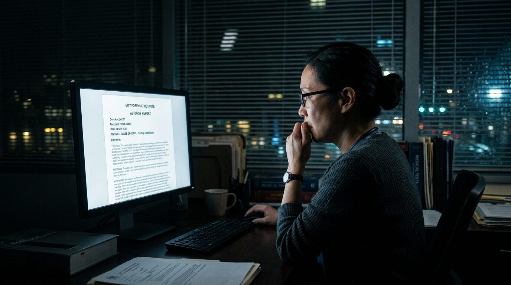
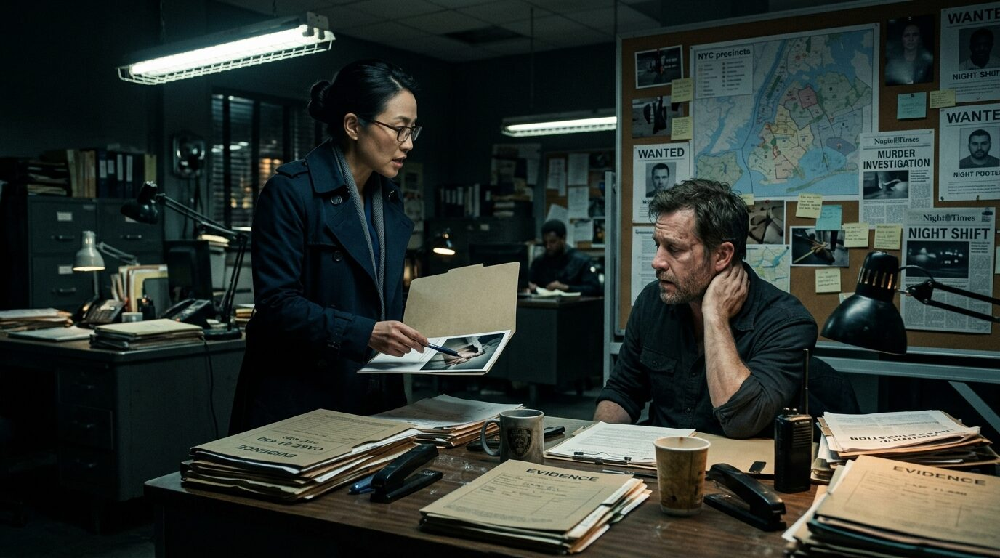
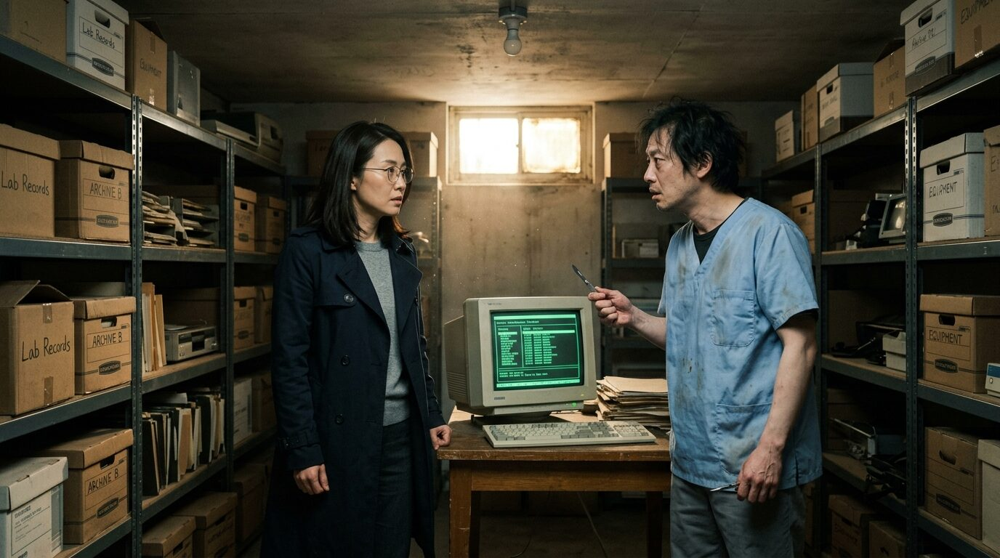

## 第一章：多出來的報告

凌晨一點十五分，解剖室的排風扇嗡嗡作響，混合著福馬林與強效消毒水的氣味，沉悶地在狹窄的空間裡循環。

程映揉了揉發酸的眼角，摘下沾有乾涸組織碎屑的雙層乳膠手套，隨手扔進黃色的醫療廢棄物桶。她走到角落的洗手槽前，轉開水龍頭。冷水嘩啦啦地沖刷著泛白的手指，她用指甲刷仔細地清理著指甲縫，再將雙手反覆揉搓，直到皮膚泛起一層不自然的紅。

她扯下一張擦手紙，將每根手指、指縫、乃至手腕關節都仔細擦乾，隨後將紙團捏成一個緊實的球，精確地投進垃圾桶正中央。她拉平了工作服上的褶皺，將旁邊整齊排列的解剖刀具重新核對了一遍——大體刀、骨鋸、肋骨剪，每一把都按長短順序與卡槽對齊，分毫不差。

回到辦公桌前，液晶螢幕散發著慘白的光芒。程映點開法醫鑑定管理系統，準備上傳剛剛完成的第十二份驗屍報告——林健國，急性心肌梗塞。

她輸入帳號與那串每兩週更換一次的複雜密碼，登入系統的簽核頁面。

待處理清單載入完畢，她的食指在滑鼠滾輪上滑動，突然停住了。

螢幕上靜靜地列著兩筆待簽核資料。

第一筆是她剛剛輸入的案號「115-D-08922」，死者姓名林健國。
第二筆，案號「115-D-08923」，死者姓名陳正義，狀態欄顯示：**已完成簽署**。

程映的眼角跳動了一下。她伸出右手，移開鍵盤，露出了壓在底下的紙本登記簿。她用鉛筆指著上面的記錄，從昨晚第一具送達的屍體開始，一筆一筆往下對：

08911，車禍。
08912，溺水。
……
08922，林健國，心肌梗塞。

沒有陳正義。

她推了推眼鏡，握著滑鼠的手指有些僵硬，點開了那份案號「115-D-08923」的電子報告。

螢幕上彈出了密密麻麻的格式化表格。
「死者：陳正義。性別：男。年齡：四十八歲。送驗單位：市警局第一分局。」
再往下看，是極度詳盡的解剖紀錄：
「外傷觀察：死者頸部有一道深及氣管的橫向割裂傷，邊緣整齊，起自左側下頜角下方兩公分處，止於右側胸鎖乳突肌前緣。頸總動脈及頸內靜脈均被切斷。氣管內有吸入性血液造成的泡沫，肺部呈現急性氣腫……」
「死死因判定：銳器刺割頸部致頸動脈及靜脈破裂，引起失血性休克死亡。」
「死亡方式：他殺。」

報告的右下角，電子簽章欄赫然顯示著程映的個人姓名與憑證編號。

程映感到後頸的汗毛一根根豎了起來。

割頸？失血性休克？
今晚送來的屍體中，根本沒有任何一具是死於利刃割頸。

她抓起辦公桌上的內線電話，撥給了值班助理小吳。

「喂，映姐？」電話那頭傳來小吳含糊不清的聲音，伴隨著一聲哈欠。

「小吳，今晚第一分局有送來一個叫陳正義的死者嗎？割頸外傷。」程映的聲音壓得很低，呼吸比平時快了半拍。

電話那頭傳來紙張翻動和鍵盤敲擊的雜音。半分鐘後，小吳回答：「沒有啊，映姐。今晚最後一具送進來的是林健國，就是你剛剛解剖完的那位。冰庫裡現在一共就十二具屍體，我都核對過牌子了。怎麼了？」

「沒事，掛了。」

程映放下聽筒。她閉上眼睛，深呼吸，試圖理清頭緒。這間辦公室除了她沒有別人，門鎖是感應卡的，十分鐘前她一直在解剖室裡清理林健國的屍體，距離辦公桌只有幾步之遙，沒有人能越過她走進來用這台電腦。

她重新睜開眼，將滑鼠移到系統日誌上。日誌上記錄著這份報告的儲存與簽署時間——就在十分鐘前。登入帳號是她的，憑證金鑰是她的，連簽章權限也是正常的，就好像剛才真的有一個隱形的人坐在這裡，替她完成了這一切。

她的目光緩緩移向報告最上方的基本資料區。死者的身分證字號、戶籍地址都完整無缺，最後，她的目光落在了「死亡時間」那一欄。

那裡寫著一行精確到分秒的時間：
**2026年7月6日，03:00**。

程映下意識地抬起左手，看了看自己的机械錶。

指針指著凌晨一點二十八分。螢幕右下角的時間顯示著：2026年7月5日。

這份由她「親自簽署」的驗屍報告上所標註的死亡時間，是明天凌晨三點。

距離這名死者的死亡，還有整整二十五個半小時。

## 第二章：尚未死亡的人

程映盯著螢幕上「陳正義」這三個字，以及那行寫著七月六日凌晨三點的死亡時間，指尖緊緊貼著滑鼠的外殼。

她沒有試圖重整網頁或檢查網路連線。對程序的極致追求讓她明白，系統不會無端出錯到這種地步。這是一份結構完整、格式無誤的公文書，甚至連頸動脈破裂的解剖描述都符合病理學邏輯。

但陳正義此時此刻應該還活著。

她將游標移到聯絡人資訊查詢的欄位。依照公務程序，法醫調閱非承辦案件的公民個資，是極為嚴重的違規行為。每一次點擊、每一次輸入，都會被內控系統永久記錄，直接呈報給督察室。多年前那場因為忽略程序而導致的誤判，至今仍像一把隱形的解剖刀懸在她頭頂，讓她在此後的職業生涯中，將「嚴守程序」奉為唯一的保護傘。

如果她查了，她多年來苦心維持的無瑕紀錄將會破裂，甚至可能面臨停職調查。但如果不查，這份蓋有她電子簽章的報告，就等於她默許了某個尚未發生的現場。

程映的手指在鍵盤上方懸空，解剖室排風扇的嗡嗡聲在耳邊無限放大。她深吸了一口氣，敲下了陳正義的身分證字號，然後按下確認。

螢幕彈出刺眼的紅色警示：*「您正在查詢非承辦案件之個資，此操作將被記錄並送交審核。」*

她點擊了「同意」。

系統吐出了陳正義的資料：四十八歲，大頂建設前財務經理。戶籍地址在信義區和平東路三段。

程映迅速用手機拍下螢幕，隨即將瀏覽器紀錄徹底清除。她關掉螢幕，穿上掛在門口的深色防風外套，拿了車鑰匙便往外走。

大雨在半夜傾盆而下，將城市的街道沖刷得一片模糊。程映開著那輛老舊的瑞典房車，在積水的路面上疾馳。她沒有直接去陳正義的住處，而是將車停在了市警局第一分局的後門。

分局二樓的偵查隊辦公室裡，日光燈管發出微弱的電流聲。偵查隊長高建閔正靠在椅背上，一隻手揉著酸痛的脖子，桌上堆滿了沒吃完的便當盒和散亂的筆記。

看到程映深夜出現，高建閔有些意外地抬起頭，「程法醫？這麼晚了，有新案子要收？」

程映走到他的辦公桌前，沒有坐下，直接拉開防風外套的拉鍊，露出沾有泥水的褲腳，「高隊，我需要你聯絡大頂建設掏空案的證人保護小組，立刻提高陳正義的維安層級。」

高建閔眉頭一皺，放下手中的原子筆，「陳正義？他是地檢署那邊直接派隨扈保護的對象，安全屋的地址是保密的，連我們分局都無權過問。妳怎麼突然提到他？」

「我的法醫帳號被人盜用，在系統裡簽發了一份陳正義的驗屍報告。」程映壓低聲音，語氣平靜得近乎冷酷，「報告上的死因是頸部銳器割傷，死亡時間是明天凌晨三點。」

高建閔盯著她看了幾秒，隨後失笑地搖了搖頭，「程法醫，妳這是在開玩笑吧？明天凌晨三點的驗屍報告？這聽起來像哪家報紙的科幻專欄。是不是系統時間設定錯誤，或者是資訊科那邊在測試新軟體？」

「報告裡連他右側胸鎖乳突肌前緣的割裂傷深度都寫得清清楚楚，這不是系統測試會用的隨機文字。」程映雙手撐在桌面上，身體前傾，「有人用我的憑證入侵了系統，這是在向我預告一場謀殺。如果他明天出了事，而我們現在什麼都不做，這就是瀆職。」

高建閔收起笑容，神色變得嚴肅，但眼神裡更多的是無奈，「程法醫，妳冷靜一點。如果照妳說的，有人入侵了系統，妳應該先向局裡的資訊科通報，讓他們凍結妳的帳號並進行IP追查。我現在打電話給檢方，說我因為收到一份『未來的驗屍報告』而要求更改證人保護計劃，妳覺得檢察官會怎麼想？他們只會覺得我們第一分局的法醫壓力太大，產生了幻覺。更何況，妳是怎麼拿到陳正義個資的？」

高建閔指了指她，「妳越權查詢了個資，對吧？如果這件事往上報，在查清楚系統有沒有被駭之前，妳先得被停職。」

「如果等程序走完，他已經是一具屍體了。」程映盯著他。

「他身邊有兩個帶槍的便衣二十四小時輪班，安全屋的防禦是最高規格的。」高建閔站起身，拍了拍她的肩膀，「聽我的，回家睡覺。明天一早，我幫妳跟資訊科打個招呼，讓他們去查後台紀錄。在沒有具體危害事證之前，警方不可能憑空採取行動。這不合程序。」

又是程序。

程映看著高建閔那雙疲憊卻固執的眼睛，知道自己再說下去也沒有意義。在警方的邏輯裡，規章與程序是不可逾越的鐵律，而她所帶來的警告，在程序上只是一紙無效的雜訊。

她轉身走出辦公室，走入冰冷的雨幕中。

坐回車裡，儀表板的冷光照亮了她緊繃的面孔。她從口袋裡拿出手機，撥通了剛才違規查詢到、記在腦海中的那個私人號碼。

雨水猛烈地敲擊著車頂，撥號音在狹小的車廂裡一聲聲迴盪，顯得無比漫長。

在第七聲響起時，電話接通了。

「喂？」電話那頭傳來一個粗重、防備心極強的男聲，背景隱約有電視新聞的嘈雜聲。

「陳正義先生嗎？」程映握緊了方向盤。

「哪位？大半夜的打這電話幹嘛？」男人的聲音立刻提高，充滿了警惕。

「我叫程映，是市警局的法醫。我接下來要說的話非常重要，請你仔細聽。我的法醫系統被入侵了，裡面出現了一份關於你的驗屍報告，上面寫著你將在明天凌晨三點，死於頸部銳器割傷。我想確認你現在的安全狀況。」

電話那頭頓時陷入了死一般的寂靜。片刻後，傳來一聲神經質的粗口。

「法醫？你們這群人到底想怎麼樣？」陳正義的聲音因為恐懼與憤怒而變得尖銳，「大頂的人給了妳多少錢？用這種下三濫的手段來恐嚇我？我告訴妳，我明天一定會出庭，你們就算派法醫來裝神弄鬼也沒用！」

「陳先生，我不是大頂建設的人，我也沒有必要恐嚇你。」程映試圖用最理性的語氣去說服他，「如果你現在的安全屋防護有漏洞，或者你發現隨扈有任何異常，請立刻要求更換地點，或者通知檢察官……」

「夠了！」陳正義暴躁地打斷她，「我這裡有警察守著，門是防彈的！這地方連我老婆都不知道，安全得很！妳少在這裡跟我玩心理戰。要是妳再打來，我立刻讓隨扈去查妳的號碼，控告妳恐嚇證人！」

電話被粗暴地掛斷，冰冷的忙音隨即塞滿了程映的耳朵。

程映緩緩放下手，任由手機滑落在副駕駛座上。

大雨順著車窗流淌，將車外的霓虹燈光折射成無數怪異的色塊。警方拒絕相信她，證人將她的警告視為對手的心理戰，拒絕做出任何調整。她已經跨過了那條曾經發誓不再逾越的界線，卻只換來一場空無。

她看著儀表板上的時鐘。

現在是七月五日，凌晨兩點四十五分。

距離那份報告上寫著的死亡時間，還有整整二十四小時又十五分鐘。而那個即將被送上解剖台的男人，正一步步走向那道早已被寫好的致命傷口。

## 第三章：相同的刀口

雨在破曉前停了。台北的夏晨依然悶熱得像一塊濕透的抹布，沉甸甸地裹在皮膚上，讓人喘不過氣。

程映坐在辦公桌前，盯著手機螢幕上的時間。
03:02。

距離報告上的死亡時間已經過去了兩分鐘。

沒有收到任何通報。值班室的內線電話安靜地趴在原處，像是一具冰冷的塑料裝飾。程映閉上眼，揉了揉緊繃的太陽穴。也許高建閔是對的，那真的只是一個惡劣的系統惡作劇，或者某個精通資訊的兇手在跟她玩一場故弄玄虛的心理戰——

叮鈴鈴。

尖銳的電話聲在寂靜的辦公室裡突兀地炸開。

程映幾乎是瞬間睜開眼，右手精確地抓起聽筒，「我是程映。」

「程法醫，」電話那頭傳來高建閔低沉且沙啞的聲音，失去了昨晚的敷衍，只剩下緊繃的沉重，「陳正義死了。」

程映的呼吸微微一凝，握著聽筒的指節因為用力而泛白。

「半個小時前，隨扈發現他倒在安全屋的客廳裡。現場沒有外人闖入的痕跡，但人已經沒氣了。」高建閔頓了頓，聲音低了下去，「傷口在脖子。第一分局正在保護現場，遺體十分鐘後會送過去妳那裡。」

「我知道了。」

程映掛斷電話，沒有一秒的遲疑，迅速換上解剖防護服，戴上雙層乳膠手套，拉下防護面罩。

當負壓解剖室的鐵門被推開，藍色的運屍袋被推上不銹鋼解剖台時，小吳的臉色顯得有些蒼白。他看了看遺體，又看了看程映，欲言又止。

「開始吧。」程映的聲音在面罩後顯得有些沉悶，冷靜得不帶一絲溫度。

她拉開運屍袋的拉鍊。

陳正義的臉呈現在無影燈下，雙眼圓睜，瞳孔已經放大固定，臉色因失血而呈現出一種詭異的石膏白。而他的頸部，赫然橫著一道觸目驚心的巨大傷口。

程映拿起量尺，指尖平穩。

「死者頸部有一道橫向割裂傷，邊緣整齊……」程映一邊檢視，一邊對著錄音設備口述，「起自左側下頜角下方兩公分處，止於右側胸鎖乳突肌前緣。」

她停了下來。

這句話，與那份昨天出現在系統中、標註著「115-D-08923」的預告報告裡的字句，一字不差。

她用探針輕輕探入創口，感覺著肌肉與血管的斷裂邊緣。
「頸總動脈及頸內靜脈均被切斷。氣管內有吸入性血液造成的泡沫，肺部呈現急性氣腫……」

血管斷裂的角度、氣管吸入性泡沫的分布，每一個病理特徵都與那份「未來的報告」完美重合。

「映姐……這，這怎麼可能？」小吳在一邊幫忙記錄，手裡的平板電腦差點滑落，「昨天的報告，怎麼會……」

「記錄死因。」程映打斷他，聲音冷硬如鐵，「銳器刺割頸部致頸動脈及靜脈破裂，引起失血性休克死亡。死亡方式：他殺。」

當解剖結束，程映將工具整齊地放回卡槽。她站在洗手槽前，冷水沖刷著雙手，但那股從骨髓裡滲透出來的寒意卻怎麼也洗不掉。

她回到辦公室，關上門，將自己隔絕在安靜的空間裡。

她盯著自己的雙手。指尖因為反覆清洗而發紅，甚至有些乾裂。

她轉身走到電腦前，再次登入法醫鑑定管理系統。這一次，她點開了個人帳號的安全登入日誌。

日誌顯示，在過去的幾個月裡，她的帳號有數次在深夜三點到四點之間登入的紀錄。那段時間，通常是她已經下班回宿舍休息的時間。

是她的密碼外洩，還是……

程映的手指在鍵盤上方懸空。她對自己的記憶一向極有自信，對程序的偏執更讓她不容許自己有半點模糊。但在那幾次深夜登入的日期裡，有兩天，她因為失眠而吃過處方安眠藥，對於清晨醒來前的細節，確實有一段無法確定的空白。

她深吸了一口氣，為了驗證什麼，開始調閱過去經手過的案件檔案。她沒有直接看系統內的最終報告，而是將自己硬碟裡備份的解剖初稿，與系統資料庫裡的現存版本進行逐一比對。

滑鼠指針在冷光螢幕上快速移動，發出單調的點擊聲。

在對比到去年秋天的一起案件時，她的視線停住了。

那是一起登記為「吸毒過量致死」的街友案。程映調出自己的初稿，上面寫著：*「左側顳骨有輕微骨裂，不排除生前曾遭鈍器打擊。」*然而，系統上的最終簽署報告裡，這行字不見了，死因被定性為單純的藥物中毒。

簽章欄上，赫然是她的名字。

程映的呼吸變得有些急促，她立刻點開另一份前年的溺水案。

初稿：*「死者結膜出血點異常，肺部積水特徵不符合典型溺水。」*
系統最終版：*「生前溺水窒息死亡。」*

這些被修改的細節極其隱蔽，若非逐字對照初稿，根本無法察覺。

程映將這幾起異常案件的死者資訊拉出來，逐一比對他們的背景。隨著資料一筆筆呈現，她的心臟猛地收縮了一下。

這些案件的發生地點、承辦分局，全指向了同一個地方——五分局。

那是多年前，那場將她徹底擊碎的司法誤判案的轄區。

當年因為她忽略了死者指甲縫裡的微量纖維檢體，導致警方鎖定了錯誤的嫌疑人，最終那名無辜者在獄中自縊。那是她職業生涯中唯一的，也是最致命的一次污點。

而現在，這些被悄悄改動、抹去疑點的驗屍報告，竟然全都圍繞著當年那場誤判的陰影。

程映看著螢幕上與自己一模一樣的電子簽章，以及系統日誌裡顯示的登入紀錄。

這究竟是有人在系統背後藉著她的名字做手腳，還是她的大腦早已在經年累月的自責與藥物副作用下出現了偏差，在那些空白的深夜裡，親手做出了這些她完全不記得的操作？

窗外的天光已經徹底亮了，灰白色的光線穿過百葉窗的縫隙，斜斜地照在解剖室的鋼門上，折射出冷冽的銀光。

## 第四章：簽名的來源

程映關掉瀏覽器，將背部緊緊貼在椅背上。

辦公室內的排風口發出沉悶的低鳴。她看著自己微微發抖的雙手，隨後將它們用力攥成拳頭，按在冰冷的桌面。指尖殘留的消毒水氣味刺激著鼻腔。她必須保持冷靜，那種在解剖台上將死者內臟逐一取出的絕對冷靜。

她從大衣口袋裡拿出那串隨身鑰匙，拉開辦公桌最下方的抽屜。在層層疊疊的舊講義與法醫學期刊的最底下，躺著一個貼有綠色標籤的小型防潮盒。

打開盒子，裡面只有一枚外殼已經有些磨損的 USB 憑證金鑰。

這是她多年前調離五分局時，依規定應繳回銷毀、卻因為當時的混亂而遺忘在抽屜底部的舊工作憑證。

程映將舊憑證插進電腦主機。

螢幕上的讀取紅燈閃爍了幾下。她點開法醫局內部專用的系統登入檢測工具，調出系統後台的權限稽核日誌。她沒有急著下結論，而是按照法醫存取稽核的標準程序，一步步向下檢索。

第一步，驗證憑證狀態。
日誌顯示：帳號「CY-091」，狀態「已註銷」，生效日期「2019年8月14日」。

第二步，驗證物理介面。
昨晚陳正義報告產生的登入憑證，與她剛剛插入的舊憑證進行對比。
憑證編號一致。
系統識別碼：**CY-091**。
憑證尾數：**0472**。

這確實是她七年前被封存的舊帳號。

但這不合邏輯。程映看著顯示為「已註銷」的紅字，眉頭緊鎖。在法醫局的資訊安全規範中，已註銷的帳號在沒有經過人事室遞交變更申請、資訊科簽核、以及局長級別的數位簽章授權下，後台數據庫是無法重啟的。

她點開該帳號的「變更歷史紀錄」。

那一欄是空白的。沒有申請單號，沒有簽核程序，沒有任何審批紀錄。但該帳號卻在過去幾個月裡，擁有了甚至高於她現用帳號的系統寫入權限。

這不是簡單的密碼外洩，也不是實體晶片被複製。這是在系統底層的數據庫中，有人直接越過了所有前端的行政審查程序，在數據庫的用戶權限表裡，手動將「CY-091」的狀態修改為「啟用」，並抹去了所有變更日誌。

要做到這一點，必須擁有數據庫的最高管理權限——系統根帳號。

在法醫研究所與五分局的體制內，擁有這個根帳號物理密碼備份的人，只有歷任的研究所所長。而七年前，正是那個人手把手帶她入門，並在她因為那起誤判案被督察室調查時，親自簽署了調職令。

沈嚴。

程映的額頭滲出一層細密的汗珠。她靠回椅背，右手不自覺地抓緊了桌角。

當年，她忽略了死者指甲縫裡的微量纖維檢體，導致警方鎖定了錯誤的嫌疑人，最終那名無辜者在獄中自縊。那時的她驚慌失措，是沈嚴在辦公室裡對她說：「程序會保護妳，程映。把報告交給我，剩下的我來處理。」

隨後，她的舊帳號「CY-091」被迅速註銷，她被調離五分局，免受了最嚴厲的行政處分。她以為那是導師對她的保護，於是她此後將「嚴守程序」奉為規臬，把繁瑣的規章當作逃避責任的盾牌。

但現在，這個本該在七年前隨著她的失誤一同被埋葬的帳號，卻在數據庫的深處活了過來。

她把手伸進大衣內側口袋，指尖碰到了一個硬質的鐵盒。那是沈嚴過世前留給她的遺物——一盒陳舊的解剖刀具，以及一疊手寫的案情分析筆記。

沈嚴已經在兩年前因肝癌過世。

程映看著螢幕上冷冰冰的登入代碼。如果沈嚴已經死了，那麼昨晚用這個帳號登入系統、簽發預告報告的人，又是誰？是誰拿到了沈嚴留下的根帳號權限，又是誰，在替她「修正」當年那些被掩蓋的錯誤？

她看著日誌上顯示的登入端IP代碼。

**Terminal ID: SY-001**。

那是沈嚴生前在老法醫研究所辦公室裡，那一台從不聯網、只用於內部存檔的專用終端機代碼。

## 第五章：第十三具屍體

程映關掉稽核工具的視窗，握滑鼠的右手有些僵硬。

Terminal ID: SY-001。那台老舊的終端機位於法醫研究所舊大樓的地下二樓，一個早該在三年前隨著所內行政搬遷而被廢棄、並被列入拆遷計劃的儲藏室內。

她將舊的 USB 憑證拔出，連同沈嚴遺留的鐵盒一起塞進防風外套的內側口袋。她深吸了一口氣，正要起身，液晶螢幕的右下角突然閃爍起紅色的提示燈。

系統後台的核心進程被強制喚醒。

那是法醫鑑定管理系統在接收到高優先級急件時的提示音。程映的動作僵在半空中。她緩緩坐回椅子上，點開那條閃爍的訊息。

案號：「115-D-08924」。
死者姓名：**程映**。
狀態欄顯示：**已完成簽署**。

程映的眼皮猛烈地跳動了一下。她伸出食指點開這份報告。

「死者：程映。性別：女。年齡：四十歲。送驗單位：市警局第一分局。」
「外傷觀察：死者頸部有一道橫向割裂傷，氣管斷裂，雙側頸總動脈外露，創口邊緣平整，符合鋒利手術刀刃一次性切開特徵。創口內部無生活反應，研判為死後造成之偽裝傷口；真正死因為吸入性一氧化碳中毒，死者血液中碳氧血紅素濃度達百分之六十五……」
「死死因判定：一氧化碳中毒窒息死亡。」
「死亡方式：自殺。」

報告右下角的簽章處，依然是她那個已註銷的舊憑證代號：**CY-091**。

而在最上方，那一欄預告死亡的時間，用刺眼的黑體字標註著：
**2026年7月6日，23:30**。

距離現在，還有整整十四個小時。

死後偽裝的割頸傷，真正死因是一氧化碳中毒，最後被判定為自殺。

程映看著螢幕上的「死後偽裝傷口」這幾個字。這個設計極其殘忍，也極其了解她。在陳正義死後，警方必然會深入調查系統入侵的來源，而她越權查詢陳正義個資的紀錄，以及這幾份用她帳號簽發的預告報告，都會指向她就是那個利用職權製造死亡的幕後黑手。當她「自殺」身亡，這一切就會成為無法翻案的死無對證。

她盯著那份報告上的每一個字，手指慢慢移到鍵盤上。

她沒有試圖刪除這份報告，也沒有通報資訊科。她知道，在底層權限被掌控的情況下，任何行政申訴都會被後台悄無悄無聲息地抹去。

她需要的是實體證據，以及一個無法被篡改的現場。

程映拿起桌上的公務電話，撥給了高建閔。

「高隊，」程映的聲音平靜得像是在討論一件例行的病理分析，「第十三份報告出來了。死者是我，死因是一氧化碳中毒。今晚十一點，帶人去舊大樓地下二樓儲藏室外埋伏。不要開警車，不要走漏風聲。」

「程法醫，妳瘋了嗎？」高建閔的聲音裡透著壓抑的怒火與疲憊，「陳正義的案子現在已經被市刑大接管了，我也在接受內部調查，妳現在叫我私下去圍捕一個根本不存在的嫌犯？」

「高隊，系統裡的登入終端機代號是SY-001，那是沈嚴老師舊辦公室的專用機。那裡沒有對外網路，只能通過法醫局內部專線的硬編碼節點連接。也就是說，發送報告的人此時此刻必須坐在那台終端機前。」程映握緊了聽筒，「我會進去。我身上會帶上一台錄音筆，並且將音訊通過民用強訊號微型無線電傳輸。地下二樓訊號極差，一般的行動網路發不出去，但我會在舊大樓的通風口架設一個中繼器，直接把訊號打到你們車上的收音機頻率。」

她頓了頓，繼續說道：「如果十一點半我沒有出來，或者訊號中斷，你們就進來。這不是求救，高隊，這是我在建立證據鏈。如果連妳都不相信我，那麼今晚過後，我就會成為系統登載的自殺犯。」

電話那頭是一陣漫長的死寂。

「……我知道了。」高建閔低沉地回了一句，隨即掛斷了電話。

程映放下聽筒。她拉開抽屜，拿出一只塵封已久的微型無線電發報器，這是她多年前協助山難驗屍時留下的裝備。她仔細測試了頻率與電池，將其固定在防風外套的內襯夾層中。

這一次，她不再尋求程序的庇護，她要將自己變成程序的一部分。

***

當晚十一點。

老舊的法醫研究所大樓隱沒在郊區的荒草之中，四周沒有路燈，整棟建築在夜色中如同一具巨大的水泥骸骨。

程映穿著深色的防風外套，手裡拿著一隻手電筒，踩著腐爛的落葉走向後門。她先走到外側的排風口旁，將預先調好頻率的無線電中繼器用磁鐵吸附在鐵柵欄內側，確保訊號能穿透厚重的水泥牆。

隨後，她用鐵撬撥開生鏽的鐵鎖，推開門。一股混雜著霉味與水泥剝落的粉塵氣味撲面而來。

手電筒的光束照亮了鋪滿灰塵的走廊。她順著水泥階梯一步步往下走。

地下二樓的空氣異常冰冷。這裡曾是舊大樓的停屍間與檔案室，自從行政中心搬遷後，這裡就成了無人問津的死角。

她走到走廊盡頭的儲藏室門前。門縫底下，隱約透出一絲微弱的、螢幕散發出的藍光。

程映沒有猶豫，伸手推開了木門。

儲藏室裡堆滿了廢棄的鐵架與紙箱。在房間中央的木桌上，那台本該斷電多年的舊終端機 SY-001 竟然亮著，螢幕的藍光照亮了坐在電腦前那個瘦削的身影。

那人穿著一件舊款的法醫助理制服，手指正飛快地在鍵盤上敲擊著，發出清脆的啪嗒聲。

聽到開門聲，那人沒有驚慌，只是緩緩停下手上的動作，轉過頭來。

螢幕的冷光照亮了他的側臉。那是林哲。沈嚴當年的另一位學生，也是程映在五分局時的同事。在當年的誤判案發生後，林哲因為拒絕在修改過的報告上副署，被體制邊緣化，最後主動辭職，消失在所有人的視線裡。

程映看著他，手電筒的光束落在桌上的憑證讀卡機上。

「原來是你在用這個帳號。」程映的聲音在空曠的地下室裡顯得冷靜而清晰。

林哲沒有回答，他看著程映，眼中沒有凶光，只有一種燃燒殆盡的疲憊。他指了指螢幕，上面顯示著程映那一張已經完成所有欄位填寫、只差最後一個確認鍵的驗屍報告。

「我一直在等妳，程法醫。」林哲的聲音有些沙啞，「我以為妳會帶更多警察來，或者乾脆躲起來。但妳還是來了，一個人。」

「陳正義是怎麼死的？」程映往前走了一步，腳步踏在灰塵上，沒有發出多餘的聲響。

林哲看著她，嘴角牽起一抹嘲弄的笑，「妳是法醫，妳看過他的屍體，不是嗎？頸部銳器割傷，氣管斷裂。他死在自己安全屋的沙發上。」

「現場沒有掙扎痕跡，氣管吸入性血液量異常，說明他在被割頸前就已經失去了意識。」程映看著他，語氣像是在探討案情，「安全屋的門窗沒有外力入侵跡象。陳正義在喝下含有麻醉劑的飲料後昏迷，兇手進入，用手術刀切開他的頸動脈，隨後清理了現場所有痕跡。能做到這麼乾淨、不留下任何防禦性傷口的，只有懂解剖的人。」

「而且，還必須知道安全屋的地址。當大頂建設案的陳正義被列入保護，外界根本無法得知他的藏身處。但你拿到了老師的根帳號密碼，自然也拿到了他遺留下來的人際網絡與當年的案卷。」程映看著林哲，「可是，陳正義的死只是大頂案的封口。你為什麼要殺他？」

林哲沉默了片刻，隨後低低地笑了起來，笑聲在狹窄的儲藏室裡迴盪，帶著一絲淒涼。

「妳覺得我是為了大頂建設的封口？還是為了私仇？」林哲站起身，指著那台終端機，「陳正義當年是五分局那場案子裡，提供關鍵假證詞的人。如果他不死，這件案子永遠只會被當成一件普通的冤案。只有他死了，而且死得跟當年的被害人一模一樣，妳才會去查系統，妳才會發現這些被抹去的痕跡。他是個引子，程映。」

他指著螢幕上那一欄「死亡時間：23:30」。

「現在是十一點十五分。還有十五分鐘，這份報告就會自動同步到法醫局的外部備份伺服器。那是我用老師的根帳號設定的強制排程，無法取消。」林哲的呼吸變得急促，「只要妳在這裡，親手把當年五分局那一案的原始檢驗數據上傳，並簽署妳的真實姓名，我就會按下取消發布這份死亡報告的指令。」

「但如果妳拒絕，」林哲從口袋裡拿出一把鋒利的手術刀，抵在自己的左手腕上，「我就會在這裡，用這把手術刀，在妳面前切開我自己的頸動脈。然後，這台終端機會在十一點半，自動將妳的『自殺報告』發布出去。當警方在現場發現我的屍體，以及妳身上那份寫有妳名字的預告報告，他們會怎麼想？他們會追查這個舊帳號，會發現我們之間的恩怨，最終，當年沈嚴老師幫妳掩蓋的那起錯案，將會被徹底翻開。」

林哲上前一步，眼睛發紅，聲音沙啞得近乎哀求：「程映，妳只有這兩個選擇。要麼妳主動公開，要麼我用我的命，逼這整個體制幫妳公開。妳選哪一個？」

空氣中瀰漫著舊大樓特有的霉味與鐵鏽氣氣味。

程映看著林哲，看著他手腕上緩緩滲出的鮮血。她終於明白，這十三份報告從來不是一場針對她的謀殺計畫，而是一場用生命做籌碼的逼供。

手電筒的光圈在牆壁上微微晃動。程映的喉嚨有些發乾。她想起那些吃安眠藥才能入睡的夜晚，想起這七年來，每一次寫報告時對程序的近乎病態的執著。

「林哲，你以為我會害怕真相公開嗎？」程映緩緩開口，聲音聽不出情緒起伏。

林哲愣了一下。

程映從防風外套裡拿出那個沾滿鐵鏽的舊解剖刀盒，輕輕放在桌上。

她看著林哲，伸出了右手，覆蓋在滑鼠上。

程映點開了法醫系統的附件上傳頁面。她從口袋裡拿出自己的隨身碟，插進主機。

那是她今天下午，在被通知可能面臨行政停職的當下，從檔案庫裡調出來的、當年五分局錯案的原始纖維檢驗報告。

滑鼠點擊聲在寂靜的地下室裡顯得無比清晰。

檔案載入完成。

程映輸入了自己的現用憑證密碼，然後，按下了上傳鍵。

「我已經把原始報告和我的陳述書上傳到了公務系統的公開通報欄。」程映看著螢幕上顯示的「上傳成功」字樣，轉過頭看著林哲，「這不需要用你的命來換。」

林哲看著螢幕，握著手術刀的手微微顫抖起來。他眼中的瘋狂與執著在這一瞬間失去了支撐，整個人像是被抽空了骨架一般，委頓在椅子上。

「妳……妳真的上傳了……」林哲喃喃自語，刀刃從他的手腕上滑落，掉在木桌上，發出清脆的響聲。

就在此時，儲藏室的木門被猛烈推開。

「警察！不許動！」

高建閔帶著兩名便衣警察衝了進來，手電筒的強光瞬間照亮了整間昏暗的儲藏室。高建閔看著桌上的手術刀和林哲手腕上的血跡，又看了看站在一旁的程映，重重地吐了一口氣。

「程法醫，無線電收音機裡的對話，我們都錄音了。」高建閔走上前，將林哲雙手反剪銬上，隨後看著程映，眼神裡滿是複雜的情緒，「但妳知道妳剛剛做了什麼嗎？妳私自上傳未公開案件卷宗，這已經違反了刑事訴訟法和公務員服務法。我必須帶妳回去。」

「我知道。」程映看著被警察帶走的林哲，又看了看那台漸漸熄滅螢幕的終端機，臉上沒有波瀾。

***

一週後。

法醫研究所的走廊上依舊瀰漫著淡淡的福馬林氣味。

程映站在所長辦公室門前，手裡拿著一個紙箱，裡面只裝著她的幾本專業書和那盒沈嚴留下的解剖刀。

高建閔穿著便服，靠在走廊的牆邊，手裡拿著兩杯紙杯裝的熱咖啡。他遞了一杯給程映。

「市檢署那邊已經受理了當年的案件重審申請。」高建閔看著她，「但妳的行政懲處令也下來了。免職，並且可能面臨一年以下的有期徒刑，緩刑的機率很大，但妳以後不能再執業了。」

「這很公平。」程映接過咖啡，沒有喝，只是用手掌感受著紙杯傳來的微弱溫度。

「妳本來可以有別的辦法的。」高建閔嘆了口氣，語氣裡有些惋惜，「如果我們把這一切都推到林哲和已經過世的沈嚴身上，說妳是被威脅的，或許妳還能保住這份工作。法醫局的長官其實也不希望這樁醜聞擴大。」

程映看著走廊盡頭那扇緊閉的解剖室大門。排風扇的嗡嗡聲隱約傳來，那是她聽了十年的聲音。

她沒有回答，只是朝高建閔點了點頭，抱起紙箱，轉身朝大樓出口走去。

午後的陽光有些刺眼，穿過大門的玻璃，將她的影子長長地拉在水泥地面上。程映走入熱浪襲人的街道，耳邊沒有了排風扇的轟鳴，只有城市喧囂的市聲。

她低頭看了看自己的雙手。指尖因為這幾天沒有反覆用消毒水刷洗，皮膚有些粗糙，甚至帶著幾處乾裂的細縫。

