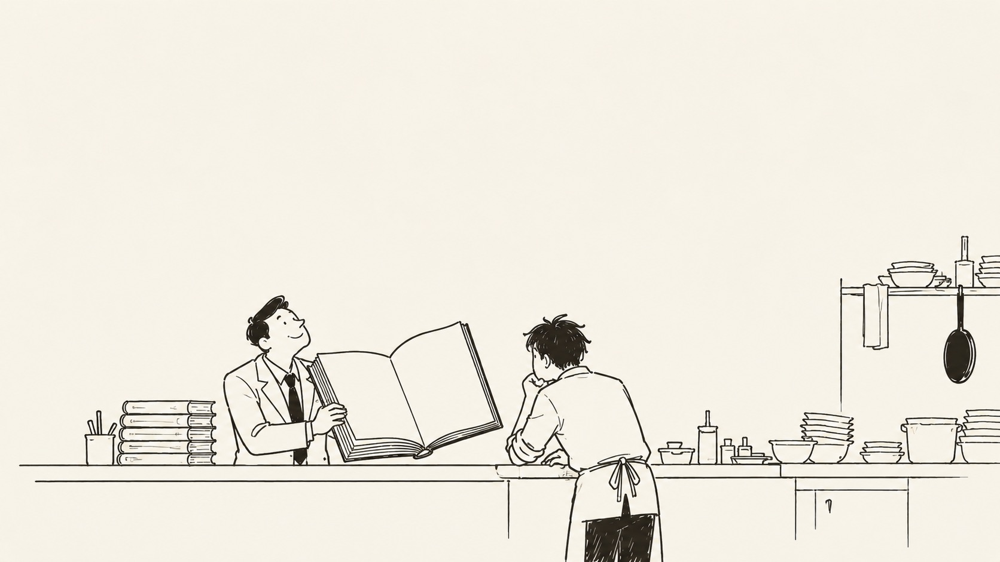
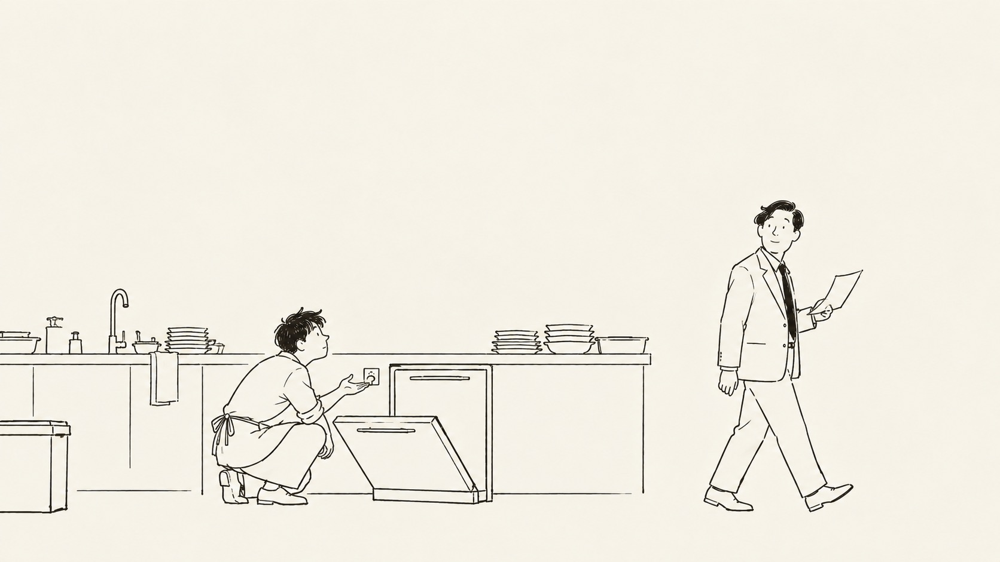
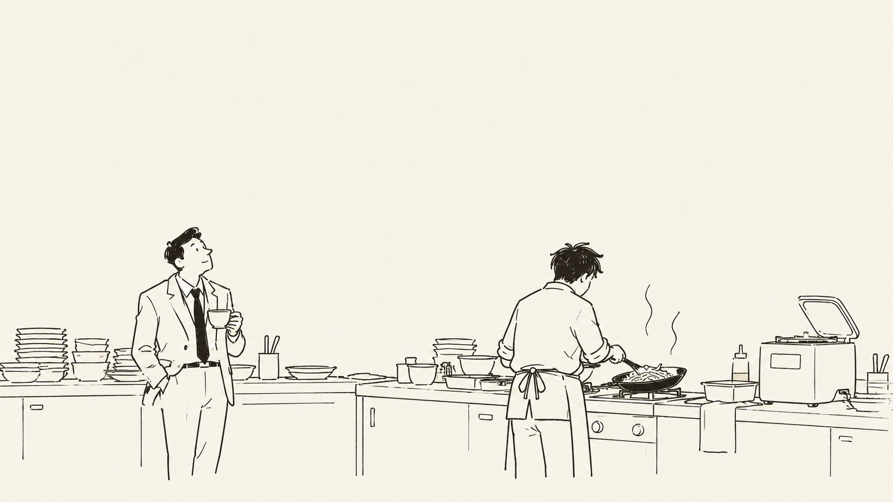

## 第一章：菜單

阿明在一家餐廳當廚師。

餐廳的菜單很厚，從炒飯、牛肉麵到水煎包、鍋貼都有。阿明剛來時，花了三天才把冰箱裡的東西認清楚。

經理很喜歡新菜。

每隔一陣子，他就會拿一本食譜來廚房，跟阿明討論。

有一天，經理帶來一本義大利料理的書。

「我們可以做這個。」

阿明看了一下。

「可以，不過冰箱裡還有很多上次買的材料。」

「那些也可以用。」

「那原本的菜要不要先賣完？」

「不用，我們可以同時進行。」

阿明點點頭。

隔天，經理又帶來一本泰國料理的書。

再隔一天是墨西哥料理。

星期五，經理宣布下個月要推出全新菜單。

阿明問：「有幾道？」

「還在想。」

「那要先準備什麼？」

「你可以先研究。」

一個月後，新菜單印好了。

原本的菜一道也沒刪。

經理把菜單拿給阿明看。

「怎麼樣？」

「很厚。」

經理笑了。

「選擇多，客人才會喜歡。」

那天晚上，有個客人點了牛肉麵、披薩和一道法國燉菜。

阿明做到一半，發現燉菜的材料不夠。他出去跟經理說。

經理想了一下。

「那你看看能不能用牛肉麵的牛肉。」

阿明說：「兩種做法不一樣。」

經理說他知道。

「不過做菜就是要有彈性。」

阿明回到廚房，把牛肉從冰箱拿出來。

## 第二章：主廚

經理在阿明把牛肉切成塊的時候走進廚房。

「你有沒有想過當主廚？」

阿明抬頭。

「我現在就是廚師。」

「主廚不一樣。」經理說，「主廚要有經營的觀念。」

隔天，經理把阿明的名字排進每週的菜單會議。

桌上攤著新印的菜單。經理要阿明說說餐廳可以怎麼改善。

阿明說：「菜單太長，有些菜一個月也賣不出幾份，可以先拿掉。」

經理說：「每一道菜都有自己的客人。」

阿明說：「那至少把材料重複的菜放在一起。」

「餐廳應該保有特色。」

阿明想了一下。

「能不能先不要推出新菜？」

經理搖頭。

「餐飲業不創新就會被淘汰。」

散會時，經理把菜單收起來。

「你還需要培養經營思維。」

下一週，經理帶來一張新的組織圖。

他把阿明的名字寫在中央，旁邊畫了很多箭頭。

「以後你就是廚房的核心。」

阿明看著圖。

「那我可以決定菜單嗎？」

「菜單還是要一起討論。」

「可以決定採購嗎？」

「金額太大的要先問我。」

「可以決定不接某些訂單嗎？」

「客人都進來了，怎麼能不接？」

阿明看了一會兒。

「那這張圖跟之前有什麼不同？」

經理拿起筆，在阿明名字下面加了一行。

「主廚。」

阿明說好。

那天晚上，洗碗機壞了。

經理走進廚房。

「你現在是主廚了，這個你處理一下。」

阿明蹲下來檢查洗碗機。

經理在旁邊看了一會兒。

「你要從整體營運的角度思考問題。」

阿明抬起頭。

「你能幫我把插頭拔掉嗎。」

經理看了一眼插座。

「我還有一個會要開。」

然後飄飄然的走了。

## 第三章：新時代

餐廳最近生意普通。

經理站在門口看了一會兒空桌，進廚房時說：「我們不能再這樣下去。」

隔天，他訂了一台全自動料理機。

業務員說，這台機器可以煎、煮、炒、炸，還能根據客人的喜好自動設計菜單。

經理很高興。

機器送來那天，大家圍在廚房。業務員放進一顆馬鈴薯，按下按鈕。

五分鐘後，機器做出一盤薯泥。

經理帶頭鼓掌。

阿明試吃了一口。

「還可以。」

經理問他有什麼想法。

「可以拿來做薯泥。」

「還有呢？」

「可能也可以煮湯。」

經理看了他一眼。

「你對新科技不夠積極。」

接下來幾個星期，經理常常提早到餐廳。

他做南瓜濃湯，請阿明試吃。

阿明說：「還可以。」

他做燉飯，請阿明試吃。

阿明說：「還可以。」

他做咖哩，又做了一種叫不出名字的醬汁。每次端到阿明面前，阿明都試一口，說還可以。

有一次，阿明正在炒菜，經理問：「你為什麼沒有更多意見？」

「我在炒菜。」

經理看了看他手上的鍋子。

「這些以後機器都可以做。」

「好。」

又過幾天，經理宣布餐廳要轉型。

他希望以後每個服務生都能使用料理機，讓客人享受到更多元的料理。

服務生們很興奮。

第一天，有人做了草莓義大利麵。第二天，有人做了巧克力炒飯。第三天，有人把整顆鳳梨放進機器。

機器卡住了。

經理請阿明幫忙。

阿明取出鳳梨，清理刀片，又花了半小時把機器裝回去。

下午，機器做了一鍋咖哩，但沒人記得放鹽。

經理就請阿明調味。

晚上，機器突然停止運作。

經理打電話給阿明。

「你明天能不能早點來？」

「怎麼了？」

「機器壞了。」

「可以找原廠。」

「原廠說要三天。」

「那就等三天。」

電話那頭安靜了一會兒。

「可是明天有客人訂位。」

阿明想了想。

「那我明天照常煮。」

經理鬆了一口氣。

「太好了。」

隔天，阿明六點到餐廳。

他把材料拿出來，開始備菜。

經理七點半才到。他走進廚房，看見阿明正在切洋蔥。

「你看，還是傳統方法可靠。」

阿明沒有回答。

經理喝了一口咖啡。

「不過長期來說，我們還是要減少對人的依賴。」

阿明把切好的洋蔥放進鍋裡。

經理站在旁邊看了一會兒。

「對了，機器修好以後，你可以教大家怎麼用嗎？」

「可以。」

「那以後你就不用這麼辛苦了。」

阿明點點頭。

鍋子熱了。

他開始炒洋蔥。

